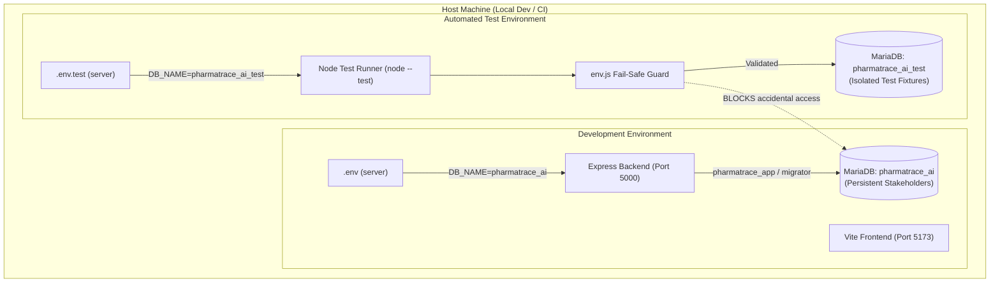
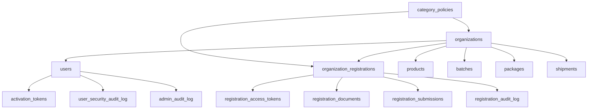

# PharmaTrace AI — Automated Test Database Isolation Plan

**Document Version:** 1.0.0  
**Repository:** `D:\pharmatrace-ai`  
**Target Environment:** Local MariaDB 10.11.16 / Express Backend / React Vite Frontend  
**Scope:** Architectural Technical Assessment & Implementation Blueprint (Strictly READ-ONLY Assessment)  
**Author:** Antigravity Engineering Team  

---

## Executive Summary

An architectural audit of the PharmaTrace AI test infrastructure reveals that **automated unit, integration, and end-to-end tests share the exact same physical MariaDB database (`pharmatrace_ai`) as the active local development server and persistent stakeholder accounts.**

When the three missing operational stakeholder accounts (Distributor, Wholesaler, Pharmacy) were provisioned and activated in accordance with DGDA statutory workflows, two canonical organizations (`PharmaTrace Dev Central Logistics Ltd` and `PharmaTrace Dev Wholesale Depot Ltd`) occupied the single allowable active instances (`max_active_instances = 1`) enforced by `category_policies`.

Consequently, subsequent test runs produced **nine test failures** across four test suites (`client/tests/registrationEndToEnd.test.js`, `server/tests/admin_registration.test.js`, `server/tests/registration.test.js`, and `server/tests/schema.test.js`). Six of these failures stem from **direct capacity contention**, while three failures stem from **uncascaded raw SQL deletions** attempting to delete parent organization rows that are referenced by persistent foreign keys (`fk_reg_approved_org`).

This document presents a comprehensive, zero-drift architectural plan to **isolate automated testing into a dedicated test database (`pharmatrace_ai_test`)**, establish strict runtime safeguards to prevent accidental targeting of the development database, correct test fixture teardown cascading, and achieve a 100% clean test execution pass rate without modifying or endangering development data.

---

## 1. Current Test Database Configuration Audit

An exhaustive inspection of the configuration modules, test runners, and package definitions revealed the following current state:

### 1.1. Environment Configuration (`server/src/config/env.js`)
- `server/src/config/env.js` imports `dotenv` and reads `../../.env` (i.e., `server/.env`).
- `DB_NAME` is defined as:
  ```javascript
  DB_NAME: process.env.DB_NAME || 'pharmatrace_ai'
  ```
- `MIGRATION_DB_NAME` is defined as:
  ```javascript
  MIGRATION_DB_NAME: process.env.MIGRATION_DB_NAME || process.env.DB_NAME || 'pharmatrace_ai'
  ```
- **Architectural Gap:** `env.js` contains **no branching logic for `NODE_ENV === 'test'`**. Even when tests run with `NODE_ENV=test`, `env.js` defaults `DB_NAME` and `MIGRATION_DB_NAME` to `pharmatrace_ai` unless explicitly overridden in the shell environment.

### 1.2. Database Connection Pool (`server/src/config/database.js`)
- `getPoolConfig(overrides)` connects to `overrides.database || env.DB_NAME`.
- It enforces least privilege by connecting as `DB_USER=pharmatrace_app` and strictly throwing an error if connection is attempted as `root`.
- In `server/.env`, `DB_NAME=pharmatrace_ai` and `DB_USER=pharmatrace_app`.
- All standard server API requests and test query helpers (`execute()`, `getPool()`) bind to this pool.

### 1.3. Migration Connection Engine (`server/src/database/migrator.js`)
- `createMigrationConnection(overrides)` establishes a dedicated connection using `MIGRATION_DB_USER=pharmatrace_migrator` to `overrides.database || env.MIGRATION_DB_NAME`.
- Tests import `createMigrationConnection` for privileged operations (such as test teardowns, trigger immutability assertions, and admin setup).
- Because `MIGRATION_DB_NAME` defaults to `pharmatrace_ai`, all administrative test teardowns operate directly on the development database.

### 1.4. Client Integration Test Wiring (`client/tests/registrationEndToEnd.test.js`)
- `client/tests/registrationEndToEnd.test.js` imports `../../server/src/app.js` and `../../server/src/config/database.js`.
- It starts an ephemeral HTTP server wrapping the Express app (`server = http.createServer(app)`).
- When `app.js` is imported, it evaluates `env.js`, loading `server/.env` and binding directly to `pharmatrace_ai`.

### 1.5. Package Scripts (`server/package.json` & `client/package.json`)
- **Server:** `"test": "node --test --test-concurrency=1 tests/*.test.js"`
- **Client:** `"test": "node --test tests/*.test.js"`
- Neither script sets `NODE_ENV=test`, nor specifies `--env-file`, nor passes `DB_NAME=pharmatrace_ai_test`.
- Both client and server tests execute against the active development database `pharmatrace_ai`.

---

## 2. Root Cause Analysis: Shared Database Contention

### 2.1. Dynamic Capacity Quota Rules
Migration `021_seed_category_policies.sql` establishes Bangladesh DGDA statutory limits:
```sql
INSERT INTO category_policies (category, display_name, max_active_instances, is_registration_allowed) VALUES
    ('manufacturer', 'Pharmaceutical Manufacturer', NULL, TRUE),
    ('distributor',  'Central Distributor',         1,    TRUE),
    ('wholesaler',   'Authorized Wholesaler',       1,    TRUE),
    ('pharmacy',     'Retail & Government Pharmacy', NULL, TRUE);
```
- `distributor` is limited to **exactly 1 active production instance**.
- `wholesaler` is limited to **exactly 1 active production instance**.
- Capacity enforcement occurs at two checkpoints:
  1. **Public Intake (`registration.service.js:493`):** Submissions for categories with active count $\ge$ limit are rejected with HTTP 409 `CAPACITY_REACHED`.
  2. **Administrator Approval (`admin.registration.service.js:348`):** Approving an application when active count $\ge$ limit is rejected with HTTP 409 `CAPACITY_REACHED`.

### 2.2. The Persistent State Collision
When the real development stakeholder accounts were provisioned:
1. `org-5159f0a4-...` (`PharmaTrace Dev Central Logistics Ltd`) became an active distributor (`status = 'active'`, `data_environment = 'production'`).
2. `org-a872bf1c-...` (`PharmaTrace Dev Wholesale Depot Ltd`) became an active wholesaler (`status = 'active'`, `data_environment = 'production'`).

With active counts at 1/1:
- `client/tests/registrationEndToEnd.test.js:395` submits a wholesaler application $\rightarrow$ Rejected HTTP 409.
- `server/tests/admin_registration.test.js:357` submits a sample distributor application $\rightarrow$ Rejected HTTP 409.
- `server/tests/registration.test.js:138` expects `remainingSlots: 1` $\rightarrow$ Receives `0`.
- `server/tests/registration.test.js:184` inserts a distributor expecting count=1 $\rightarrow$ Receives count=2.
- `server/tests/registration.test.js:634` expects intake to succeed $\rightarrow$ Rejected HTTP 409.
- `server/tests/schema.test.js:95` evaluates dynamic query assuming 0 active orgs $\rightarrow$ Fails assertion.

### 2.3. The Uncascaded Deletion Defect (`ER_ROW_IS_REFERENCED_2`)
In `server/tests/admin_registration.test.js` lines 740, 890, and 937, test authors recognized that active organizations would block approval tests. They attempted:
```javascript
await executePrivileged('DELETE FROM organizations WHERE type = "wholesaler" AND status = "active"')
await executePrivileged('DELETE FROM organizations WHERE type = "distributor" AND status = "active"')
```
MariaDB foreign key constraints strictly prohibit deleting a row from `organizations` while child rows in `organization_registrations` point to it:
- Foreign key: `fk_reg_approved_org` (`organization_registrations.approved_org_id` $\rightarrow$ `organizations.id`) has `ON DELETE RESTRICT` (default InnoDB behavior).
- MariaDB throws error code 1451:
  ```
  ER_ROW_IS_REFERENCED_2: Cannot delete or update a parent row: a foreign key constraint fails (`pharmatrace_ai`.`organization_registrations`, CONSTRAINT `fk_reg_approved_org` FOREIGN KEY (`approved_org_id`) REFERENCES `organizations` (`id`))
  ```
Furthermore, had this delete succeeded, it would have **permanently destroyed the development stakeholder accounts**!

### 2.4. Evaluation of the `data_environment` Alternative
A code search revealed that `data_environment` is queried only in:
- `registration.service.js` (lines 230, 493)
- `admin.registration.service.js` (line 348)
- `schema.test.js` (line 110)

`data_environment` is **never checked by login, authentication, JWT issuance, password verification, or RBAC authorization**. Setting the development organizations to `'demo'` would artificially bypass the capacity check, but:
1. It alters production-model data semantics in the development database.
2. It fails to protect the development database from test fixture side-effects (e.g. test deletions, test token spam, test audit logs).
3. It does not resolve test-on-test collisions when tests create organizations.
**Conclusion:** A dedicated test database (`pharmatrace_ai_test`) is the only robust, production-grade architectural solution.

---

## 3. Proposed Isolated Test Database Architecture



### 3.1. Database Identifier
- **Database Name:** `pharmatrace_ai_test`
- **Character Set:** `utf8mb4`
- **Collation:** `utf8mb4_unicode_ci`

### 3.2. User Permissions & Least Privilege
To preserve the security architecture introduced in M6 and verified in acceptance audits:
1. **Migration Account (`pharmatrace_migrator`):**
   ```sql
   GRANT ALL PRIVILEGES ON `pharmatrace_ai_test`.* TO 'pharmatrace_migrator'@'127.0.0.1';
   ```
2. **Runtime Application Account (`pharmatrace_app`):**
   ```sql
   GRANT SELECT, INSERT, UPDATE ON `pharmatrace_ai_test`.* TO 'pharmatrace_app'@'127.0.0.1';
   ```
   *Note:* `pharmatrace_app` is intentionally **denied DELETE privileges** on `pharmatrace_ai_test`, preserving runtime parity with production and ensuring that audit log immutability tests (`admin_m6_management.test.js:475`) succeed. All test deletions will continue to use `createMigrationConnection()` (`pharmatrace_migrator`).

### 3.3. Environment Configuration File (`server/.env.test`)
A committed `.env.test` configuration file will define the test environment:
```ini
# PharmaTrace AI — Isolated Test Environment Configuration
PORT=5001
NODE_ENV=test
CORS_ORIGIN=http://localhost:5173,http://127.0.0.1:5173

# Isolated Test Database Runtime Account
DB_HOST=127.0.0.1
DB_PORT=3306
DB_NAME=pharmatrace_ai_test
DB_USER=pharmatrace_app
DB_CHARSET=utf8mb4

# Isolated Test Database Migration Account
MIGRATION_DB_HOST=127.0.0.1
MIGRATION_DB_PORT=3306
MIGRATION_DB_NAME=pharmatrace_ai_test
MIGRATION_DB_USER=pharmatrace_migrator

# Connection Pool Tuning for Testing
DB_CONNECTION_LIMIT=10
DB_WAIT_FOR_CONNECTIONS=true
DB_QUEUE_LIMIT=0
DB_CONNECT_TIMEOUT=10000

# Security Controls
DEV_AUTH_LOCKOUT_BYPASS=false
```

### 3.4. Hard Fail-Safe Guard in `server/src/config/env.js`
To ensure that automated tests can **never** accidentally run against or mutate `pharmatrace_ai`, a fail-safe assertion must be added to `env.js`:
```javascript
// Fail-safe protection against executing automated tests against development or production DB
if (process.env.NODE_ENV === 'test') {
  const currentDb = (process.env.DB_NAME || '').trim().toLowerCase()
  if (currentDb === 'pharmatrace_ai' || !currentDb.endsWith('_test')) {
    throw new Error(
      `FATAL_TEST_SAFETY_ERROR: Automated tests are prohibited from targeting '${currentDb}'. ` +
      `DB_NAME must end with '_test' (expected 'pharmatrace_ai_test'). Test run halted.`
    )
  }
}
```

---

## 4. Exact Files Requiring Changes

| File | Change Type | Purpose |
| :--- | :--- | :--- |
| `server/.env.test` | **New File** | Declares test environment variables (`DB_NAME=pharmatrace_ai_test`, `PORT=5001`). |
| `server/src/config/env.js` | **Edit** | Adds test database fallback (`NODE_ENV === 'test'` defaults to `pharmatrace_ai_test`) and runtime safety guard. |
| `server/package.json` | **Edit** | Updates `"test"` to use `node --env-file=.env.test`, adds `"test:migrate"` and `"test:setup"`. |
| `client/package.json` | **Edit** | Updates `"test"` to use `node --env-file=../server/.env.test`. |
| `server/src/database/setupTestDb.js` | **New File** | One-touch utility script to verify/provision `pharmatrace_ai_test` and apply migrations. |
| `server/tests/admin_registration.test.js` | **Edit** | Replaces uncascaded `DELETE FROM organizations` with foreign-key-safe deletion helper. |

---

## 5. Migration and Seed Strategy

### 5.1. Deterministic Schema Replication
Because PharmaTrace AI utilizes a strict, forward-only SQL migration engine (`server/src/database/migrator.js`), the test database requires **zero manual DDL scripts**.
Executing:
```bash
node --env-file=.env.test src/database/migrate.js
```
applies all 26 existing migrations:
- `001_create_schema_migrations.sql`
- `002_create_category_policies.sql` through `020_create_public_reports_and_attachments.sql`
- `021_seed_category_policies.sql` (Seeds the 4 mandatory categories)
- `022_add_user_security_columns.sql` through `026_add_gtin_to_products.sql`

### 5.2. Pristine Baseline State
Upon completion of the migration run, `pharmatrace_ai_test` contains:
- Complete table schema with all constraints, indexes, and triggers.
- `category_policies` populated with default statutory rules.
- **Zero organizations, zero users, zero registrations, zero tokens.**
- Active count = 0 for all categories.
- Remaining slots = 1 for distributor and wholesaler.
- Complete isolation from development stakeholders.

---

## 6. Foreign-Key-Safe Test Cleanup Strategy

### 6.1. Relational Dependency Hierarchy
An inspection of the Information Schema foreign keys in `pharmatrace_ai` establishes the exact dependency tree:



### 6.2. The Deletion Cascade Order
To safely remove an organization and its associated test data without violating foreign keys:
1. **Child Token & Document Tables (No inbound FKs):**
   - `activation_tokens` (references `users.id`)
   - `registration_access_tokens` (references `organization_registrations.id`)
   - `registration_documents` (references `organization_registrations.id`)
   - `registration_submissions` (references `organization_registrations.id`)
   - `registration_audit_log` (references `organization_registrations.id`)
2. **Intermediate Tables (Severing Inbound FKs):**
   - `organization_registrations` (references `organizations.id` via `approved_org_id`)
     *Must be deleted or `approved_org_id` set to NULL before `organizations` can be deleted.*
3. **User Accounts:**
   - `users` (references `organizations.id` via `org_id`)
4. **Parent Entities:**
   - `organizations` (referenced by `users` and `organization_registrations`)

### 6.3. Safe Helper Implementation for `admin_registration.test.js`
Replace lines 740, 890, and 937 with a dedicated helper:
```javascript
async function removeActiveOrganizations(category) {
  const migConn = await createMigrationConnection()
  try {
    const [orgs] = await migConn.query(
      'SELECT id FROM organizations WHERE type = ? AND status = "active"',
      [category]
    )
    if (orgs.length === 0) return

    const orgIds = orgs.map(o => o.id)
    const placeholders = orgIds.map(() => '?').join(',')

    // 1. Delete activation tokens for users in these orgs
    await migConn.query(
      `DELETE FROM activation_tokens WHERE user_id IN (SELECT id FROM users WHERE org_id IN (${placeholders}))`,
      orgIds
    )

    // 2. Delete registrations and child records pointing to these orgs
    const [regs] = await migConn.query(
      `SELECT id FROM organization_registrations WHERE approved_org_id IN (${placeholders})`,
      orgIds
    )
    if (regs.length > 0) {
      const regIds = regs.map(r => r.id)
      const rPlaceholders = regIds.map(() => '?').join(',')
      await migConn.query(`DELETE FROM registration_access_tokens WHERE registration_id IN (${rPlaceholders})`, regIds)
      await migConn.query(`DELETE FROM registration_documents WHERE registration_id IN (${rPlaceholders})`, regIds)
      await migConn.query(`DELETE FROM registration_submissions WHERE registration_id IN (${rPlaceholders})`, regIds)
      await migConn.query(`DELETE FROM registration_audit_log WHERE registration_id IN (${rPlaceholders})`, regIds)
      await migConn.query(`DELETE FROM organization_registrations WHERE id IN (${rPlaceholders})`, regIds)
    }

    // 3. Delete users
    await migConn.query(`DELETE FROM users WHERE org_id IN (${placeholders})`, orgIds)

    // 4. Delete organizations
    await migConn.query(`DELETE FROM organizations WHERE id IN (${placeholders})`, orgIds)
  } finally {
    await migConn.end()
  }
}
```

---

## 7. Expected Impact on All Nine Reported Failures

| # | Test File & Line | Failure Description & Root Cause | Category | Expected Resolution |
| :--- | :--- | :--- | :--- | :--- |
| **1** | `client/tests/registrationEndToEnd.test.js:395` | **Wholesaler Rejection Workflow:** Submits wholesaler application; rejected with HTTP 409 `CAPACITY_REACHED` because dev wholesaler occupies slot 1/1. | Contention | In `pharmatrace_ai_test`, active wholesaler count is 0. Intake succeeds with HTTP 201 Created; formal rejection succeeds with 200. |
| **2** | `server/tests/admin_registration.test.js:357` | **Registration Queue & Dossier:** Helper creates sample distributor registration; rejected with HTTP 409 `CAPACITY_REACHED`. | Contention | In `pharmatrace_ai_test`, distributor slot is open (0 active). Sample distributor creation succeeds with HTTP 201. |
| **3** | `server/tests/admin_registration.test.js:739` | **Wholesaler Single-Slot Approval:** Test executes raw `DELETE FROM organizations WHERE type = "wholesaler"`; crashes with `ER_ROW_IS_REFERENCED_2` (FK `fk_reg_approved_org`). | Contention + Teardown Bug | In `pharmatrace_ai_test`, zero active wholesalers exist initially. Replacing raw delete with cascading `removeActiveOrganizations` eliminates FK crash. |
| **4** | `server/tests/admin_registration.test.js:888` | **Distributor Concurrency Stress Test:** Test executes raw `DELETE FROM organizations WHERE type = "distributor"`; crashes with `ER_ROW_IS_REFERENCED_2`. | Contention + Teardown Bug | Resolved by isolated test DB starting at 0 active orgs and cascading teardown helper. Both concurrent approvals serialize cleanly. |
| **5** | `server/tests/admin_registration.test.js:935` | **Wholesaler Concurrency Stress Test:** Test executes raw `DELETE FROM organizations WHERE type = "wholesaler"`; crashes with `ER_ROW_IS_REFERENCED_2`. | Contention + Teardown Bug | Resolved by isolated test DB starting at 0 active orgs and cascading teardown helper. Concurrency serialization completes as intended. |
| **6** | `server/tests/registration.test.js:138` | **Dynamic Category Availability:** Asserts `dist.isAvailable === true` and `remainingSlots === 1`; receives `false` and `0`. | Contention | In `pharmatrace_ai_test`, initial count is 0. Endpoint returns `isAvailable: true` and `remainingSlots: 1`. |
| **7** | `server/tests/registration.test.js:184` | **Category Exhaustion Transition:** Inserts mock distributor and asserts `activeInstances === 1`; receives `2` due to pre-existing dev distributor. | Contention | In `pharmatrace_ai_test`, baseline count is 0. Inserting mock distributor results in count=1 exactly. |
| **8** | `server/tests/registration.test.js:634` | **Distributor Registration Intake:** Submits distributor registration expecting 201 Created; rejected with 409 Conflict. | Contention | In `pharmatrace_ai_test`, distributor slot is open (0 active). Submitting registration returns HTTP 201 Created. |
| **9** | `server/tests/schema.test.js:95` | **SQL Availability Invariant Test:** Dynamic SQL query asserts initial `is_available` is true for distributor/wholesaler; returns false. | Contention | In `pharmatrace_ai_test`, initial organization count is 0. Query evaluates `is_available: true` for all categories. |

---

## 8. Risks and Rollback Strategy

### 8.1. Identified Risks & Mitigations
1. **Accidental Targeting of Development Database:**
   - *Risk:* A developer runs `npm test` without setting environment variables, causing tests to delete dev data.
   - *Mitigation:* The fail-safe guard in `env.js` immediately halts execution if `NODE_ENV === 'test'` and `DB_NAME === 'pharmatrace_ai'`. Furthermore, `package.json` uses `--env-file=.env.test` natively.
2. **Schema Drift Between Environments:**
   - *Risk:* New migrations applied to `pharmatrace_ai` might not be applied to `pharmatrace_ai_test`.
   - *Mitigation:* `schema.test.js` automatically calls `await runMigrations()` on startup, ensuring that running tests automatically migrates `pharmatrace_ai_test` to the latest version.
3. **Port Contention During Test Execution:**
   - *Risk:* The Express dev server is currently running on port 5000. Test suites starting an Express server could conflict.
   - *Mitigation:* Tests spin up ephemeral servers using `server.listen(0)` (binding to random available high ports) and `.env.test` configures `PORT=5001`.
4. **Cross-Platform OS Shell Incompatibilities:**
   - *Risk:* Windows `cmd.exe`, PowerShell, and Linux shells handle inline environment variables differently (e.g., `cross-env`).
   - *Mitigation:* Utilizing Node.js 20+ native `--env-file` argument eliminates all third-party dependencies and works identically across Windows, macOS, and Linux.

### 8.2. Rollback Strategy
Because this plan operates strictly through database isolation:
- The persistent development database (`pharmatrace_ai`) is **never modified or restructured**.
- If any unforeseen issue arises, rolling back requires simply dropping `pharmatrace_ai_test` (`DROP DATABASE pharmatrace_ai_test;`) and reverting the test command strings in `package.json`.
- Zero risk to development stakeholder accounts, existing migrations, or working tree features.

---

## 9. Step-by-Step Implementation Sequence

When authorized to implement, the execution must proceed in the following strict order:

### Phase 1: Database Provisioning & Grants
1. Execute administrative SQL commands in MariaDB:
   ```sql
   CREATE DATABASE IF NOT EXISTS `pharmatrace_ai_test` CHARACTER SET utf8mb4 COLLATE utf8mb4_unicode_ci;
   GRANT ALL PRIVILEGES ON `pharmatrace_ai_test`.* TO 'pharmatrace_migrator'@'127.0.0.1';
   GRANT SELECT, INSERT, UPDATE ON `pharmatrace_ai_test`.* TO 'pharmatrace_app'@'127.0.0.1';
   FLUSH PRIVILEGES;
   ```
2. Verify user privileges using `SHOW GRANTS FOR 'pharmatrace_migrator'@'127.0.0.1'`.

### Phase 2: Configuration & Safety Guard
1. Create `server/.env.test` containing isolated configuration (`DB_NAME=pharmatrace_ai_test`).
2. Update `server/src/config/env.js` to:
   - Default `DB_NAME` and `MIGRATION_DB_NAME` to `pharmatrace_ai_test` when `NODE_ENV === 'test'`.
   - Add the fatal fail-safe check preventing tests against `pharmatrace_ai`.

### Phase 3: Initial Migration & Schema Verification
1. Run migrations against the isolated database:
   ```bash
   node --env-file=server/.env.test server/src/database/migrate.js
   ```
2. Verify that all 26 migrations are successfully applied to `pharmatrace_ai_test`.

### Phase 4: Test Fixture Teardown Correction
1. In `server/tests/admin_registration.test.js`, replace raw SQL deletes with `removeActiveOrganizations(category)` to enforce foreign-key-safe cascading.

### Phase 5: Package Scripts & Full Regression Validation
1. Update `server/package.json`:
   ```json
   "test": "node --env-file=.env.test --test --test-concurrency=1 tests/*.test.js"
   ```
2. Update `client/package.json`:
   ```json
   "test": "node --env-file=../server/.env.test --test tests/*.test.js"
   ```
3. Execute client test suite: `cd client && npm test`.
4. Execute server test suite: `cd server && npm test`.
5. Confirm that all 14 client suites (including `registrationEndToEnd.test.js`) and all 58 server suites pass with **zero failures**.
6. Verify that `pharmatrace_ai` retains all six active development stakeholder accounts and organizations completely untouched.
