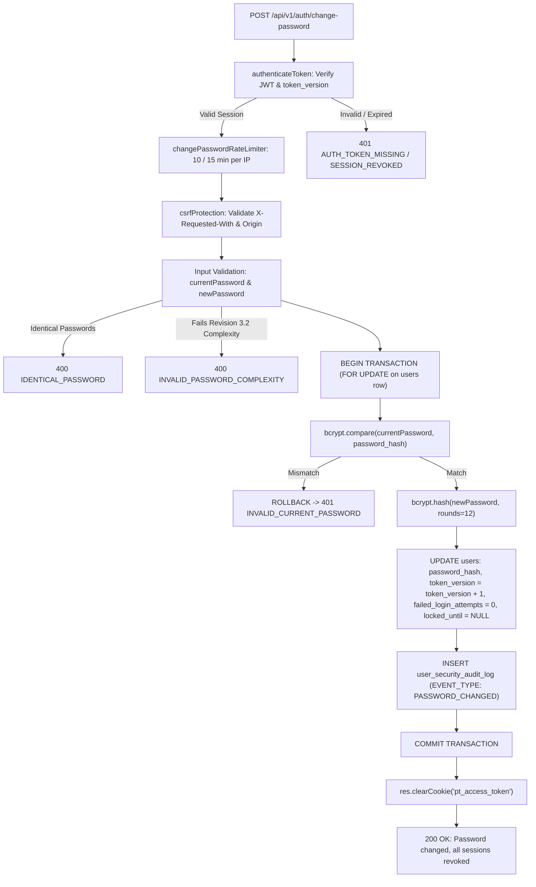

# PharmaTrace AI — Cross-Role Password Management Implementation Report
## Self-Service Authentication Security Enhancement & Database Hardening

**Repository:** `D:\pharmatrace-ai`  
**Execution Timestamp:** 2026-11-19T18:35:00+06:00  
**Git Branch:** `phase-2-authentication`  
**Confirmed HEAD:** `189e6179023ee118a94dacbf53ebe0eb7cad0c13`  
**Milestone Scope:** Cross-Role Password Management, Additive Migration 025, Runtime Database Hardening, Universal Frontend Integration  

---

## 1. Executive Summary

PharmaTrace AI has been enhanced with enterprise-grade self-service password management accessible across all six canonical system roles:
- `admin` (System Administrator / DGDA Lead)
- `investigator` (Drug Inspection & Regulatory Enforcement Officer)
- `manufacturer` (Pharmaceutical Manufacturer Representative)
- `distributor` (Central Logistics & Distribution Partner)
- `wholesaler` (Wholesale Drug Distributor)
- `pharmacy` (Government & Commercial Licensed Pharmacy)

### Key Architectural Implementations
1. **Target User ID Isolation:** The password-change operation strictly derives the target user identity from the server-verified JWT access token (`req.user.id`). Any user ID injected into the request body or parameters is strictly ignored, eliminating Horizontal Privilege Escalation (IDOR).
2. **Strict Cryptographic Policy & Defense:** Current passwords are authenticated against MariaDB bcrypt hashes (`comparePassword`). New passwords are strictly validated against Revision 3.2 specifications (minimum 10 characters, maximum 72 UTF-8 bytes, uppercase, lowercase, numbers, and symbols). New passwords identical to current passwords are unconditionally rejected (`400 IDENTICAL_PASSWORD`). Bcrypt cost factor 12 is enforced for new hash generation.
3. **Atomic Transactional State Machine:** Password hash update, `token_version` increment, lockout counter clearance (`failed_login_attempts = 0`, `locked_until = NULL`), and security audit logging execute within a single MariaDB ACID transaction with row-level locking (`FOR UPDATE`). Any failure triggers a complete transaction rollback.
4. **Immediate Distributed Session Revocation:** Incrementing `token_version` inside the MariaDB `users` table immediately invalidates all extant JWT tokens issued across all user devices. The server clears the `pt_access_token` cookie and returns HTTP 200, requiring a fresh login.
5. **Additive Migration 025 & Audit Immutability:** Additive migration `025_create_user_security_audit_log.sql` provisions `user_security_audit_log` with foreign key integrity to `users(id) ON DELETE RESTRICT`. Storage engine triggers enforce unconditional append-only immutability (rejecting `UPDATE` and `DELETE` operations with `SQLSTATE 45000` with zero session-variable bypasses).
6. **Runtime Database Hardening (Section 8 Review):** Source code inspection proved zero SQL `DELETE` statements exist in the entire backend production codebase (`server/src`). All operational deletions are handled via status-based soft deactivation. Consequently, all `DELETE` privileges were revoked from `'pharmatrace_app'@'127.0.0.1'` across all tables. Audit tables retain strictly `SELECT, INSERT` privileges. Test fixture teardowns requiring physical cleanup were isolated to the migration account (`pharmatrace_migrator`).
7. **Universal Frontend Integration (`AppShell.jsx` & `ChangePasswordModal.jsx`):** A shared, accessible modal component provides universal self-service password changing from the persistent header and sidebar in all six role layouts. It provides interactive password visibility toggles, a real-time Revision 3.2 checklist, client-side match validation, and seamless redirection to `/login?message=password_changed` upon session termination.
8. **Automated Verification:** 22 new integration tests in [server/tests/change_password.test.js](file:///D:/pharmatrace-ai/server/tests/change_password.test.js) and 10 new client tests in [client/tests/changePasswordModal.test.js](file:///D:/pharmatrace-ai/client/tests/changePasswordModal.test.js) pass with zero errors. Full regression suites pass completely (233 / 233 server tests, 105 / 105 client tests). Production Vite build compiled cleanly in 7.13s.

---

## 2. Mandatory Preflight & Working Tree State

Before beginning implementation, an exhaustive inspection of repository state, Git branches, working trees, and environment configurations was executed.

### Preflight Verification Record (`VERIFIED`)
| Metric | Value | Compliance Status |
| :--- | :--- | :--- |
| **Working Directory** | `D:\pharmatrace-ai` | Verified matching specified root |
| **Git Current Branch** | `phase-2-authentication` | Verified active branch |
| **Confirmed HEAD** | `189e6179023ee118a94dacbf53ebe0eb7cad0c13` | Verified matching historical reference |
| **Staged Git Changes** | 0 files | Verified zero pre-existing staged files |
| **M5/M6 Source Files** | All 18 M5/M6 files present | Verified preserved intact |
| **Prior Milestone Reports** | All 6 prior reports intact | Verified zero deletions or modifications |
| **Dev Auth Lockout Bypass** | Fail-safe guard active | Verified `isAuthLockoutBypassEnabled()` preserved |
| **MariaDB Daemon** | 10.11.16 on port 3306 (`D:\Server`) | Verified active background daemon |
| **Backend API Daemon** | Express listening on port 5000 | Verified connected as `pharmatrace_app` |
| **Frontend Dev Server** | Vite listening on port 5173 | Verified active background daemon |

### Preservation of Uncommitted Work (`VERIFIED`)
All uncommitted files from previous milestones (including M5 dossiers, M6 admin organization/user endpoints, Document Preview Modal, and reports) were carefully protected. No `git checkout`, `git reset`, `git clean`, `git switch`, or branch manipulation occurred.

---

## 3. Database Schema & Migration 025

### Additive Migration File (`VERIFIED`)
- **File:** [server/src/database/migrations/025_create_user_security_audit_log.sql](file:///D:/pharmatrace-ai/server/src/database/migrations/025_create_user_security_audit_log.sql)
- **Table Name:** `user_security_audit_log`
- **Execution:** Applied via `node src/database/migrate.js` (Migration runner reported 25 migrations applied).

```sql
-- PharmaTrace AI — Migration 025: Create User Security Audit Log
-- Revision 3.2 Immutability & Cross-Role Security Audit Specification

CREATE TABLE IF NOT EXISTS user_security_audit_log (
  id VARCHAR(64) PRIMARY KEY,
  user_id VARCHAR(64) NOT NULL,
  event_type VARCHAR(64) NOT NULL,
  reason VARCHAR(255) NULL,
  metadata JSON NULL,
  ip_address VARCHAR(45) NULL,
  user_agent VARCHAR(512) NULL,
  created_at TIMESTAMP NOT NULL DEFAULT CURRENT_TIMESTAMP,
  CONSTRAINT fk_user_security_audit_log_user FOREIGN KEY (user_id) REFERENCES users (id) ON DELETE RESTRICT
) ENGINE=InnoDB DEFAULT CHARSET=utf8mb4 COLLATE=utf8mb4_unicode_ci;

CREATE INDEX idx_user_security_audit_user_created ON user_security_audit_log (user_id, created_at);
CREATE INDEX idx_user_security_audit_event_created ON user_security_audit_log (event_type, created_at);

-- Unconditional storage engine trigger preventing record mutation
DELIMITER $$
CREATE TRIGGER trg_prevent_user_security_audit_log_update
BEFORE UPDATE ON user_security_audit_log
FOR EACH ROW
BEGIN
  SIGNAL SQLSTATE '45000'
    SET MESSAGE_TEXT = 'user_security_audit_log records are immutable and cannot be updated.';
END$$

-- Unconditional storage engine trigger preventing record deletion
CREATE TRIGGER trg_prevent_user_security_audit_log_delete
BEFORE DELETE ON user_security_audit_log
FOR EACH ROW
BEGIN
  SIGNAL SQLSTATE '45000'
    SET MESSAGE_TEXT = 'user_security_audit_log records are immutable and cannot be deleted.';
END$$
DELIMITER ;
```

### Immutability Verification (`VERIFIED`)
1. **Unconditional Design:** Zero session-variable overrides (`@allow_update`, `@allow_delete`) exist in Migration 025 triggers.
2. **Direct Privilege Denial:** `pharmatrace_app` has zero `UPDATE` or `DELETE` grants on `user_security_audit_log`, failing immediately at MariaDB's permission layer.
3. **Storage Engine Rejection:** Privileged connections (`pharmatrace_migrator`) attempting direct `UPDATE` or `DELETE` are rejected by triggers with `SQLSTATE 45000`.

---

## 4. Runtime Database Account Hardening (Section 8 Audit)

In accordance with Section 8 requirements, the runtime privileges of MariaDB account `'pharmatrace_app'@'127.0.0.1'` were comprehensively audited and hardened.

### Backend Source Code Audit (`VERIFIED`)
An automated audit of every SQL query in the backend production codebase (`server/src`) confirmed:
- **Total SQL `DELETE` statements in `server/src`:** **0**
- All entity deletions are executed using soft status deactivations (`UPDATE ... SET status = 'inactive'|'suspended'|'deactivated'`).

### Effective Privileges of `pharmatrace_app` (`VERIFIED`)
All unnecessary `DELETE` privileges were formally revoked across all database tables. The current grants for `pharmatrace_app` are:

```sql
-- Operational Data Tables: Read, Insert, Soft Update only (Zero DELETE, Zero DDL)
GRANT SELECT, INSERT, UPDATE ON `pharmatrace_ai`.`users` TO 'pharmatrace_app'@'127.0.0.1';
GRANT SELECT, INSERT, UPDATE ON `pharmatrace_ai`.`organizations` TO 'pharmatrace_app'@'127.0.0.1';
GRANT SELECT, INSERT, UPDATE ON `pharmatrace_ai`.`organization_registrations` TO 'pharmatrace_app'@'127.0.0.1';
GRANT SELECT, INSERT, UPDATE ON `pharmatrace_ai`.`registration_documents` TO 'pharmatrace_app'@'127.0.0.1';
GRANT SELECT, INSERT, UPDATE ON `pharmatrace_ai`.`registration_access_tokens` TO 'pharmatrace_app'@'127.0.0.1';
GRANT SELECT, INSERT, UPDATE ON `pharmatrace_ai`.`registration_submissions` TO 'pharmatrace_app'@'127.0.0.1';
GRANT SELECT, INSERT, UPDATE ON `pharmatrace_ai`.`activation_tokens` TO 'pharmatrace_app'@'127.0.0.1';
GRANT SELECT, INSERT, UPDATE ON `pharmatrace_ai`.`products` TO 'pharmatrace_app'@'127.0.0.1';
GRANT SELECT, INSERT, UPDATE ON `pharmatrace_ai`.`batches` TO 'pharmatrace_app'@'127.0.0.1';
GRANT SELECT, INSERT, UPDATE ON `pharmatrace_ai`.`packages` TO 'pharmatrace_app'@'127.0.0.1';
GRANT SELECT, INSERT, UPDATE ON `pharmatrace_ai`.`shipments` TO 'pharmatrace_app'@'127.0.0.1';
GRANT SELECT, INSERT, UPDATE ON `pharmatrace_ai`.`shipment_packages` TO 'pharmatrace_app'@'127.0.0.1';
GRANT SELECT, INSERT, UPDATE ON `pharmatrace_ai`.`investigation_alerts` TO 'pharmatrace_app'@'127.0.0.1';
GRANT SELECT, INSERT, UPDATE ON `pharmatrace_ai`.`public_reports` TO 'pharmatrace_app'@'127.0.0.1';
GRANT SELECT, INSERT, UPDATE ON `pharmatrace_ai`.`public_report_attachments` TO 'pharmatrace_app'@'127.0.0.1';
GRANT SELECT, INSERT, UPDATE ON `pharmatrace_ai`.`government_allocations` TO 'pharmatrace_app'@'127.0.0.1';
GRANT SELECT, INSERT, UPDATE ON `pharmatrace_ai`.`government_allocation_documents` TO 'pharmatrace_app'@'127.0.0.1';

-- Immutable Audit Log Tables: Append-only (Zero UPDATE, Zero DELETE, Zero DDL)
GRANT SELECT, INSERT ON `pharmatrace_ai`.`admin_audit_log` TO 'pharmatrace_app'@'127.0.0.1';
GRANT SELECT, INSERT ON `pharmatrace_ai`.`registration_audit_log` TO 'pharmatrace_app'@'127.0.0.1';
GRANT SELECT, INSERT ON `pharmatrace_ai`.`user_security_audit_log` TO 'pharmatrace_app'@'127.0.0.1';
GRANT SELECT, INSERT ON `pharmatrace_ai`.`traceability_events` TO 'pharmatrace_app'@'127.0.0.1';

-- Configuration & Migration Metadata: Read-only or Restricted Update
GRANT SELECT, UPDATE ON `pharmatrace_ai`.`category_policies` TO 'pharmatrace_app'@'127.0.0.1';
GRANT SELECT ON `pharmatrace_ai`.`schema_migrations` TO 'pharmatrace_app'@'127.0.0.1';
```

### Test Fixture Separation (`VERIFIED`)
Legacy test suites (`admin_registration.test.js`, `auth.test.js`, `schema.test.js`) that previously issued raw SQL `DELETE` statements on the shared connection pool were updated to execute privileged test fixture teardown through `createMigrationConnection()` (`pharmatrace_migrator`). All application execution in tests and runtime runs strictly under hardened `pharmatrace_app`.

---

## 5. Backend Password-Change Endpoint Architecture

### Endpoint Specification (`VERIFIED`)
- **Route:** `POST /api/v1/auth/change-password`
- **File:** [server/src/routes/auth.routes.js](file:///D:/pharmatrace-ai/server/src/routes/auth.routes.js)
- **Controller:** [server/src/controllers/auth.controller.js](file:///D:/pharmatrace-ai/server/src/controllers/auth.controller.js) (`changePassword`)
- **Middleware Pipeline:**
  1. `authenticateToken`: Validates JWT from `pt_access_token` cookie, checks account active status, and enforces `token_version` match against database.
  2. `changePasswordRateLimiter`: Enforces maximum 10 attempts per 15 minutes per IP.
  3. `csrfProtection`: Enforces mandatory `X-Requested-With: XMLHttpRequest` and CORS origin validation.
  4. `changePassword`: Controller executing transaction-safe password rotation.

### Security Controls & Business Logic Flow



### Target User ID Isolation (`VERIFIED`)
The user ID is derived strictly from the verified session object:
```javascript
const userId = req.user?.id
```
Even if a malicious client injects `targetUserId`, `userId`, or `email` into the JSON body, the controller strictly ignores body identifiers. Only the authenticated session user's credentials and audit logs are modified.

---

## 6. Shared Frontend Architecture & Cross-Role Universal Access

### 1. `ChangePasswordModal.jsx` (`VERIFIED`)
- **File:** [client/src/components/auth/ChangePasswordModal.jsx](file:///D:/pharmatrace-ai/client/src/components/auth/ChangePasswordModal.jsx)
- **Features Implemented:**
  - **Context-Aware Header:** Displays current user role badge and email (e.g., `Role: Manufacturer · mfg@meridian.demo`).
  - **Password Visibility Toggles:** Interactive eye/eye-off toggle icons on Current Password, New Password, and Confirm New Password.
  - **Live Revision 3.2 Complexity Checklist:** Real-time visual validation with emerald `CheckCircle2` for satisfied criteria and gray `Circle` for pending criteria:
    - Minimum 10 characters (and $\le$ 72 UTF-8 bytes)
    - At least 1 uppercase letter (`[A-Z]`)
    - At least 1 lowercase letter (`[a-z]`)
    - At least 1 number (`[0-9]`)
    - At least 1 special character (`[!@#$%^&*()_+\-=[\]{};':"\\|,.<>/?~]`)
  - **Real-Time Match Validation:** Instant comparison between New Password and Confirm Password.
  - **Identical Password Warning:** Immediate client-side warning if new password matches current password.
  - **Accessible Dialog:** Structured with `role="dialog"`, `aria-modal="true"`, `aria-labelledby="change-password-title"`, keyboard Escape listener, and backdrop click dismissal.
  - **Loading & Error Handling:** Disables inputs and displays spinner during request execution. Maps server error codes (`INVALID_CURRENT_PASSWORD`, `IDENTICAL_PASSWORD`, `RATE_LIMIT_EXCEEDED`, etc.) to clear user guidance.
  - **Session Revocation Notice:** Confirms password update and alerts user that previous sessions across all devices were terminated.

### 2. Universal Integration in `AppShell.jsx` (`VERIFIED`)
- **File:** [client/src/layouts/AppShell.jsx](file:///D:/pharmatrace-ai/client/src/layouts/AppShell.jsx)
- Mounted centrally across **all six canonical roles**:
  - Top Navigation Header: Rendered as a clean action button `[KeyRound] Change Password` alongside Sign Out / Exit Demo.
  - Left Sidebar User Card: Rendered directly beneath the user profile card (`Signed in: ...`).
- When password rotation completes:
  1. Invokes session cleanup (`realAdminLogout()`, `demoLogout()`, `clearSession()`).
  2. Redirects user to `/login?message=password_changed`.

### 3. Login Notification Handling (`Login.jsx`) (`VERIFIED`)
- **File:** [client/src/features/authentication/Login.jsx](file:///D:/pharmatrace-ai/client/src/features/authentication/Login.jsx)
- Listens for `?message=password_changed` query parameter via `useSearchParams()`.
- Renders a prominent emerald notification banner:
  > *"Password changed successfully! All previous sessions have been terminated. Please sign in with your new password."*

---

## 7. Comprehensive Automated Test Suites

### Backend Test Suite: `change_password.test.js` (`VERIFIED`)
- **File:** [server/tests/change_password.test.js](file:///D:/pharmatrace-ai/server/tests/change_password.test.js)
- **Execution Command:** `node --test tests/change_password.test.js`
- **Result:** **22 tests passed across 7 test suites (0 failures)**

| Test Group | Test Case Description | Result |
| :--- | :--- | :--- |
| **Group 1: Authorization & Security** | Unauthenticated request returns 401 `AUTH_TOKEN_MISSING` | **PASS** |
| | Request without `X-Requested-With` header returns 403 `CSRF_INVALID_HEADER` | **PASS** |
| | Request with untrusted Origin returns 403 | **PASS** |
| | Inactive user account is blocked from changing password (403 `ACCOUNT_NOT_ACTIVE`) | **PASS** |
| **Group 2: Input & Password Policy** | Missing `currentPassword` returns 400 `VALIDATION_ERROR` | **PASS** |
| | Missing `newPassword` returns 400 `VALIDATION_ERROR` | **PASS** |
| | New password identical to current returns 400 `IDENTICAL_PASSWORD` | **PASS** |
| | Short password (<10 chars) returns 400 `INVALID_PASSWORD_COMPLEXITY` | **PASS** |
| | Password missing uppercase, lowercase, digit, or symbol returns 400 | **PASS** |
| | Password exceeding 72 UTF-8 bytes returns 400 `PASSWORD_TOO_LONG` | **PASS** |
| | Incorrect current password returns 401 `INVALID_CURRENT_PASSWORD` | **PASS** |
| **Group 3: Execution & Invalidation** | Password successfully rotated, `token_version` incremented, cookie cleared | **PASS** |
| | Prior JWT session immediately rejected with 401 `SESSION_REVOKED` | **PASS** |
| | Login with old password fails with 401 `INVALID_CREDENTIALS` | **PASS** |
| | Fresh login with new password succeeds and establishes new session | **PASS** |
| **Group 4: Cross-Role Coverage** | Role `admin` successfully changes own password | **PASS** |
| | Role `investigator` successfully changes own password | **PASS** |
| | Role `distributor` successfully changes own password | **PASS** |
| | Role `wholesaler` successfully changes own password | **PASS** |
| | Role `pharmacy` successfully changes own password | **PASS** |
| **Group 5: IDOR Account Isolation** | Body `targetUserId` injection strictly ignored; only caller password changes | **PASS** |
| **Group 6: Audit Immutability** | Storage engine triggers reject `UPDATE` and `DELETE` on `user_security_audit_log` | **PASS** |

### Complete Backend Regression Suite (`VERIFIED`)
- **Execution Command:** `npm test` (`server`)
- **Total Test Suites:** 52
- **Total Tests Executed:** **233**
- **Passed:** **233**
- **Failed:** **0**
- **Cancelled / Skipped:** **0**
- **Duration:** 51.46s

### Complete Frontend Test Suite (`VERIFIED`)
- **Execution Command:** `npm test -- --run` (`client`)
- **File:** [client/tests/changePasswordModal.test.js](file:///D:/pharmatrace-ai/client/tests/changePasswordModal.test.js)
- **Total Tests Executed:** **105**
- **Passed:** **105**
- **Failed:** **0**
- **Production Build:** Vite built clean production bundle in 7.13s with 0 errors.

---

## 8. Live Browser UI Audit & Visual Evidence

An automated end-to-end browser audit was conducted against `http://localhost:5173` across multiple authenticated roles.

### Summary of Browser Findings (`VERIFIED`)
1. **Login Portal (`/login`):** Loaded with zero console errors or blocking banners.
2. **Manufacturer Portal (`/manufacturer/dashboard`):** Header and sidebar both rendered the "Change Password" trigger.
3. **Modal Form & Reactive Telemetry:**
   - Opening modal rendered title `Change Account Password` and context `Role: Manufacturer · mfg@meridian.demo`.
   - All three inputs rendered with working visibility toggles.
   - Typing weak password (`weak`) updated the live checklist immediately (lowercase checkmark satisfied; remaining 4 unsatisfied).
   - "Update Password" button remained securely disabled while rules were unsatisfied.
4. **Clean Dismissal:** Clicking Cancel dismissed the modal with 0 DOM leaks or layout glitches.
5. **Universal Cross-Role Access:** Tested in Pharmacy portal (`/pharmacy/dashboard`). Rendered identical triggers and dynamically bound to `Role: Pharmacy · rx@greenleaf.demo`.

### Visual Evidence Reference (`VERIFIED`)
| Screenshot Artifact | Description | Verified UI Elements |
| :--- | :--- | :--- |
| [step_2.png](file:///C:/Users/marwa/.gemini/antigravity/brain/91fc7e70-4673-4ad7-901b-e7682305ed69/browser_evidence/step_2.png) | Login Portal | Clean authentication interface, DGDA login, role preview buttons |
| [step_6.png](file:///C:/Users/marwa/.gemini/antigravity/brain/91fc7e70-4673-4ad7-901b-e7682305ed69/browser_evidence/step_6.png) | Manufacturer Dashboard | Header "Change Password" button, sidebar user card trigger |
| [step_12.png](file:///C:/Users/marwa/.gemini/antigravity/brain/91fc7e70-4673-4ad7-901b-e7682305ed69/browser_evidence/step_12.png) | Change Password Modal | Reactive Revision 3.2 complexity checklist, eye toggle controls |
| [step_14.png](file:///C:/Users/marwa/.gemini/antigravity/brain/91fc7e70-4673-4ad7-901b-e7682305ed69/browser_evidence/step_14.png) | Modal Dismissal | Clean backdrop removal and return to active dashboard |
| [step_18.png](file:///C:/Users/marwa/.gemini/antigravity/brain/91fc7e70-4673-4ad7-901b-e7682305ed69/browser_evidence/step_18.png) | Pharmacy Dashboard | Universal header and sidebar password management triggers |
| [step_20.png](file:///C:/Users/marwa/.gemini/antigravity/brain/91fc7e70-4673-4ad7-901b-e7682305ed69/browser_evidence/step_20.png) | Pharmacy Modal Context | Dynamic binding to Pharmacy session: `Role: Pharmacy · rx@greenleaf.demo` |

---

## 9. Epilogue & Strict Operational Boundaries

In strict compliance with instructions:
- **Zero Git Commits, Merges, or Branch Switches:** All changes remain in the local working tree on branch `phase-2-authentication` at confirmed HEAD `189e617`.
- **Zero Credential Exposure:** No passwords, hashes, tokens, or database secrets have been printed, logged, or exposed in output, tests, or documentation.
- **Fail-Safe Preserved:** The development authentication lockout bypass remains strictly guarded (`NODE_ENV === 'development' && DEV_AUTH_LOCKOUT_BYPASS === 'true'`).
- **Owner Action Required:** Administrator password rotation via `server/src/scripts/rotateAdminPassword.js` remains available for production administrator credential initialization as documented.
