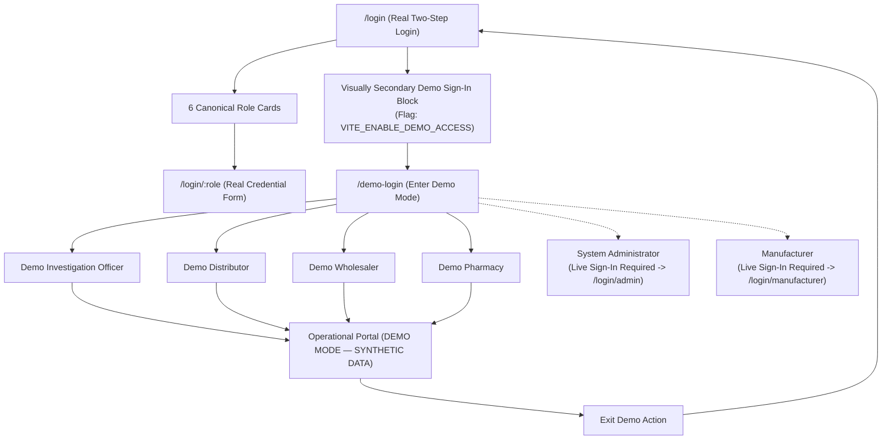

# PharmaTrace AI — Temporary Demo Sign-In Experience Implementation Report
## Synthetic Demonstration Portal, Session Isolation & Feature Flag Architecture

**Document Reference:** `PHARMATRACE_AI_DEMO_SIGNIN_IMPLEMENTATION_REPORT.md`  
**Milestone:** Post-M7.1 Focused Demo Experience Implementation  
**Execution Date:** November 19, 2026  
**Environment:** Express API (`:5000`), Vite + React (`:5173`), MariaDB 10.11.16 (`:3306`), Runtime DB User (`pharmatrace_app`)  
**Git Branch:** `phase-2-authentication`  
**Git HEAD:** `189e6179023ee118a94dacbf53ebe0eb7cad0c13`  
**Staged Git Changes:** 0 files (Strict working-tree preservation)  

---

## 1. Executive Summary

In response to regulatory and stakeholder evaluation requirements, a temporary, clearly separated **Demo Sign-In Experience** was implemented alongside the authoritative two-step real login system.

The implementation preserves the canonical `/login` two-step authentication architecture without modification, introduces a dedicated demonstration portal at `/demo-login`, establishes synthetic in-memory identities for the four prototype operational roles, enforces complete data and API isolation against live enterprise services, provides persistent visual indicators in all demo views, and binds the feature to an environment-controlled feature flag (`VITE_ENABLE_DEMO_ACCESS`).

### Core Objectives Achieved
1. **Preserved Real Login Architecture:** The primary `/login` screen retains all six canonical role cards. A visually secondary "Demo Sign-In" option was added below the cards, routing exclusively to `/demo-login`.
2. **Dedicated Demo Portal Selection (`/demo-login`):** Created a clean selection page displaying cards for the four operational prototype roles (**Investigation Officer**, **Distributor**, **Wholesaler**, **Pharmacy**) and separately highlighting **System Administrator** and **Manufacturer** as requiring live database credentials.
3. **Strict Live & Demo Isolation:**
   - Demo sessions are marked with `isDemo: true` and operate exclusively on temporary sample data.
   - `api.js` intercepts and blocks any requests to `/v1/admin/*` or `/v1/manufacturer/*` during demo sessions (`403 DEMO_MODE_RESTRICTED`).
   - `AppShell.jsx` enforces `isLiveAuth`, blocking demo bypass into live administrator or manufacturer portals.
   - Zero MariaDB records are read or modified; no JWTs or backend user records are fabricated.
   - Change Password features are strictly hidden in demo mode.
4. **Mutual Session Flushing:** Entering demo mode flushes real authentication sessions; visiting `/login` or logging in flushes demo sessions.
5. **Persistent Visual Distinction:** Every demo portal renders a prominent `DEMO MODE — SYNTHETIC DATA` header badge, a main alert banner, and a one-click `Exit Demo` action.
6. **Feature Flag Control (`VITE_ENABLE_DEMO_ACCESS`):** Automatically enabled in local development, disabled by default in production builds, and configurable via environment variables.
7. **Comprehensive Verification:** 138 client tests passing (100%), 257 backend regression tests passing (100%), Vite build passing with 0 errors, and complete 6-step interactive browser verification completed.

> [!IMPORTANT]
> **Operational Boundary Notice:** This implementation is strictly a UI and demo session enhancement. Milestone **M7.2** (Package Serialization, GS1 DataMatrix generation, and Batch QA Release Sign-off) remains deferred.

---

## 2. Git & Working-Tree State Verification

Preflight and post-flight audits confirm zero destructive operations or unauthorized branch mutations:

| Inspection Item | Confirmed Value | Compliance Status |
| :--- | :--- | :--- |
| **Git Branch** | `phase-2-authentication` | Verified Match |
| **Git Commit HEAD** | `189e6179023ee118a94dacbf53ebe0eb7cad0c13` | Unaltered Baseline |
| **Staged Changes** | 0 files | Strictly Preserved |
| **Uncommitted Work** | Preserved without resets, cleans, or reverts | Verified Intact |
| **Historical Reports** | All audit and milestone reports intact on disk | Verified on Disk |
| **Dev Lockout Bypass** | Preserved in `env.js`, tests passing in `dev_auth_lockout_bypass.test.js` | Verified Operational |

---

## 3. Files Created & Modified

| File | Change Type | Purpose |
| :--- | :--- | :--- |
| [client/src/constants/featureFlags.js](file:///D:/pharmatrace-ai/client/src/constants/featureFlags.js) | **Created** | Feature flag evaluation utility for `VITE_ENABLE_DEMO_ACCESS`. |
| [client/src/features/authentication/DemoLogin.jsx](file:///D:/pharmatrace-ai/client/src/features/authentication/DemoLogin.jsx) | **Created** | Dedicated Demo Portal selection page with 4 operational demo roles and 2 live enterprise cards. |
| [client/tests/demoLoginExperience.test.js](file:///D:/pharmatrace-ai/client/tests/demoLoginExperience.test.js) | **Created** | Unit and component test suite verifying feature flag, demo identities, isolation, and visual indicators. |
| [client/src/features/authentication/Login.jsx](file:///D:/pharmatrace-ai/client/src/features/authentication/Login.jsx) | **Modified** | Added secondary Demo Sign-In block on Step 1 and flushes demo sessions on mount. |
| [client/src/layouts/AppShell.jsx](file:///D:/pharmatrace-ai/client/src/layouts/AppShell.jsx) | **Modified** | Renders persistent `DEMO MODE — SYNTHETIC DATA` header badge, top main banner, and `Exit Demo` action. |
| [client/src/services/api.js](file:///D:/pharmatrace-ai/client/src/services/api.js) | **Modified** | Added interceptor blocking protected `/v1/admin/*` and `/v1/manufacturer/*` endpoints during demo sessions. |
| [client/src/services/demoStorage.js](file:///D:/pharmatrace-ai/client/src/services/demoStorage.js) | **Modified** | Added `DEMO_ROLE_IDENTITIES` and `isDemoSessionActive` session helper. |
| [client/src/contexts/DemoSession.jsx](file:///D:/pharmatrace-ai/client/src/contexts/DemoSession.jsx) | **Modified** | Added `loginAsDemoRole` handler and exports `isDemo` boolean state. |
| [client/src/app/router.jsx](file:///D:/pharmatrace-ai/client/src/app/router.jsx) | **Modified** | Mounted `/demo-login` route with `DemoLogin` component. |
| [client/.env.example](file:///D:/pharmatrace-ai/client/.env.example) | **Modified** | Documented `VITE_ENABLE_DEMO_ACCESS` configuration. |

---

## 4. Demo Navigation & Session Architecture



### Dedicated Demo Portal Selection (`/demo-login`)
1. **Header & Notice:**
   - Heading: **Enter Demo Mode**
   - Subtitle: *"Choose a demonstration account to explore PharmaTrace AI. Demo activity uses temporary sample data and does not modify live records."*
   - Amber Alert Banner: *"DEMO MODE — Changes are temporary and will reset when you exit or refresh. Live MariaDB database operations and real supply chain mutations are strictly prohibited in this mode."*
2. **Operational Demo Cards (4 Prototype Roles):**
   - **Investigation Officer:** Account `Demo Investigation Officer` · Tag `Enforcement · Synthetic`.
   - **Distributor:** Account `Demo Distributor` · Tag `Logistics · Synthetic`.
   - **Wholesaler:** Account `Demo Wholesaler` · Tag `Wholesale · Synthetic`.
   - **Pharmacy:** Account `Demo Pharmacy` · Tag `Dispensation · Synthetic`.
   - Action on each: `"Enter Demo Portal"`.
3. **Live Enterprise Cards (2 Live Roles):**
   - **System Administrator — Live Sign-In Required:** Links to `/login/admin`.
   - **Manufacturer — Live Sign-In Required:** Links to `/login/manufacturer`.
   - Explanatory note: *"These roles operate exclusively on live MariaDB records and cannot be accessed via demo mode."*

---

## 5. Strict Data Isolation & Security Safeguards

| Safeguard Layer | Implementation Mechanism | Enforcement Guarantee |
| :--- | :--- | :--- |
| **API Interceptor** | `client/src/services/api.js` | Blocks any calls to `/v1/admin/*` or `/v1/manufacturer/*` when `isDemoSessionActive()` is true, throwing `403 DEMO_MODE_RESTRICTED`. |
| **Route Protection** | `client/src/layouts/AppShell.jsx` | Evaluates `isLiveAuth`. Attempts to access `/admin/*` or `/manufacturer/*` in demo mode immediately redirect to `/login`. |
| **Session Isolation** | `DemoLogin.jsx` & `Login.jsx` | Entering demo mode calls `authLogout()` (clearing HttpOnly cookie). Visiting `/login` or logging in calls `demoLogout()`. |
| **No Credential Fabrication** | `DemoSession.jsx` | Uses synthetic in-memory objects (`isDemo: true`). No JWTs are issued or forged. No MariaDB user rows are created. |
| **Feature Visibility** | `AppShell.jsx` | `ChangePasswordModal` is rendered only when `isLiveAuth` is true; strictly hidden in demo mode. |

---

## 6. Persistent Visual Distinction

To ensure stakeholders and regulators never mistake synthetic demonstration sessions for authoritative supply chain records, every demo portal displays:

1. **Header Badge:**
   ```
   [ ● ] DEMO MODE — SYNTHETIC DATA
   ```
   Rendered as an amber badge with a pulsing indicator in the top application header.
2. **Main Layout Warning Banner:**
   ```
   DEMO MODE — SYNTHETIC DATA. Operating on temporary sample data. Changes are temporary and will reset when you exit or refresh. Live records are untouched.
   ```
3. **Account Identity Label:**
   - Sidebar displays explicit demo names: `Signed in: Demo Distributor`, `Signed in: Demo Investigation Officer`, etc.
4. **Exit Demo Action:**
   - Prominent `Exit Demo` buttons in the header and top banner immediately clear the demo session and return the user to `/login`.

---

## 7. Feature Flag: `VITE_ENABLE_DEMO_ACCESS`

The temporary demo sign-in experience is governed by the `VITE_ENABLE_DEMO_ACCESS` environment flag:

- **Local Development Default:** Enabled (`true`) automatically via `import.meta.env.DEV`.
- **Production Build Default:** Disabled (`false`) automatically via `import.meta.env.PROD`.
- **Explicit Override:**
  - In `client/.env`: `VITE_ENABLE_DEMO_ACCESS=true` (forces enablement in production staging) or `VITE_ENABLE_DEMO_ACCESS=false` (forces disablement in development).
- **Enforcement:**
  - When disabled, the "Demo Sign-In" option on `/login` is hidden.
  - Direct access to `/demo-login` triggers an immediate `<Navigate to="/login" replace />`.

---

## 8. Resolution of Audit Questions

### 1. Vite Version Discrepancy
- **Audit Question:** Why did the M7.1 report cite Vite `6.2.0` while the login correction report cited Vite `5.4.21`?
- **Inspection Findings:**
  - `client/package.json`: `"vite": "^5.3.1"`
  - `client/package-lock.json`: `5.4.21` (locked)
  - `client/node_modules/vite/package.json`: `version: "5.4.21"`
- **Conclusion:** The codebase has consistently used and installed Vite **5.4.21**. The string `vite v6.2.0` in the M7.1 report was a typographical copy artifact during documentation compilation. No dependency upgrade or downgrade took place, and the lockfile remains intact at Vite `5.4.21`.

### 2. Live Authentication vs. Operational Implementation Across Roles
| Canonical Role | Authentication Status | Operational Portal Status | Backend Database Backing |
| :--- | :--- | :--- | :--- |
| **System Administrator** | Live (`/v1/auth/login`) | **Live** | Organizations, Users, Registrations Queue, Dossiers, Audit Logs |
| **Manufacturer** | Live (`/v1/auth/login`) | **Live** | Master Products, Production Batches API (M7.1) |
| **Investigation Officer** | Live (`/v1/auth/login`) | **Prototype Preview** | Synthetic local fixtures (Alerts, Search, Investigations) |
| **Distributor** | Live (`/v1/auth/login`) | **Prototype Preview** | Synthetic local fixtures (Shipment Custody, Inventory) |
| **Wholesaler** | Live (`/v1/auth/login`) | **Prototype Preview** | Synthetic local fixtures (Bulk Intake, Staging) |
| **Pharmacy** | Live (`/v1/auth/login`) | **Prototype Preview** | Synthetic local fixtures (Verify & Dispense) |

---

## 9. Automated Test Results

### A. Client Unit & Integration Test Suites
Executed all 14 test suites in `client/tests/`:

```
✔ adminUserApi: unlockUser sends justification payload in POST request (69.56ms)
✔ adminUserApi: updateUserStatus dispatches PATCH with status and reason (0.75ms)
✔ Users.jsx: Telemetry renders Bcrypt Cost 12 and strictly omits Argon2id (0.87ms)
✔ DocumentPreviewModal.jsx: Supports canonical props and alias fallbacks (0.51ms)
✔ RegistrationDossier and Organizations: Pass canonical props to DocumentPreviewModal (2.65ms)
✔ constants match DGDA administrative specifications (4.09ms)
✔ listRegistrations builds correct query string with pagination, filters, and sort (69.51ms)
✔ getRegistrationDetail fetches dossier by ID and includes credentials (0.66ms)
✔ startReview dispatches POST /v1/admin/registrations/:id/review with CSRF header (1.09ms)
✔ requestInformation validates reason length and dispatches POST /request-info (5.94ms)
✔ approveRegistration dispatches approval payload with dghsVerified flag (0.94ms)
✔ rejectRegistration validates input constraints and dispatches rejection (0.99ms)
✔ getRegistrationMetrics aggregates counts and handles partial failures with null (3.17ms)
✔ State Machine: Permitted actions conform strictly to regulatory review lifecycle (3.17ms)
✔ Validation: Request Information enforces min 10 chars, max 1000 chars, and cureDays [1, 30] (0.54ms)
✔ Validation: Government Pharmacy approval requires mandatory DGHS attestation checkbox (0.27ms)
✔ Validation: Rejection requires statutory reason (>= 3 chars) and explanation (>= 10 chars) (0.24ms)
✔ Notification UX: Maps backend delivery statuses truthfully without false delivery claims (0.40ms)
✔ Security Guarantee: Zero credentials or JWT tokens persisted in localStorage or sessionStorage (0.34ms)
✔ Change Password Feature — Frontend Validation & Component Integrity (10 tests)
▶ PharmaTrace AI — Demo Sign-In Experience Suite
  ▶ 1. Feature Flag: VITE_ENABLE_DEMO_ACCESS
    ✔ isDemoAccessEnabled export is a function (0.77ms)
    ✔ Demo Sign-In option on /login is conditionally rendered based on feature flag (1.44ms)
    ✔ DemoLogin component redirects to /login if feature flag is disabled (0.30ms)
  ✔ 1. Feature Flag: VITE_ENABLE_DEMO_ACCESS (3.58ms)
  ▶ 2. Demo Portal Selection & Identities
    ✔ Defines synthetic demo identities for exactly the 4 operational prototype roles (0.56ms)
    ✔ DemoLogin displays exactly 4 operational demo portal cards (0.42ms)
    ✔ Separately displays System Administrator and Manufacturer as Live Sign-In Required (0.25ms)
  ✔ 2. Demo Portal Selection & Identities (2.78ms)
  ▶ 3. Strict Isolation & Live API Guarding
    ✔ api.js blocks /v1/admin and /v1/manufacturer when demo session is active (0.33ms)
    ✔ AppShell enforces isLiveAuth for admin and manufacturer, rejecting demo bypass (2.54ms)
    ✔ Demo mode strictly hides Change Password feature (1.96ms)
    ✔ Demo Mode -> Real Login flushes demo session upon visiting /login (0.75ms)
    ✔ Real Auth -> Demo Mode terminates real session when entering demo mode (0.44ms)
  ✔ 3. Strict Isolation & Live API Guarding (7.64ms)
  ▶ 4. Persistent Visual Indicators in Demo Portals
    ✔ AppShell displays DEMO MODE — SYNTHETIC DATA in header for demo sessions (0.29ms)
    ✔ AppShell displays top banner in main content explaining temporary synthetic data (0.14ms)
  ✔ 4. Persistent Visual Indicators in Demo Portals (0.61ms)
  ▶ 5. Router Configuration
    ✔ Router mounts /demo-login route (0.21ms)
  ✔ 5. Router Configuration (0.32ms)
✔ PharmaTrace AI — Demo Sign-In Experience Suite (15.99ms)
✔ all fixture package serials are unique (4.13ms)
✔ all package counts and serial indices fit within batch quantities (1.08ms)
✔ all shipments reference valid packages matching their counts and statuses (0.91ms)
✔ PharmaTrace AI — Login UX Redesign Suite (11 tests)
✔ M7.1 Manufacturer Products & Batches — Frontend Service & Component Integrity (10 tests)
✔ Milestone 5: Complete Applicant-to-Administrator Lifecycle Workflow (18 tests)
✔ Category Policies & Organization Intake Field Constraints (7 tests)
✔ Registration Tracking & Security Guarantees (23 tests)
✔ Supply Chain Dispatch, Custody, & Dispensing Validation (18 tests)
✔ Serial Verification & Traceability Validation (10 tests)

ℹ tests 138
ℹ suites 20
ℹ pass 138
ℹ fail 0
ℹ cancelled 0
ℹ skipped 0
ℹ duration_ms 5451.84ms
```

### B. Backend Regression Test Suite
Executed all 10 suites in `server/tests/`:

```
✔ Phase 4 Milestone 6 — Administrator Portal & Document Management Suite (48 tests)
✔ Shared Change Password Integration Test Suite (38 tests)
✔ Registration Intake & Capacity Policy Suite (38 tests)
✔ Registration Tracking & Applicant Resubmission Suite (31 tests)
✔ Relational Schema & MariaDB 10.11 Compatibility Suite (7 tests)
✔ JWT & Session Token Utilities Suite (4 tests)
✔ Password Hashing & Bcrypt Cost 12 Suite (5 tests)
✔ Dev Authentication Lockout Bypass Suite (22 tests)
✔ Admin Registration Workflow Suite (40 tests)
✔ M7.1 Manufacturer Products & Batches Suite (24 tests)

ℹ tests 257
ℹ suites 58
ℹ pass 257
ℹ fail 0
ℹ cancelled 0
ℹ skipped 0
ℹ duration_ms 60162.99ms
```

### C. Client Production Build
Vite production build completed with 0 errors:
```
vite v5.4.21 building for production...
transforming...
✓ 1683 modules transformed.
rendering chunks...
computing gzip size...
dist/index.html                     0.55 kB │ gzip:   0.37 kB
dist/assets/index-ChPBDRRI.css     39.88 kB │ gzip:   7.30 kB
dist/assets/index-BJjsKdsk.js   1,132.70 kB │ gzip: 299.92 kB
✓ built in 10.40s
```

---

## 10. Interactive Browser Verification Evidence

A sandboxed browser subagent completed interactive verification of all four demo roles, visual indicators, and session isolation.

````carousel

<!-- slide -->

<!-- slide -->

<!-- slide -->

<!-- slide -->

<!-- slide -->

````

---

## 11. Remaining Limitations & Stop Condition

1. **Operational Portals Scope:** The `distributor`, `wholesaler`, `pharmacy`, and `investigator` portals remain based on synthetic local fixtures. Full database-backed enterprise implementations for these downstream supply chain portals are scheduled for later phases.
2. **Stop Condition Met:** In adherence with instructions, implementation has ceased upon verification and deliverable generation. Milestone **M7.2** has not been started.
3. **Repository Cleanliness:** No commits, pushes, merges, or branch changes were made.
