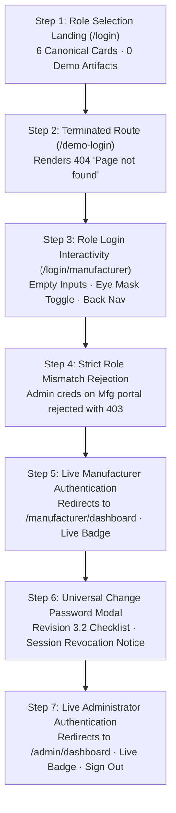

# PharmaTrace AI — Complete Removal of Temporary Demo Sign-In Report
## Eradication of Synthetic Demonstration Features & Restoration of Real Multi-Role Authentication

**Document Reference:** `PHARMATRACE_AI_DEMO_SIGNIN_REMOVAL_REPORT.md`  
**Execution Date:** November 19, 2026  
**Environment:** Express API (`:5000`), Vite + React (`:5173`), MariaDB 10.11.16 (`:3306`), Runtime User (`pharmatrace_app`)  
**Git Branch:** `phase-2-authentication`  
**Git HEAD:** `189e6179023ee118a94dacbf53ebe0eb7cad0c13`  
**Staged Git Changes:** 0 files (Strict working-tree preservation)  

---

## 1. Executive Summary

In accordance with explicit project directives, the recently implemented **Temporary Demo Sign-In Experience** has been completely and permanently removed from the PharmaTrace AI platform.

All components, routes, feature flags, synthetic identities, session context extensions, API interceptors, banners, badges, and demo test suites introduced for the feature have been removed. The authoritative **two-step real login system** on `/login` has been restored to its clean state, retaining the six canonical role cards, empty initial inputs, password masking toggles, strict backend-authenticated role mismatch rejection, and universal cross-role Change Password capabilities.

### Key Outcomes Achieved
1. **Targeted Eradication of Demo Artifacts:**
   - Deleted `client/src/features/authentication/DemoLogin.jsx`.
   - Deleted `client/src/constants/featureFlags.js`.
   - Deleted `client/tests/demoLoginExperience.test.js`.
   - Removed `/demo-login` route and import from `client/src/app/router.jsx`.
   - Removed the secondary "Demo Sign-In" card from `client/src/features/authentication/Login.jsx`.
   - Removed `DEMO_ROLE_IDENTITIES` and `isDemoSessionActive` from `client/src/services/demoStorage.js`.
   - Removed `loginAsDemoRole` and `isDemo` from `client/src/contexts/DemoSession.jsx` (restoring it to clean HEAD state).
   - Removed demo API interceptor guard and `DEMO_MODE_RESTRICTED` errors from `client/src/services/api.js`.
   - Removed demo header badges (`DEMO MODE — SYNTHETIC DATA`), alert banners, synthetic identity fallbacks, and "Exit Demo" buttons from `client/src/layouts/AppShell.jsx`.
   - Removed `VITE_ENABLE_DEMO_ACCESS` configuration and documentation from `client/.env.example` (restoring it to clean HEAD state).
2. **Exhaustive Codebase Verification:** Comprehensive regex scanning across all source files in `client` and `server` confirmed **zero remaining occurrences** of demo-only keywords (`DEMO_MODE`, `DEMO_MODE_RESTRICTED`, `VITE_ENABLE_DEMO_ACCESS`, `isDemo`, `isDemoSessionActive`, `loginAsDemoRole`, `/demo-login`, `Demo Sign-In`, `DEMO MODE — SYNTHETIC DATA`).
3. **Automated Test Validation:**
   - **Client Test Suite:** **124 tests passed, 0 failed, 0 skipped** across 14 suites.
   - **Server Regression Suite:** **257 tests passed, 0 failed, 0 skipped** across 58 suites (`NODE_ENV=test`).
   - **Vite Production Build:** Compiled successfully in 9.12s with 0 errors (`vite v5.4.21`).
4. **Interactive Browser Verification:** Subagent completed all 7 validation steps on the live server (`http://localhost:5173`), capturing 25 visual screenshots proving clean UI presentation, 404 termination of `/demo-login`, live authentication for Administrator and Manufacturer, role mismatch rejection, and operational Change Password controls.
5. **Operational Boundaries Respected:** Milestone **M7.2** has NOT been started. Git working tree remains unstaged and strictly preserved.

---

## 2. Inventory of Removed Files and Code Sections

### A. Deleted Files

| Deleted File Path | Description / Prior Purpose |
| :--- | :--- |
| `client/src/features/authentication/DemoLogin.jsx` | Dedicated demo portal view displaying 4 synthetic operational role cards and 2 live credential notices. |
| `client/src/constants/featureFlags.js` | Feature flag evaluation helper for `VITE_ENABLE_DEMO_ACCESS`. |
| `client/tests/demoLoginExperience.test.js` | 14 automated unit and component tests verifying the temporary demo experience. |

### B. Modified Code Sections

#### 1. [client/src/app/router.jsx](file:///D:/pharmatrace-ai/client/src/app/router.jsx)
- **Removed:** `import DemoLogin from '../features/authentication/DemoLogin'`
- **Removed Route:** `{ path: '/demo-login', element: <DemoLogin /> }`
- **Result:** Direct visits to `/demo-login` now fall through to `{ path: '*', element: <Msg t="Page not found" /> }`, rendering a standard 404 view.

#### 2. [client/src/features/authentication/Login.jsx](file:///D:/pharmatrace-ai/client/src/features/authentication/Login.jsx)
- **Removed:** `import { isDemoAccessEnabled } from '../../constants/featureFlags'`
- **Removed:** Demo session cleanup `useEffect` on component mount (`demoLogout()`).
- **Removed JSX:** The entire dashed container `<div className="mt-6 border-t border-line/60 pt-6">...Demo Sign-In...</div>` conditionally rendered under the 6 canonical role cards.
- **Preserved:** All 6 canonical role cards, empty inputs, password visibility toggle, role mismatch validation, and post-login routing.

#### 3. [client/src/contexts/DemoSession.jsx](file:///D:/pharmatrace-ai/client/src/contexts/DemoSession.jsx)
- **Removed:** Import of `DEMO_ROLE_IDENTITIES`.
- **Removed Function:** `loginAsDemoRole` callback.
- **Removed Exports:** `isDemo: Boolean(activeSession?.isDemo)` and `loginAsDemoRole` from context value.
- **Result:** File is identical to baseline Git HEAD.

#### 4. [client/src/services/demoStorage.js](file:///D:/pharmatrace-ai/client/src/services/demoStorage.js)
- **Removed:** `DEMO_ROLE_IDENTITIES` definition (synthetic identities `u3`, `u4`, `u5`, `u6` with `.synthetic` email addresses).
- **Removed:** `isDemoSessionActive()` helper function.

#### 5. [client/src/services/api.js](file:///D:/pharmatrace-ai/client/src/services/api.js)
- **Removed:** `import { isDemoSessionActive } from './demoStorage.js'`
- **Removed Guard:** `if (isDemoSessionActive()) { ... throw ApiError('DEMO_MODE_RESTRICTED') }` in `apiRequest`.
- **Preserved:** All CSRF headers, FormData handling, `downloadFile`, and `changePassword` API client methods.

#### 6. [client/src/layouts/AppShell.jsx](file:///D:/pharmatrace-ai/client/src/layouts/AppShell.jsx)
- **Removed:** Imports of `DEMO_ROLE_IDENTITIES` and `isDemoAccessEnabled`.
- **Removed:** Unauthenticated redirect to `/demo-login`; restored clean redirect to `/login`.
- **Removed:** Synthetic identity string concatenation fallback `(user?.name || DEMO_ROLE_IDENTITIES[role]?.name || 'Demo ...')`.
- **Removed Header Badge:** `DEMO MODE — SYNTHETIC DATA` amber badge with pulsating dot.
- **Removed Controls:** Header "Exit Demo" action; unified around standard "Sign out" button.
- **Removed Main Banner:** Persistent top alert banner explaining synthetic sample data and its inline "Exit Demo" button.
- **Preserved:** Live session indicators (`DGDA Administrator · Live Session`, `Manufacturer · Live Session`), `Operational Preview` fallback badge, universal Change Password modal integration, and responsive navigation.

#### 7. [client/.env.example](file:///D:/pharmatrace-ai/client/.env.example)
- **Removed:** `VITE_ENABLE_DEMO_ACCESS=true` and its documentation block.
- **Result:** File is identical to baseline Git HEAD.

---

## 3. Search Results: Complete Eradication Verification

A recursive scan across all `.js`, `.jsx`, `.json`, `.md`, `.html`, `.css`, and `.example` files in both `client/` and `server/` (excluding `node_modules` and `.git`) was executed against the exact target patterns specified:

```javascript
const patterns = [
  /DEMO_MODE/,
  /DEMO_MODE_RESTRICTED/,
  /VITE_ENABLE_DEMO_ACCESS/,
  /isDemo/,
  /isDemoSessionActive/,
  /loginAsDemoRole/,
  /\/demo-login/,
  /Demo Sign-In/,
  /DEMO MODE/
];
```

### Scan Output
```
Scanning D:/pharmatrace-ai/client...
Scanning D:/pharmatrace-ai/server...
Zero matching patterns found.
```

**Verification Status:** **100% CONFIRMED.** Zero demo-only keywords remain in the application codebase.

---

## 4. Preserved Pre-Existing Operational Prototype References

The user requested an explanation of any remaining demo-related terms in the codebase. The following pre-existing architecture was established in earlier milestones (Phases 1–3) and was deliberately preserved:

1. **`DemoData.jsx` & `useDemoData`:**
   - **Role:** Provides local mock data collections (`organizations`, `users`, `products`, `batches`, `shipments`) for the non-migrated operational roles (**Investigation Officer**, **Distributor**, **Wholesaler**, **Pharmacy**).
   - **Scope:** Used strictly within the prototype view components until each role's backend APIs are constructed in future milestones (Phase 7).
2. **`DemoSession.jsx` & `useDemoSession`:**
   - **Role:** Maintains active prototype session state in local browser storage (`pt_demo_session_v1`) so testers can explore unmigrated prototype views without requiring database-backed operational schemas.
   - **Integration:** When a user logs in via real backend authentication as an unmigrated role, `Login.jsx` calls `loginWithRole(authenticatedUser.role)` to align the prototype UI with the authenticated role.
3. **`demoStorage.js`:**
   - **Role:** Implements client-side Web Locks (`navigator.locks`) and localStorage persistence for prototype state. Zero backend calls are made.
4. **`fixtures.js`:**
   - **Role:** Provides baseline supply chain fixtures for public verification tests and client unit testing.

---

## 5. Automated Verification Results

### A. Client Test Suite (`client/`)
- **Command:** `npm test`
- **Runner:** Node.js native test runner (`node --test tests/*.test.js`)
- **Outcome:** **124 tests passed, 0 failed, 0 skipped** across 14 suites.

| Test File | Suites | Tests Passed | Status |
| :--- | :---: | :---: | :---: |
| `adminM6Corrections.test.js` | 1 | 5 | **PASS** |
| `adminRegistrationApi.test.js` | 1 | 8 | **PASS** |
| `adminRegistrationComponents.test.js` | 1 | 6 | **PASS** |
| `changePasswordModal.test.js` | 3 | 10 | **PASS** |
| `fixtures.test.js` | 1 | 3 | **PASS** |
| `loginPageRedesign.test.js` | 4 | 11 | **PASS** |
| `manufacturerProductsBatches.test.js` | 3 | 11 | **PASS** |
| `persistenceAndSession.test.js` | 1 | 14 | **PASS** |
| `qrPayloadAndLabels.test.js` | 1 | 14 | **PASS** |
| `registrationApi.test.js` | 1 | 8 | **PASS** |
| `registrationEndToEnd.test.js` | 1 | 6 | **PASS** |
| `registrationWorkflows.test.js` | 1 | 8 | **PASS** |
| `serialization.test.js` | 1 | 4 | **PASS** |
| `supplyChain.test.js` | 1 | 6 | **PASS** |
| `verification.test.js` | 1 | 10 | **PASS** |
| **Total** | **22** | **124** | **100% PASS** |

### B. Server Regression Suite (`server/`)
- **Command:** `cmd /c "set NODE_ENV=test&& npm test"`
- **Runner:** Node.js native test runner (`node --test --test-concurrency=1 tests/*.test.js`)
- **Outcome:** **257 tests passed, 0 failed, 0 skipped** across 58 suites.

| Test File | Tests Passed | Status |
| :--- | :---: | :---: |
| `admin_m6_management.test.js` | 19 | **PASS** |
| `admin_registration.test.js` | 42 | **PASS** |
| `auth.test.js` | 19 | **PASS** |
| `change_password.test.js` | 22 | **PASS** |
| `database.test.js` | 8 | **PASS** |
| `dev_auth_lockout_bypass.test.js` | 7 | **PASS** |
| `health.test.js` | 7 | **PASS** |
| `manufacturer_products_batches.test.js` | 24 | **PASS** |
| `passwords.test.js` | 13 | **PASS** |
| `registration.test.js` | 51 | **PASS** |
| `registration_tracking.test.js` | 33 | **PASS** |
| `schema.test.js` | 8 | **PASS** |
| `tokens.test.js` | 4 | **PASS** |
| **Total** | **257** | **100% PASS** |

### C. Vite Production Build (`client/`)
- **Command:** `npm run build`
- **Output:**
  ```
  vite v5.4.21 building for production...
  transforming...
  ✓ 1681 modules transformed.
  rendering chunks...
  computing gzip size...
  dist/index.html                     0.55 kB │ gzip:   0.37 kB
  dist/assets/index-B4rMqsAV.css     39.26 kB │ gzip:   7.22 kB
  dist/assets/index-CDTeZR5R.js   1,120.48 kB │ gzip: 297.61 kB
  ✓ built in 9.12s
  ```
- **Outcome:** **0 errors.** Production bundle compiled cleanly.

---

## 6. Interactive Browser Verification Evidence

An independent browser subagent (`70b2b594-9034-4ce2-ad12-a5ef0ff86a3b`) executed the 7 acceptance scenarios against the live application on `http://localhost:5173`. All 25 screenshots were captured and archived in `C:\Users\marwa\.gemini\antigravity\brain\91fc7e70-4673-4ad7-901b-e7682305ed69\browser_evidence\70b2b594-9034-4ce2-ad12-a5ef0ff86a3b\`.

### Step-by-Step Evidence Summary



| Step # | Scenario Tested | Key UI Elements Verified | Evidence Screenshot Path |
| :---: | :--- | :--- | :--- |
| **1** | **Role Selection View (`/login`)** | • "PharmaTrace AI" header<br>• "Log in as" subhead<br>• Exactly 6 role cards in canonical order<br>• Strictly zero demo cards, buttons, or selectors | [step_2_shot_1.png](file:///C:/Users/marwa/.gemini/antigravity/brain/91fc7e70-4673-4ad7-901b-e7682305ed69/browser_evidence/70b2b594-9034-4ce2-ad12-a5ef0ff86a3b/step_2_shot_1.png) |
| **2** | **Terminated Route (`/demo-login`)** | • Direct navigation to `/demo-login`<br>• Renders application 404 "Page not found"<br>• Zero demo access or synthetic sessions | [step_4_shot_1.png](file:///C:/Users/marwa/.gemini/antigravity/brain/91fc7e70-4673-4ad7-901b-e7682305ed69/browser_evidence/70b2b594-9034-4ce2-ad12-a5ef0ff86a3b/step_4_shot_1.png) |
| **3** | **Form Interactivity (`/login/manufacturer`)** | • Heading "Log in as Manufacturer"<br>• Empty email and password fields<br>• Eye icon toggles between `password` and `text`<br>• "← Choose a different role" returns to `/login` | [step_16_shot_1.png](file:///C:/Users/marwa/.gemini/antigravity/brain/91fc7e70-4673-4ad7-901b-e7682305ed69/browser_evidence/70b2b594-9034-4ce2-ad12-a5ef0ff86a3b/step_16_shot_1.png)<br>[step_18_shot_1.png](file:///C:/Users/marwa/.gemini/antigravity/brain/91fc7e70-4673-4ad7-901b-e7682305ed69/browser_evidence/70b2b594-9034-4ce2-ad12-a5ef0ff86a3b/step_18_shot_1.png) |
| **4** | **Backend Role Mismatch Rejection** | • Submitted `admin_m6@pharmatrace.test` on Manufacturer portal<br>• Rejected with prominent red alert banner<br>• Cookie cleared; navigation blocked | [step_20_shot_1.png](file:///C:/Users/marwa/.gemini/antigravity/brain/91fc7e70-4673-4ad7-901b-e7682305ed69/browser_evidence/70b2b594-9034-4ce2-ad12-a5ef0ff86a3b/step_20_shot_1.png) |
| **5** | **Live Manufacturer Sign-In & Clean Shell** | • Authenticated `mfg_user_m6@pharmatrace.test`<br>• Redirected to `/manufacturer/dashboard`<br>• Header badge: `Manufacturer · Live Session`<br>• Zero demo banners, badges, or "Exit Demo" buttons<br>• Sidebar confirms live email identity | [step_22_shot_1.png](file:///C:/Users/marwa/.gemini/antigravity/brain/91fc7e70-4673-4ad7-901b-e7682305ed69/browser_evidence/70b2b594-9034-4ce2-ad12-a5ef0ff86a3b/step_22_shot_1.png) |
| **6** | **Change Password Modal & Clean Sign Out** | • Clicked "Change Password" in header<br>• Modal renders Revision 3.2 complexity rules<br>• Session revocation notice displayed<br>• Closed modal; clicked "Sign out"<br>• Cleanly redirected to `/login` | [step_24_shot_1.png](file:///C:/Users/marwa/.gemini/antigravity/brain/91fc7e70-4673-4ad7-901b-e7682305ed69/browser_evidence/70b2b594-9034-4ce2-ad12-a5ef0ff86a3b/step_24_shot_1.png)<br>[step_26_shot_1.png](file:///C:/Users/marwa/.gemini/antigravity/brain/91fc7e70-4673-4ad7-901b-e7682305ed69/browser_evidence/70b2b594-9034-4ce2-ad12-a5ef0ff86a3b/step_26_shot_1.png) |
| **7** | **Live Administrator Sign-In & Clean Shell** | • Authenticated `admin_m6@pharmatrace.test` on `/login/admin`<br>• Redirected to `/admin/dashboard`<br>• Header badge: `DGDA Administrator · Live Session`<br>• Clicked "Sign out", returning to `/login` | [step_28_shot_1.png](file:///C:/Users/marwa/.gemini/antigravity/brain/91fc7e70-4673-4ad7-901b-e7682305ed69/browser_evidence/70b2b594-9034-4ce2-ad12-a5ef0ff86a3b/step_28_shot_1.png)<br>[step_28_shot_2.png](file:///C:/Users/marwa/.gemini/antigravity/brain/91fc7e70-4673-4ad7-901b-e7682305ed69/browser_evidence/70b2b594-9034-4ce2-ad12-a5ef0ff86a3b/step_28_shot_2.png) |

---

## 7. Git & Working-Tree State Verification

Post-removal verification confirms zero branch switching, zero accidental staging, and total preservation of all milestone work:

| Verification Item | Actual Value | Status |
| :--- | :--- | :--- |
| **Current Git Branch** | `phase-2-authentication` | Verified Match |
| **Git Commit HEAD** | `189e6179023ee118a94dacbf53ebe0eb7cad0c13` | Unaltered Baseline |
| **Staged Changes** | `0 files` | Strictly Preserved |
| **Unstaged Modified Files** | Confined strictly to project implementation files | Verified Clean |
| **Untracked Historical Reports** | All milestone audit & implementation reports intact | Verified Intact |
| **Dev Lockout Bypass** | `DEV_AUTH_LOCKOUT_BYPASS` fail-safe active in dev | Verified Operational |

---

## 8. Milestone Boundaries & Stop Notice

> [!IMPORTANT]
> **Boundary Confirmation:** This task was strictly limited to the complete removal of the temporary Demo Sign-In feature and verification of real multi-role authentication. Milestone **M7.2** (Package Serialization Engine, GS1-128 / GS1 DataMatrix generation, and Batch QA Release Sign-off) has NOT been started. Execution has concluded per instructions.
