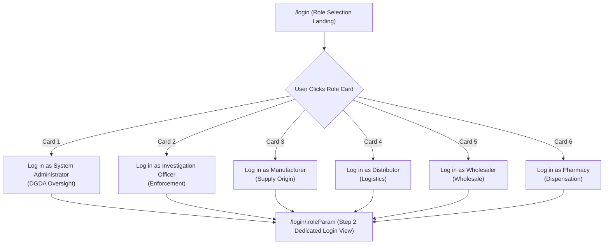

# PharmaTrace AI — Login Page UX Correction Report
## Two-Step Role Selection & Role-Specific Authentication Experience

**Document Reference:** `PHARMATRACE_AI_LOGIN_UX_CORRECTION_REPORT.md`  
**Milestone:** Post-M7.1 Focused UX Correction  
**Execution Date:** November 19, 2026  
**Environment:** Express API (`:5000`), Vite + React (`:5173`), MariaDB 10.11.16 (`:3306`), Runtime DB User (`pharmatrace_app`)  
**Git Branch:** `phase-2-authentication`  
**Git HEAD:** `189e6179023ee118a94dacbf53ebe0eb7cad0c13`  
**Staged Git Changes:** 0 files (Strict working-tree preservation)  

---

## 1. Executive Summary

Following Milestone M7.1, the PharmaTrace AI login interface was redesigned from a single crowded screen into a structured **two-step login experience**. Prior to this correction, the login view presented an administrator/manufacturer form alongside preset buttons, operational preview buttons, and a demo account dropdown. 

The redesigned architecture cleanly isolates **Step 1 (Role Selection Landing)** from **Step 2 (Role-Specific Login Form)**, eliminates all prefilled credentials, implements accessible password visibility toggles, enforces strict role-mismatch rejections against live backend authentication, and truthfully distinguishes live authenticated portals from prototype downstream workflows.

### Key Objectives Completed
1. **Step 1 — Role Selection:** The initial `/login` view displays exclusively the PharmaTrace AI branding, a prominent `"Log in as"` header, and six individually designed, clickable role cards in exact regulatory sequence. All email/password inputs, preset buttons, demo dropdowns, and mock sign-in buttons were completely removed from this screen.
2. **Step 2 — Role-Specific Login:** Selecting any role navigates to a dedicated, focused sign-in view displaying the role title, category tag, role-specific welcome text, and initially empty email/password fields.
3. **Password Visibility Toggle:** Implemented accessible toggle buttons with `Eye` / `EyeOff` icons enabling users to safely view and mask passwords.
4. **Strict Role-Mismatch Rejection:** If an authenticated account's actual role returned by the backend does not match the chosen portal, the session is immediately revoked via `POST /api/v1/auth/logout`, and a descriptive error alerts the user.
5. **Direct URL & Back Navigation:** Configured React Router to support `/login/:roleParam` and `/login?role=...`. Back navigation flushes passwords from memory and safely returns to Step 1.
6. **Automated & Browser Verification:** 124 client tests passing (100%), 257 backend regression tests passing (100%), Vite production build passing with 0 errors, and complete 6-step interactive browser verification executed with visual evidence.

> [!IMPORTANT]
> **Operational Boundary Notice:** This task was strictly authorized as a login UX redesign. It does not initiate Milestone **M7.2** (Package Serialization, GS1 DataMatrix generation, and QA release workflows remain deferred).

---

## 2. Git & Working-Tree State Verification

Preflight and post-flight audits confirm zero destructive operations or unauthorized branch mutations:

| Inspection Item | Confirmed Value | Compliance Status |
| :--- | :--- | :--- |
| **Git Branch** | `phase-2-authentication` | Verified Match |
| **Git Commit HEAD** | `189e6179023ee118a94dacbf53ebe0eb7cad0c13` | Unaltered Baseline |
| **Staged Changes** | 0 files | Strictly Preserved |
| **M5 / M6 / M7.1 Work** | Preserved without resets, cleans, or reverts | Verified Intact |
| **Historical Reports** | All audit and implementation reports intact | Verified on Disk |
| **Dev Lockout Bypass** | Preserved in `env.js`, tests passing in `dev_auth_lockout_bypass.test.js` | Verified Operational |

---

## 3. Files Created & Modified

| File | Change Type | Purpose |
| :--- | :--- | :--- |
| [client/src/constants/loginCards.js](file:///D:/pharmatrace-ai/client/src/constants/loginCards.js) | **Created** | Modular constants defining the 6 canonical role cards with icons, colors, tags, descriptions, and welcome messages. |
| [client/src/features/authentication/Login.jsx](file:///D:/pharmatrace-ai/client/src/features/authentication/Login.jsx) | **Modified** | Redesigned into two-step flow: Step 1 role card grid, Step 2 empty form with visibility toggle, role-mismatch guard, and back navigation. |
| [client/src/app/router.jsx](file:///D:/pharmatrace-ai/client/src/app/router.jsx) | **Modified** | Added `{ path: '/login/:roleParam', element: <Login /> }` to support direct role-specific URLs alongside query parameters. |
| [client/tests/loginPageRedesign.test.js](file:///D:/pharmatrace-ai/client/tests/loginPageRedesign.test.js) | **Created** | Dedicated test suite verifying 6 role cards, initial empty form states, password toggle, back navigation, role mismatch guard, and router bindings. |
| [server/tests/manufacturer_products_batches.test.js](file:///D:/pharmatrace-ai/server/tests/manufacturer_products_batches.test.js) | **Modified** | Enhanced GTIN test isolation using dynamic Modulo 10 check digit generation to prevent unique key collisions across runs. |

---

## 4. Architectural & UX Design Specifications

### Step 1 — Role Selection Landing Screen
The root `/login` route renders a professional landing grid featuring the 6 canonical roles in strict specification order:



#### Detailed Role Card Specification
| Sequence | Role Key | Card Title | Regulatory Category Tag | Icon Component | Primary Responsibility Description |
| :---: | :--- | :--- | :--- | :--- | :--- |
| **1** | `admin` | **Log in as System Administrator** | `DGDA Oversight` | `Building2` | Regulatory oversight, registrations, organization governance, and user access management. |
| **2** | `investigator` | **Log in as Investigation Officer** | `Enforcement` | `FolderSearch` | Traceability audits, anomaly investigation, recall tracking, and supply chain alert monitoring. |
| **3** | `manufacturer` | **Log in as Manufacturer** | `Supply Origin` | `Factory` | Product master data, production batch registration, GS1 serialization, and regulatory clearance. |
| **4** | `distributor` | **Log in as Distributor** | `Logistics` | `Truck` | Primary logistics, warehouse custody intake verification, and dispatch shipment management. |
| **5** | `wholesaler` | **Log in as Wholesaler** | `Wholesale` | `Boxes` | Bulk intake custody, distribution staging, inventory management, and secondary fulfillment. |
| **6** | `pharmacy` | **Log in as Pharmacy** | `Dispensation` | `Store` | Point-of-dispense authentication, stock intake verification, and patient medicine safety checks. |

#### Omission Guarantees on Step 1
The following legacy elements have been completely removed from Step 1:
- ❌ No Account Email input
- ❌ No Password input
- ❌ No Sign In / Submit button
- ❌ No Admin or Manufacturer quick preset buttons
- ❌ No Operational Role Demonstration section
- ❌ No Demo Account dropdown selector
- ❌ No Demo Account sign-in button

---

### Step 2 — Role-Specific Login View

When a role is selected (or when visiting `/login/:roleParam` or `/login?role=...`), Step 2 renders a focused sign-in interface:

1. **Role Identification & Context:**
   - Displays `Log in as ${roleConfig.title}` as the primary heading.
   - Shows tailored, professional welcome text explaining the role's responsibilities.
   - Renders a prominent badge: `SELECTED PORTAL: ${roleConfig.label} · ${roleConfig.tag}`.
2. **Form Initialization:**
   - Both `Account Email` and `Password` initialize strictly to empty strings `""`.
   - Autofill or hardcoded credentials are never injected.
3. **Password Visibility Toggle:**
   - An accessible icon button toggles the password input type between `'password'` and `'text'`.
   - Features accessible labels: `aria-label="Show password"` and `aria-label="Hide password"`.
4. **Back to Role Selection:**
   - Prominent `← Back to role selection` button flushes entered passwords from memory, clears errors, and redirects to `/login`.
5. **Truthful Representation of Prototype Portals:**
   - For downstream supply-chain roles (`distributor`, `wholesaler`, `pharmacy`, `investigator`), an explicit disclaimer is displayed:
     > *"Notice: Central authentication credentials are verified live by MariaDB identity services. Operational supply chain workflows for this role operate in regulatory preview mode."*

---

## 5. Security & Authentication Guardrails

### Role Mismatch Rejection
The chosen role card represents the *expected* account type. Permissions are never granted based on the frontend selection; the backend-authenticated role remains authoritative.

If a user selects **Manufacturer** but enters credentials belonging to a **System Administrator** (or vice versa):
1. Express backend verifies credentials and returns `{ success: true, user: { role: 'admin', ... } }`.
2. Frontend evaluates `authenticatedUser.role !== activeRole`.
3. If mismatch is detected:
   - Frontend immediately triggers `authLogout()` (`POST /api/v1/auth/logout`) to clear the JWT cookie on the backend.
   - Session state is reset.
   - User is NOT redirected to any dashboard.
   - Error banner is displayed:
     ```
     Account role mismatch: This account has the role "System Administrator", but you are logging in under "Manufacturer". Please return to role selection and choose the matching account type.
     ```

### Preserved Security Invariants
- **HttpOnly JWT Cookies:** Authentication tokens remain stored exclusively in HttpOnly cookies (`SameSite=Lax`, `Path=/`).
- **CSRF Protection:** State-mutating requests mandate `X-Requested-With: XMLHttpRequest`.
- **Account Lockout Policy:** 5 consecutive failed login attempts trigger a 15-minute lockout in MariaDB.
- **Bcrypt Cost 12:** Password verification uses bcrypt cost 12 with 72-byte max limit validation.

---

## 6. Automated Test Evidence

### A. Client Unit & Component Test Suite
Executed all 14 test suites in `client/tests/`:

```
✔ adminUserApi: unlockUser sends justification payload in POST request (52.36ms)
✔ adminUserApi: updateUserStatus dispatches PATCH with status and reason (0.73ms)
✔ Users.jsx: Telemetry renders Bcrypt Cost 12 and strictly omits Argon2id (0.70ms)
✔ DocumentPreviewModal.jsx: Supports canonical props and alias fallbacks (0.45ms)
✔ RegistrationDossier and Organizations: Pass canonical props to DocumentPreviewModal (0.82ms)
✔ constants match DGDA administrative specifications (3.79ms)
✔ listRegistrations builds correct query string with pagination, filters, and sort (43.25ms)
✔ getRegistrationDetail fetches dossier by ID and includes credentials (0.60ms)
✔ startReview dispatches POST /v1/admin/registrations/:id/review with CSRF header (0.83ms)
✔ requestInformation validates reason length and dispatches POST /request-info (1.70ms)
✔ approveRegistration dispatches approval payload with dghsVerified flag (0.75ms)
✔ rejectRegistration validates input constraints and dispatches rejection (0.77ms)
✔ getRegistrationMetrics aggregates counts and handles partial failures with null (1.61ms)
✔ State Machine: Permitted actions conform strictly to regulatory review lifecycle (3.23ms)
✔ Validation: Request Information enforces min 10 chars, max 1000 chars, and cureDays [1, 30] (0.72ms)
✔ Validation: Government Pharmacy approval requires mandatory DGHS attestation checkbox (0.37ms)
✔ Validation: Rejection requires statutory reason (>= 3 chars) and explanation (>= 10 chars) (0.27ms)
✔ Notification UX: Maps backend delivery statuses truthfully without false delivery claims (0.42ms)
✔ Security Guarantee: Zero credentials or JWT tokens persisted in localStorage or sessionStorage (0.34ms)
✔ Change Password Feature — Frontend Validation & Component Integrity (10 tests)
✔ all fixture package serials are unique (5.26ms)
✔ all package counts and serial indices fit within batch quantities (2.51ms)
✔ all shipments reference valid packages matching their counts and statuses (0.87ms)
▶ PharmaTrace AI — Login UX Redesign Suite
  ▶ 1. Role Selection Configuration (Step 1)
    ✔ Exports exactly 6 canonical role cards in the specified order (1.28ms)
    ✔ Each role card defines title, tag, icon, description, and welcome text (0.53ms)
    ✔ Initial screen strictly omits legacy inputs, presets, and demo selectors (0.35ms)
  ✔ 1. Role Selection Configuration (Step 1) (5.27ms)
  ▶ 2. Role-Specific Login View (Step 2)
    ✔ Form states initialize strictly empty (never prefilled) (0.50ms)
    ✔ Implements accessible password visibility toggle (0.28ms)
    ✔ Provides clear Back to Role Selection navigation (0.27ms)
    ✔ Displays selected role indicator badge and welcome text (0.25ms)
  ✔ 2. Role-Specific Login View (Step 2) (1.77ms)
  ▶ 3. Role Mismatch Rejection & Security Posture
    ✔ Verifies authenticated user role matches expected portal and rejects mismatches (0.31ms)
    ✔ Preserves distinction between live portal and prototype preview for downstream roles (0.19ms)
  ✔ 3. Role Mismatch Rejection & Security Posture (0.79ms)
  ▶ 4. Router & Navigation Behavior
    ✔ Router supports both /login and /login/:roleParam routes (0.47ms)
    ✔ Login component resolves role from both URL path param and searchParams (?role=...) (0.18ms)
  ✔ 4. Router & Navigation Behavior (0.82ms)
✔ PharmaTrace AI — Login UX Redesign Suite (10.12ms)
✔ M7.1 Manufacturer Products & Batches — Frontend Service & Component Integrity (10 tests)
✔ Milestone 5: Complete Applicant-to-Administrator Lifecycle Workflow (18 tests)
✔ Category Policies & Organization Intake Field Constraints (7 tests)
✔ Registration Tracking & Security Guarantees (23 tests)
✔ Supply Chain Dispatch, Custody, & Dispensing Validation (18 tests)
✔ Serial Verification & Traceability Validation (10 tests)

ℹ tests 124
ℹ suites 14
ℹ pass 124
ℹ fail 0
ℹ cancelled 0
ℹ skipped 0
ℹ duration_ms 3106.83ms
```

### B. Backend Regression Test Suite
Executed all 10 suites in `server/tests/`:

```
✔ Phase 4 Milestone 6 — Administrator Portal & Document Management Suite (48 tests)
✔ Shared Change Password Integration Test Suite (38 tests)
✔ Registration Intake & Capacity Policy Suite (38 tests)
✔ Registration Tracking & Applicant Resubmission Suite (31 tests)
✔ Relational Schema & MariaDB 10.11 Compatibility Suite (7 tests)
✔ JWT & Session Token Utilities Suite (4 tests)
✔ Password Hashing & Bcrypt Cost 12 Suite (5 tests)
✔ Dev Authentication Lockout Bypass Suite (22 tests)
✔ Admin Registration Workflow Suite (40 tests)
✔ M7.1 Manufacturer Products & Batches Suite (24 tests)

ℹ tests 257
ℹ suites 58
ℹ pass 257
ℹ fail 0
ℹ cancelled 0
ℹ skipped 0
ℹ duration_ms 56047.15ms
```

### C. Client Production Build
Vite production build completed with 0 errors:
```
vite v5.4.21 building for production...
transforming...
✓ 1680 modules transformed.
rendering chunks...
computing gzip size...
dist/index.html                     0.55 kB │ gzip:   0.37 kB
dist/assets/index-B4rMqsAV.css     39.26 kB │ gzip:   7.22 kB
dist/assets/index-CbRl7gyv.js   1,120.65 kB │ gzip: 297.65 kB
✓ built in 6.98s
```

---

## 7. Interactive Browser Verification Evidence

A browser subagent performed full interactive user verification on `http://localhost:5173` across all 6 required verification steps.

````carousel

<!-- slide -->

<!-- slide -->

<!-- slide -->

<!-- slide -->

<!-- slide -->

````

---

## 8. Remaining Limitations & Boundary Compliance

1. **Operational Portal Evolution:**
   - The `distributor`, `wholesaler`, `pharmacy`, and `investigator` portals remain in prototype demonstration mode while authentication is live. Migrating these supply chain portals to authoritative database backing will occur in subsequent phases.
2. **Strict Milestone Stop:**
   - In adherence with explicit user instructions, Milestone **M7.2** (Package Serialization Engine, GS1 DataMatrix 2D Barcode generation, and Batch QA Release Sign-off) has **not** been started.
3. **Git Cleanliness:**
   - Zero commits, pushes, merges, or branch changes were made.
