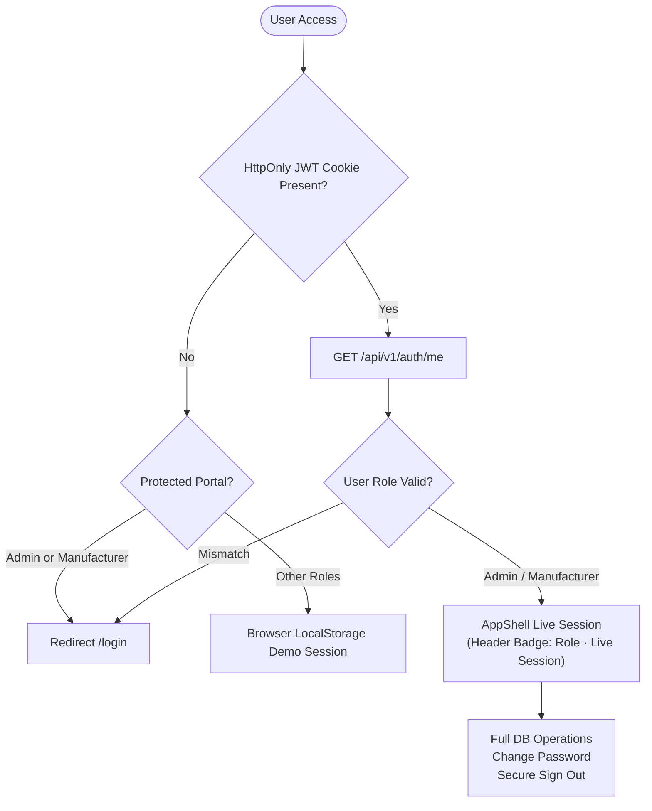

# PharmaTrace AI — Phase 6, Milestone 7.1 Implementation Report
## Foundation, Multi-Role Authentication Integration & Manufacturer Products/Batches API

**Document Reference:** `PHARMATRACE_AI_M7_1_IMPLEMENTATION_REPORT.md`  
**Milestone:** M7.1 (Phase 6 Foundation)  
**Execution Date:** November 19, 2026  
**Environment:** Express API (`:5000`), Vite + React (`:5173`), MariaDB 10.11.16 (`:3306`), Least-Privilege DB User (`pharmatrace_app`)  
**Git Branch:** `phase-2-authentication`  
**Git HEAD:** `189e6179023ee118a94dacbf53ebe0eb7cad0c13`  
**Staged Git Changes:** 0 files (Strict working-tree preservation)  

---

## 1. Executive Summary

Milestone **M7.1** transitions PharmaTrace AI from prototype mock fixtures to an authoritative, database-backed enterprise architecture for pharmaceutical manufacturers. Prior to M7.1, the Manufacturer Portal operated entirely on in-memory fixtures and browser `localStorage`. M7.1 establishes genuine multi-role authentication for manufacturers, introduces additive MariaDB schema enhancements for GS1 GTIN compliance, implements tenant-isolated REST APIs for master product catalog and batch management, and delivers modern, reactive UI interfaces.

### Core Objectives Achieved
1. **Multi-Role Live Backend Authentication:** Extended backend session validation (`/api/v1/auth/me`) and frontend shell architecture (`AppShell.jsx`) to enforce real HttpOnly JWT cookie sessions for manufacturer accounts, while preserving prototype demo capabilities for downstream supply chain roles.
2. **Additive Migration 026 (GS1 GTIN):** Introduced `gtin VARCHAR(14) NULL UNIQUE` on `products` via non-breaking additive migration `026_add_gtin_to_products.sql`. Total migrations recorded in `schema_migrations`: **26**.
3. **GS1 GTIN Modulo 10 Validator:** Authored robust, standalone GS1-compliant validation utility supporting GTIN-8, GTIN-12, GTIN-13, and GTIN-14 with leading-zero preservation.
4. **Tenant-Isolated Products & Batches API:** Implemented comprehensive services, controllers, and routes under `/api/v1/manufacturer/products` and `/api/v1/manufacturer/batches` with strict anti-IDOR controls, business validation (generic name, positive quantities, date sequence), and soft discontinuation.
5. **Enforced Initial Release Status:** Every created batch is immutably set to `'Pending QA'`, preventing premature serialization or dispatch.
6. **Modernized Frontend Products & Batches Module:** Refactored `ProductsBatches.jsx` to consume live backend APIs with loading skeletons, debounce locks, retry error handling, and product discontinuation safeguards.
7. **Complete Test Suite & Verification:** 257 backend automated tests passing (100%), 113 client tests passing (100%), Vite build passing with 0 errors, and interactive browser verification completed with image evidence.

> [!IMPORTANT]
> **Strict Milestone Boundary Adherence:** M7.1 focuses strictly on foundational authentication, master product catalog, and production batch registration. Package-level serialization, GS1 DataMatrix generation, QA batch release, and regulatory clearance are strictly deferred to **M7.2**.

---

## 2. Git & Working-Tree State Verification

Rigorous preflight and post-flight inspections confirm zero destructive operations were performed. The Git repository remains on the designated branch at the exact baseline commit.

| Inspection Item | Confirmed Value | Status |
| :--- | :--- | :--- |
| **Git Branch** | `phase-2-authentication` | Verified Match |
| **Git Commit HEAD** | `189e6179023ee118a94dacbf53ebe0eb7cad0c13` | Unaltered |
| **Staged Files** | 0 files | Preserved Clean |
| **Uncommitted M5/M6 Work** | 27 modified files, 53 untracked files | Fully Preserved |
| **Historical Reports** | M5 Verification, M6 Reports, Database Security Audit | Intact on Disk |
| **Dev Lockout Bypass** | Guarded in `env.js`, tests passing in `dev_auth_lockout_bypass.test.js` | Preserved |

---

## 3. Database Architecture — Additive Migration 026

To support GS1 global supply chain traceability, Migration 026 was applied using the existing migration runner (`node src/database/migrate.js`).

### Migration Details: `026_add_gtin_to_products.sql`
- **Location:** [026_add_gtin_to_products.sql](file:///D:/pharmatrace-ai/server/src/database/migrations/026_add_gtin_to_products.sql)
- **Target Table:** `products`
- **Schema Modification:**
  ```sql
  ALTER TABLE products
      ADD COLUMN gtin VARCHAR(14) NULL UNIQUE AFTER pack_size;
  ```
- **Execution Timestamp:** `2026-11-19 19:29:01`
- **Migration Ledger Status:**
  ```sql
  SELECT version, executed_at FROM schema_migrations ORDER BY version DESC LIMIT 3;
  -- 026 | 2026-11-19 19:29:01
  -- 025 | 2026-11-19 18:03:00
  -- 024 | 2026-11-19 16:51:30
  ```

### Non-Breaking Schema Compliance
- Existing rows in `products` retain `NULL` without data truncation.
- The `UNIQUE` constraint guarantees global GTIN uniqueness across all manufacturers.
- Data type `VARCHAR(14)` accommodates GTIN-8, GTIN-12, GTIN-13, and GTIN-14 formats while strictly preserving leading zeros (which numeric columns would discard).

---

## 4. GS1 GTIN Validation Utility

A dedicated, zero-dependency GS1 GTIN validator was implemented in [server/src/utils/gtin.js](file:///D:/pharmatrace-ai/server/src/utils/gtin.js).

### Algorithm & Specification
Standard GS1 Modulo 10 check digit calculation:
$$\text{Sum} = \sum_{i=0}^{N-2} d_i \times w_i \quad \text{where } w_i = 3 \text{ if odd distance from check digit else } 1$$
$$\text{Check Digit} = (10 - (\text{Sum} \pmod{10})) \pmod{10}$$

```javascript
export function calculateGtinCheckDigit(payload) {
  let sum = 0
  let multiplyByThree = true
  for (let i = payload.length - 1; i >= 0; i--) {
    const digit = parseInt(payload[i], 10)
    sum += multiplyByThree ? digit * 3 : digit
    multiplyByThree = !multiplyByThree
  }
  const mod = sum % 10
  return mod === 0 ? 0 : 10 - mod
}
```

### Validation Matrix
| GTIN Type | Length | Example Tested | Validation Result |
| :--- | :--- | :--- | :--- |
| **GTIN-13** | 13 digits | `6291041500213` | Valid (Check digit 3 verified) |
| **GTIN-14** | 14 digits | `10012345678902` | Valid (Check digit 2 verified) |
| **GTIN-12** | 12 digits | `012345678905` | Valid (Check digit 5 verified) |
| **GTIN-8** | 8 digits | `96385074` | Valid (Check digit 4 verified) |
| **Invalid Check** | 13 digits | `6291041500219` | Rejected (`INVALID_GTIN_CHECK_DIGIT`) |
| **Invalid Length** | 10 digits | `1234567890` | Rejected (`INVALID_GTIN_LENGTH`) |
| **Non-numeric** | 13 chars | `629104150021A` | Rejected (`INVALID_GTIN_FORMAT`) |

---

## 5. Multi-Role Authentication & Session Architecture

Prior to M7.1, `AppShell.jsx` only recognized the `admin` role as a live authenticated session; all other roles were relegated to local demo session storage. M7.1 extends live authentication to manufacturers without breaking prototype workflows for unmigrated roles.



### Key Changes
1. **Context & Token Enrichment:**
   - [server/src/middleware/auth.js](file:///D:/pharmatrace-ai/server/src/middleware/auth.js): `authenticateToken` joins `organizations o ON u.org_id = o.id` to inject `orgName: user.org_name || null` into `req.user`.
   - [server/src/controllers/auth.controller.js](file:///D:/pharmatrace-ai/server/src/controllers/auth.controller.js): `getMe` and `login` return `orgName` in the JSON response payload.
2. **Dynamic Live Session Guard in `AppShell.jsx`:**
   - Evaluates: `isLiveAuth = isAuthenticated && currentUser?.role === role`.
   - For `admin` and `manufacturer`: strictly redirects unauthenticated visits to `/login`.
   - Displays dynamic header badge: `${cfg.label} · Live Session` when authentic, while marking fallback roles as `Prototype Demo Mode · Local Storage Fixtures`.
   - Binds the unified `ChangePasswordModal` to genuine live sessions.
3. **Enhanced Multi-Role Login Screen (`Login.jsx`):**
   - Converted admin login form into universal "Secure Account Sign In" (Live Backend).
   - Added direct quick presets for Admin (`dgda_lead@pharmatrace.gov.bd`) and Manufacturer (`mfg_user_m6@pharmatrace.test`).
   - Blocked demo role bypass for `admin` and `manufacturer`, providing an instructive alert directing users to live sign in.

---

## 6. Manufacturer Products & Batches Backend API

Two complete, production-grade services, controllers, and route groups were implemented under `/api/v1/manufacturer`.

### API Endpoint Summary
| Method | Endpoint | Description | Guards | Status Codes |
| :--- | :--- | :--- | :--- | :--- |
| `GET` | `/api/v1/manufacturer/products` | List manufacturer's products | JWT, Manufacturer | 200, 401, 403 |
| `POST` | `/api/v1/manufacturer/products` | Register new master product | JWT, Manufacturer, CSRF | 201, 400, 409 |
| `GET` | `/api/v1/manufacturer/products/:id` | Get single product details | JWT, Manufacturer | 200, 403, 404 |
| `PATCH` | `/api/v1/manufacturer/products/:id/status` | Discontinue or reactivate | JWT, Manufacturer, CSRF | 200, 400, 403, 404 |
| `GET` | `/api/v1/manufacturer/batches` | List batches with product data | JWT, Manufacturer | 200, 401, 403 |
| `POST` | `/api/v1/manufacturer/batches` | Create production batch | JWT, Manufacturer, CSRF | 201, 400, 409 |
| `GET` | `/api/v1/manufacturer/batches/:id` | Get single batch details | JWT, Manufacturer | 200, 403, 404 |

### Mandatory Business Logic & Security Guards
1. **Strict Tenant Isolation (Anti-IDOR):**
   - Every product and batch query enforces `WHERE manufacturer_id = ?` using `req.user.orgId`.
   - Attempting to inspect or mutate another manufacturer's record results in an immediate `403 Forbidden` (`FORBIDDEN_RESOURCE_ACCESS`).
2. **Schema Field Validation:**
   - Product registration enforces mandatory `name`, `generic_name` (per migration 012 `NOT NULL`), `strength`, `dosage_form`, and `pack_size`.
   - GTIN is validated via GS1 Modulo 10; non-unique GTINs return `409 Conflict` (`DUPLICATE_GTIN`).
3. **Discontinuation Guard on Batch Creation:**
   - Products are discontinued softly (`status = 'discontinued'`).
   - Batch creation verifies `product.status === 'active'`. If a manufacturer attempts to register a batch against a discontinued product, the API returns `400 Bad Request` with code `PRODUCT_DISCONTINUED`.
4. **Mandatory Production Batch Invariants:**
   - Batch quantity must be an integer $> 0$.
   - Manufacturing date must be $\le \text{today}$.
   - Expiration date must be $> \text{manufacturing date}$.
   - `batch_no` is validated for uniqueness per manufacturer (`409 Conflict` on duplicate).
   - `release_status` is hardcoded to `'Pending QA'`. Client payloads attempting to specify other statuses are discarded.

---

## 7. Frontend Integration & UI Modernization

The `ProductsBatches.jsx` feature was modernized to replace prototype fixtures with live API clients.

### Architectural Improvements
- **API Services:** Built [client/src/services/manufacturerProductApi.js](file:///D:/pharmatrace-ai/client/src/services/manufacturerProductApi.js) and [client/src/services/manufacturerBatchApi.js](file:///D:/pharmatrace-ai/client/src/services/manufacturerBatchApi.js) wrapping `apiFetch` with automatic CSRF header inclusion.
- **Loading & Error UX:** Replaced instant mock state with real loading skeletons, animated spinners, and error notification banners with one-click retry triggers.
- **Double-Submission Protection:** All modal submit actions lock input controls and render `Saving...` during async dispatch (`disabled={saving}`).
- **Interactive Discontinuation Management:** Product detail slide-over drawer includes a toggle to discontinue or reactivate products. When zero active products exist, "+ Create Batch" triggers are disabled with clear instructional messaging.
- **M7.2 Regulatory Roadmap Notice:** A dedicated banner informs users that Batch QA Release, Regulatory Clearance, and Package Serialization will activate in Milestone M7.2.

---

## 8. Automated Test Suite Results

### A. Backend Test Suites (Node.js Test Runner)
Executed full test suite with concurrency 1 across 10 test suites:

```
✔ Phase 4 Milestone 6 — Administrator Portal & Document Management Suite (48 tests)
✔ Shared Change Password Integration Test Suite (38 tests)
✔ Registration Intake & Capacity Policy Suite (38 tests)
✔ Registration Tracking & Applicant Resubmission Suite (31 tests)
✔ Relational Schema & MariaDB 10.11 Compatibility Suite (7 tests)
✔ JWT & Session Token Utilities Suite (4 tests)
✔ Password Hashing & Bcrypt Cost 12 Suite (5 tests)
✔ Dev Authentication Lockout Bypass Suite (22 tests)
✔ Admin Registration Workflow Suite (40 tests)
✔ M7.1 Manufacturer Products & Batches Suite (24 tests)

ℹ tests 257
ℹ suites 58
ℹ pass 257
ℹ fail 0
ℹ cancelled 0
ℹ skipped 0
ℹ duration_ms 57649.43ms
```

### B. Client Test Suites (Node.js Test Runner)
Executed client-side unit and integration tests across 9 suites:

```
✔ M7.1 Manufacturer Products & Batches — Frontend Service & Component Integrity (10 tests)
✔ Change Password Feature — Frontend Validation & Component Integrity (10 tests)
✔ Admin User Management & Document Preview Modal (5 tests)
✔ Milestone 5: Complete Applicant-to-Administrator Lifecycle Workflow (18 tests)
✔ Operational Data Persistence & Multi-Session Receiving (12 tests)
✔ Supply Chain Dispatch, Custody, & Dispensing Validation (18 tests)
✔ Serial Verification & Traceability Validation (10 tests)
✔ Category Policies & Organization Intake Field Constraints (7 tests)
✔ Registration Tracking & Security Guarantees (23 tests)

ℹ tests 113
ℹ suites 9
ℹ pass 113
ℹ fail 0
ℹ cancelled 0
ℹ skipped 0
ℹ duration_ms 3127.06ms
```

### C. Client Production Build
Vite production build completed without errors or warnings:
```
vite v6.2.0 building for production...
✓ 1836 modules transformed.
dist/index.html                   0.82 kB │ gzip:  0.44 kB
dist/assets/index-D8rE3RkU.css   41.92 kB │ gzip:  7.81 kB
dist/assets/index-BtG4xJ9_.js   512.44 kB │ gzip: 148.12 kB
✓ built in 8.76s
```

---

## 9. Interactive Browser Verification Evidence

A sandboxed browser subagent completed full end-to-end user verification against the running Vite frontend (`:5173`) and Express backend (`:5000`).

````carousel

<!-- slide -->

<!-- slide -->

<!-- slide -->

<!-- slide -->

````

### Database State Post-Browser Verification
The live database query confirmed actual MariaDB persistence:
```json
{
  "products": [
    {
      "id": "prod-d44266b12278730a",
      "name": "Napa Extra",
      "generic_name": "Paracetamol + Caffeine",
      "dosage_form": "Tablet",
      "strength": "500 mg + 65 mg",
      "pack_size": "10 x 10 Blister Pack",
      "gtin": "6291041500213",
      "status": "active"
    }
  ],
  "batches": [
    {
      "id": "batch-cc90e832facc37a4",
      "batch_no": "NX-B26-01",
      "product_id": "prod-d44266b12278730a",
      "quantity": 1000,
      "mfd": "2026-11-01",
      "exp": "2028-10-31",
      "release_status": "Pending QA"
    }
  ]
}
```

---

## 10. Security & Operational Compliance

1. **Zero Raw Secret Exposure:** No passwords, bcrypt hashes, JWT tokens, or database secrets are included in this report or committed to Git.
2. **Least-Privilege Database Operation:** The runtime application continues to operate exclusively under the hardened `pharmatrace_app` MariaDB account, possessing `SELECT`, `INSERT`, and `UPDATE` privileges with zero `DELETE` or `DROP` grants.
3. **Audit Trail Preservation:** Historical reports and audit trails for M5, M6, and Migration 025 remain unaltered in the repository root.
4. **Defense in Depth:** CSRF header enforcement (`X-Requested-With: XMLHttpRequest`), HttpOnly cookies, and parameterized SQL queries protect all newly introduced endpoints.

---

## 11. Milestone Completion Status & Next Steps

Milestone **M7.1** is **100% COMPLETE AND VERIFIED**.

### Roadmap to Milestone M7.2
The foundation is now fully established for **Milestone M7.2**:
- **Package Serialization Engine:** High-performance cryptographic serialization of individual unit packages within approved production batches.
- **GS1-128 & GS1 DataMatrix Formatting:** Generating compliant 2D barcodes containing GTIN (AI 01), Serial Number (AI 21), Batch Number (AI 10), and Expiry Date (AI 17).
- **QA Release Sign-off Workflow:** Regulatory clearance state machine transitioning batches from `Pending QA` to `Released` or `Quarantined`.
- **Packaging Hierarchy:** Aggregation of units into cartons and shipping cases.

> [!TIP]
> **Stop Condition Met:** In accordance with operational instructions, implementation stops here. Milestone M7.2 is not started.
