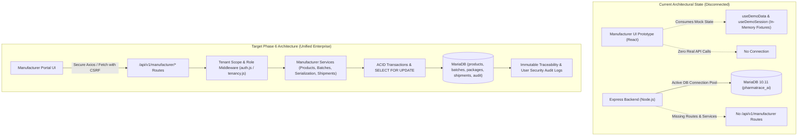
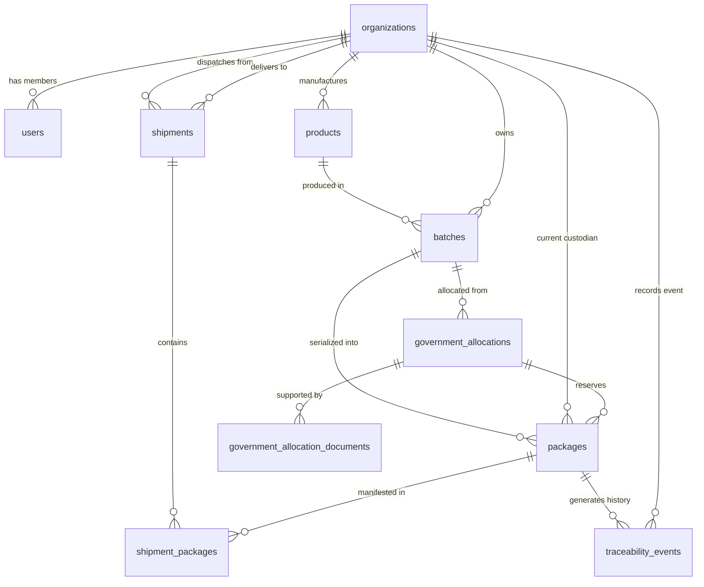
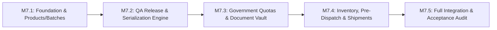

# PharmaTrace AI — Manufacturer Portal Readiness Audit (Phase 6)
## Architectural, Schema, and Implementation Readiness Assessment

**Repository:** `D:\pharmatrace-ai`  
**Execution Timestamp:** 2026-11-19T19:25:00+06:00  
**Current Git Branch:** `phase-2-authentication`  
**Confirmed Git HEAD:** `189e6179023ee118a94dacbf53ebe0eb7cad0c13`  
**Audit Purpose:** Comprehensive, read-only architectural readiness evaluation to prepare for the development of the fully functional, API-backed Manufacturer Portal (Phase 6).  
**Operational Status:** **READ-ONLY AUDIT COMPLETE — IMPLEMENTATION ON HOLD PENDING APPROVAL**

---

## 1. Executive Summary & Readiness Verdict

PharmaTrace AI currently provides a rich client-side prototype of the Manufacturer Portal featuring Dashboard overview, Product & Batch registration, Package Serialization with QR label generation, and Outgoing Shipment preparation. However, all manufacturer workflows are presently powered by in-memory mock fixtures (`useDemoData`, `useDemoSession`) and browser storage, completely detached from the live Express API and MariaDB database.

On the database and backend tier, the core database tables (`products`, `batches`, `packages`, `government_allocations`, `shipments`, `shipment_packages`, `traceability_events`) were provisioned in early migrations (012–018), and enterprise-grade multi-tenant security middleware (`authenticateToken`, `requireRoles`, `assertTenantAccess`, `buildTenantQueryScope`) is operational and verified. However, **zero backend manufacturer routes, controllers, or services currently exist**.



### Readiness Assessment Verdict

| Subsystem / Domain | Status | Key Readiness Finding |
| :--- | :--- | :--- |
| **Git Working Tree & State** | **VERIFIED** | Clean branch `phase-2-authentication`, confirmed HEAD `189e617`, all M5/M6/Security files preserved intact. |
| **Database Schema Provisioning** | **PARTIALLY IMPLEMENTED** | Core tables (012–018) exist in MariaDB, but three schema-prototype discrepancies exist in `products` (missing `gtin`, mandatory `generic_name`, enum mismatch). |
| **Tenant Isolation Architecture** | **VERIFIED** | Middleware in `server/src/middleware/auth.js` and `server/src/utils/tenancy.js` is fully verified and ready for production consumption. |
| **Backend API Implementation** | **MISSING** | 0 routes, 0 controllers, and 0 services exist for the manufacturer domain in `server/src`. |
| **Frontend UI Integration** | **PARTIALLY IMPLEMENTED** | UI layout, component hierarchy, forms, and QR generation are mature in prototype form, but 100% disconnected from backend APIs. |
| **Overall Milestone Readiness** | **READY TO PROCEED** | Architecture is sound; implementation sequence (M7.1–M7.5) is fully mapped out. |

---

## 2. Existing Implementation Inventory

### 2.1 Frontend Component & Routing Inventory

All manufacturer routes are declared in [client/src/app/router.jsx](file:///D:/pharmatrace-ai/client/src/app/router.jsx) and wrapped by [client/src/layouts/AppShell.jsx](file:///D:/pharmatrace-ai/client/src/layouts/AppShell.jsx).

| Route Path | Component | Implementation File | Current Data Source | Functional Status |
| :--- | :--- | :--- | :--- | :--- |
| `/manufacturer/dashboard` | `MfgDashboard` | [client/src/features/manufacturer/dashboard/Dashboard.jsx](file:///D:/pharmatrace-ai/client/src/features/manufacturer/dashboard/Dashboard.jsx) | `useDemoData`, `useDemoSession` | **PARTIALLY IMPLEMENTED (PROTOTYPE ONLY)** |
| `/manufacturer/products-batches` | `MfgProductsBatches` | [client/src/features/manufacturer/products-batches/ProductsBatches.jsx](file:///D:/pharmatrace-ai/client/src/features/manufacturer/products-batches/ProductsBatches.jsx) | `useDemoData`, `useDemoSession` | **PARTIALLY IMPLEMENTED (PROTOTYPE ONLY)** |
| `/manufacturer/serialization` | `Serialization` | [client/src/features/manufacturer/serialization/Serialization.jsx](file:///D:/pharmatrace-ai/client/src/features/manufacturer/serialization/Serialization.jsx) | `useDemoData`, `useDemoSession` | **PARTIALLY IMPLEMENTED (PROTOTYPE ONLY)** |
| `/manufacturer/shipments` | `MfgShipments` | [client/src/features/manufacturer/shipments/Shipments.jsx](file:///D:/pharmatrace-ai/client/src/features/manufacturer/shipments/Shipments.jsx) | `useDemoData`, `useDemoSession` | **PARTIALLY IMPLEMENTED (PROTOTYPE ONLY)** |
| *N/A (Missing from Nav)* | Government Allocations | *None (No dedicated view)* | *None* | **MISSING** |

#### Detailed Component Inspection Findings:
1. **`Dashboard.jsx`:** Computes metrics (total products, batches, serialized packages, outgoing shipments) by filtering mock in-memory arrays via `useMemo`. Employs `orgId` from `useDemoSession()` (defaulting to `'m1'`).
2. **`ProductsBatches.jsx`:** Provides modal dialogs for product registration and batch creation, plus a batch QA release trigger (`handleReleaseBatch`) and status toggling (`handleToggleProductStatus`). Calls local mutation functions (`addProduct`, `addBatch`, `releaseBatch`, `updateProduct`) in `DemoData.jsx`.
3. **`Serialization.jsx`:** Provides batch selection, package quantity inputs, interactive package list, and QR label inspection. Uses `generateBatchSerials` from `client/src/services/serialization.js` which creates synthetic IDs (`DEMO-${batchNo}-${seq}`). Incorporates [PackageLabelCard.jsx](file:///D:/pharmatrace-ai/client/src/components/qr/PackageLabelCard.jsx) and [LabelSheetModal.jsx](file:///D:/pharmatrace-ai/client/src/components/qr/LabelSheetModal.jsx) with client-side SVG QR generation.
4. **`Shipments.jsx`:** Integrates `QrScanner`, `OutgoingEligibilityList`, and `PreDispatchQrCheckpoint`. Validates package eligibility against in-memory arrays and dispatches shipments locally.
5. **`AppShell.jsx` Role Guard Discrepancy:**
   - In lines 18–35 of `AppShell.jsx`, live backend authentication (`useAuth`) is **only enforced for `role === 'admin'`**.
   - For all other roles (including `manufacturer`), the shell falls back to `useDemoSession()` (`initialized`, `current`).
   - `AuthContext.jsx` already captures `currentUser` on login, but `AppShell.jsx` has not yet been updated to evaluate `currentUser.role === 'manufacturer'`.
6. **`Login.jsx` Discrepancy:**
   - The interactive username/password login form is explicitly titled "Administrator Login" and submits to `adminLogin()`.
   - Manufacturer access is currently triggered via the "Role preview" card or "Account Login" demo selector (`loginWithRole('manufacturer')`, `loginWithUser(...)`), which bypasses backend JWT authentication.

### 2.2 Backend Routes, Controllers & Services Inventory

| Architectural Layer | Path / Module | Existing Manufacturer Implementation | Status |
| :--- | :--- | :--- | :--- |
| **API Router** | `server/src/routes/index.js` | None (Mounts `/admin/*`, `/auth`, `/registrations`, `/health`) | **MISSING** |
| **Manufacturer Routes** | `server/src/routes/manufacturer.*.js` | None | **MISSING** |
| **Controllers** | `server/src/controllers/manufacturer.*.js` | None | **MISSING** |
| **Services** | `server/src/services/manufacturer.*.js` | None | **MISSING** |
| **Auth & RBAC Middleware** | `server/src/middleware/auth.js` | `authenticateToken`, `requireRoles('manufacturer')` | **VERIFIED** |
| **Tenant Boundary Enforcer** | `server/src/utils/tenancy.js` | `assertTenantAccess`, `buildTenantQueryScope` | **VERIFIED** |
| **Database Pool** | `server/src/config/database.js` | Pooled connection with `pharmatrace_app` runtime user | **VERIFIED** |

### 2.3 Existing Test Coverage Inventory

| Test Suite File | Scope / Purpose | Manufacturer Coverage | Status |
| :--- | :--- | :--- | :--- |
| `server/tests/change_password.test.js` | Cross-Role Password Management | Verified `manufacturer` role login, password change, token_version increment, and audit logging. | **VERIFIED** |
| `server/tests/auth.test.js` | Authentication & JWT cookies | Tests general token issuance and role claims. | **VERIFIED** |
| `client/tests/serialization.test.js` | Unit tests for `serialization.js` | Tests batch quantity limits, QA release gating, and sequential generation using mock fixtures. | **VERIFIED (UNIT ONLY)** |
| `client/tests/supplyChain.test.js` | Unit tests for `supplyChain.js` | Tests dispatch validations, custody checks, and receiving state machine using mock fixtures. | **VERIFIED (UNIT ONLY)** |
| `client/tests/qrPayloadAndLabels.test.js`| Unit tests for QR generators | Tests QR URL encoding, SVG/PNG rendering, and label metadata formatting. | **VERIFIED (UNIT ONLY)** |
| `server/tests/manufacturer_*.test.js` | Backend API integration tests | None. | **MISSING** |

---

## 3. Database Readiness Assessment

Direct inspection of MariaDB 10.11.16 on `127.0.0.1:3306` (database `pharmatrace_ai`) was conducted to evaluate schema readiness.



### 3.1 Relevant Database Tables & Constraints

| Table Name | Provisioned In | Primary Key | Key Foreign Keys & Constraints | Current Row Count | Schema Status |
| :--- | :--- | :--- | :--- | :--- | :--- |
| **`organizations`** | Migration 003 | `id` | `UNIQUE KEY (license_number)` | 10 rows (1 active mfg: `org-m6-mfg-01`) | **VERIFIED** |
| **`users`** | Migration 004, 022 | `id` | `UNIQUE KEY (email)`, FK `org_id` -> `organizations(id)` | 19 rows (1 active mfg: `usr-m6-mfg-01`) | **VERIFIED** |
| **`products`** | Migration 012 | `id` | FK `manufacturer_id` -> `organizations(id)` | 0 rows | **PARTIALLY IMPLEMENTED** |
| **`batches`** | Migration 013 | `id` | `UNIQUE KEY uq_batch_mfg (batch_no, manufacturer_id)`, FK `product_id`, FK `manufacturer_id` | 0 rows | **VERIFIED** |
| **`government_allocations`** | Migration 014 | `id` | `UNIQUE KEY (allocation_reference)`, FK `manufacturer_org_id`, FK `product_id`, FK `batch_id`, FK `intended_pharmacy_org_id` | 0 rows | **VERIFIED** |
| **`government_allocation_documents`**| Migration 015 | `id` | FK `allocation_id` -> `government_allocations(id)`, FK `uploaded_by` -> `users(id)` | 0 rows | **VERIFIED** |
| **`packages`** | Migration 016 | `serial` | FK `batch_id`, FK `manufacturer_org_id`, FK `custodian_org_id`, FK `government_allocation_id` | 0 rows | **VERIFIED** |
| **`shipments`** | Migration 017 | `ref` | FK `from_org_id` -> `organizations(id)`, FK `to_org_id` -> `organizations(id)` | 0 rows | **VERIFIED** |
| **`shipment_packages`** | Migration 017 | `(shipment_ref, package_serial)` | FK `shipment_ref` -> `shipments(ref)`, FK `package_serial` -> `packages(serial)` | 0 rows | **VERIFIED** |
| **`traceability_events`** | Migration 018 | `id` (AUTO_INCREMENT) | FK `serial` -> `packages(serial)`, FK `actor_org_id` -> `organizations(id)` | 0 rows | **VERIFIED** |
| **`user_security_audit_log`** | Migration 025 | `id` (AUTO_INCREMENT) | FK `user_id` -> `users(id)` (Immutable triggers attached) | 42 rows | **VERIFIED** |

### 3.2 Inventory Architecture Analysis

> [!NOTE]
> **No Separate `inventory` Table Exists by Design:**  
> In PharmaTrace AI, inventory is not stored in a flat stock-balance table. Because every pharmaceutical package is uniquely serialized under GS1/DGDA compliance, **inventory is a materialized query over `packages`**:
> ```sql
> SELECT p.serial, p.batch_id, b.batch_no, pr.name, pr.strength, p.status, p.allocation_type
> FROM packages p
> JOIN batches b ON p.batch_id = b.id
> JOIN products pr ON b.product_id = pr.id
> WHERE p.custodian_org_id = ? AND p.status = 'available';
> ```
> This provides cryptographically verifiable item-level custody tracking and prevents stock desynchronization.

### 3.3 Identified Schema Inconsistencies & Migration Dependencies

The audit identified three specific discrepancies between the database schema in Migration 012 and the client prototype in `ProductsBatches.jsx`:

1. **`generic_name` Column Obligation:**
   - In MariaDB: `products.generic_name` is defined as `VARCHAR(255) NOT NULL`.
   - In Client Prototype: `EMPTY_PRODUCT = { name, strength, form, packSize, gtin }` does **not** capture generic name.
   - *Impact:* Submitting product registration from the current prototype UI to the database will trigger `ER_NO_DEFAULT_FOR_FIELD` error.
   - *Remediation:* The frontend form in `ProductsBatches.jsx` must be augmented to include the mandatory "Generic Name" input field.

2. **`gtin` (Global Trade Item Number) Storage:**
   - In Client Prototype: GTIN is captured, validated, and checked for uniqueness.
   - In MariaDB: Table `products` does **not** have a `gtin` column.
   - *Impact:* GTIN data entered by manufacturers cannot currently be persisted in MariaDB.
   - *Remediation:* A non-breaking additive migration (`026_add_gtin_to_products.sql`) adding `gtin VARCHAR(14) NULL UNIQUE` is recommended to maintain compliance with GS1 / DGDA barcoding standards.

3. **Product `status` Enum Mismatch:**
   - In MariaDB: `products.status` is defined as `ENUM('active', 'discontinued') DEFAULT 'active'`.
   - In Client Prototype: Toggles between `'active'` and `'inactive'`.
   - *Impact:* Toggling status to `'inactive'` will violate the database enum constraint.
   - *Remediation:* Align frontend status toggles to use `'active'` vs `'discontinued'`, or add `'inactive'` to the database enum in Migration 026.

---

## 4. Manufacturer Workflow Feasibility & Gap Analysis

An exhaustive evaluation of the 9 required manufacturer workflows was performed.

### Workflow 1: Manufacturer Dashboard & Operational Overview
- **Existing Implementation:** `client/src/features/manufacturer/dashboard/Dashboard.jsx`.
- **Existing API Endpoints:** None.
- **Database Dependencies:** `products`, `batches`, `packages`, `shipments`, `organizations`.
- **Missing Backend Functionality:** `GET /api/v1/manufacturer/dashboard/summary` and `/activity`. Must compute counts and batch serialization progress dynamically scoped to `req.user.orgId`.
- **Missing Frontend Functionality:** New API service `manufacturerDashboardApi.js`; loading skeletons; empty states; integration with `AuthContext`.
- **Security & Business Rules:** Multi-tenant query scoping; strictly restricted to `manufacturer` role; organization status must be `active`.
- **Feasibility:** High.

### Workflow 2: Product Creation, Editing & Status Management
- **Existing Implementation:** `client/src/features/manufacturer/products-batches/ProductsBatches.jsx`.
- **Existing API Endpoints:** None.
- **Database Dependencies:** `products` table, FK to `organizations`.
- **Missing Backend Functionality:**
  - `GET /api/v1/manufacturer/products`: Paginated list filtered by `manufacturer_id = req.user.orgId`.
  - `POST /api/v1/manufacturer/products`: Create product with `id = prod-${ulid()}`, enforcing required fields.
  - `PUT /api/v1/manufacturer/products/:id`: Update formulation/strength.
  - `PATCH /api/v1/manufacturer/products/:id/status`: Toggle `active` vs `discontinued`.
- **Missing Frontend Functionality:** Form fields for `generic_name`; GTIN handling; error toast normalization.
- **Security & Business Rules:** Tenant isolation (`manufacturer_id` forced to `req.user.orgId`). Cannot delete products (soft discontinuation only).
- **Feasibility:** High.

### Workflow 3: Production Batch Creation
- **Existing Implementation:** Batch creation modal in `ProductsBatches.jsx`.
- **Existing API Endpoints:** None.
- **Database Dependencies:** `batches` table, `uq_batch_mfg` unique constraint, FKs to `products` and `organizations`.
- **Missing Backend Functionality:**
  - `GET /api/v1/manufacturer/batches`: List batches with product joins and serialized count subqueries.
  - `POST /api/v1/manufacturer/batches`: Create batch with initial status `'Pending QA'`.
- **Missing Frontend Functionality:** Hooking up `handleCreateBatch` to `manufacturerBatchApi.js`; server validation display.
- **Security & Business Rules:**
  - Product must belong to the manufacturer and have `status = 'active'`.
  - `exp` must be strictly after `mfd` (`exp > mfd`).
  - `mfd <= CURRENT_DATE` (cannot manufacture in the future).
  - Quantity must be a positive integer ($> 0$).
  - Initial `release_status` strictly set by backend to `'Pending QA'`.
- **Feasibility:** High.

### Workflow 4: Batch Quality Assurance & Release
- **Existing Implementation:** `handleReleaseBatch` button in `ProductsBatches.jsx`.
- **Existing API Endpoints:** None.
- **Database Dependencies:** `batches.release_status` enum, `user_security_audit_log` for QA action tracking.
- **Missing Backend Functionality:**
  - `POST /api/v1/manufacturer/batches/:id/qa-release`: Transitions status from `'Pending QA'` to `'Released'`.
  - `POST /api/v1/manufacturer/batches/:id/qa-quarantine`: Flags batch as `'Quarantined'`.
- **Missing Frontend Functionality:** QA Release confirmation modal with certificate/notes input; visual QA status tags.
- **Security & Business Rules:**
  - Only batches in `'Pending QA'` may transition to `'Released'`.
  - Once released, packages can be serialized. If quarantined/rejected, serialization is hard-blocked.
  - Immutable audit trail entry generated in `user_security_audit_log`.
- **Feasibility:** High.

### Workflow 5: Unique Serial Generation for Medicine Packages
- **Existing Implementation:** `client/src/features/manufacturer/serialization/Serialization.jsx` and `client/src/services/serialization.js`.
- **Existing API Endpoints:** None.
- **Database Dependencies:** `packages` table, `batches` table, `traceability_events`.
- **Missing Backend Functionality:**
  - `POST /api/v1/manufacturer/batches/:id/serialize`: Atomic generation engine.
  - Concurrency control: `SELECT quantity, release_status FROM batches WHERE id = ? FOR UPDATE`.
  - Sequence generation: Computes `MAX(sequence)` for batch, generates $N$ canonical serials, bulk-inserts into `packages`, bulk-inserts genesis `traceability_events` (`MANUFACTURER_SERIALIZED`).
- **Missing Frontend Functionality:** Connect `Serialization.jsx` to API; pagination for high-volume serial tables.
- **Security & Business Rules:**
  - Serialization strictly prohibited unless batch is `'Released'`.
  - Cumulative package count cannot exceed `batches.quantity`.
  - Serial formatting standard: Canonical format `PT-<BATCH_NO>-<5-DIGIT_SEQ>` (e.g. `PT-B2026-00001`).
  - Initial custody: `custodian_org_id = req.user.orgId`, `status = 'available'`.
- **Feasibility:** High.

### Workflow 6: PharmaTrace QR Issuance & Verification
- **Existing Implementation:** `client/src/services/qrGenerator.js`, `PackageLabelCard.jsx`, `LabelSheetModal.jsx`.
- **Existing API Endpoints:** None for live package fetching or public consumer verification.
- **Database Dependencies:** `packages`, `batches`, `products`, `traceability_events`.
- **Missing Backend Functionality:**
  - `GET /api/v1/manufacturer/packages`: List packages with search, batch filter, and QR verification URL.
  - `GET /api/v1/public/verify/:serial`: Public endpoint for consumers and officers returning package verification status.
- **Missing Frontend Functionality:** Connect label print modals to live package data.
- **Security & Business Rules:**
  - QR payload format conforms to `https://<domain>/verify?serial=<SERIAL>`.
  - Scanning public QR records `PUBLIC_VERIFICATION_RECORDED` in `traceability_events` and increments `verify_count`.
- **Feasibility:** High.

### Workflow 7: Government Allocation & Supporting Documentation
- **Existing Implementation:** None on frontend; migrations 014 and 015 exist on backend.
- **Existing API Endpoints:** None.
- **Database Dependencies:** `government_allocations`, `government_allocation_documents`, `packages.government_allocation_id`.
- **Missing Backend Functionality:**
  - `GET /api/v1/manufacturer/allocations`: Query allocations assigned to manufacturer.
  - `POST /api/v1/manufacturer/allocations/:id/documents`: Multipart upload for PO/Tender awards.
  - `POST /api/v1/manufacturer/allocations/:id/assign-packages`: Bulk updates packages (`allocation_type = 'GOVERNMENT'`).
- **Missing Frontend Functionality:** Dedicated "Government Allocations" tab or sub-view; document upload component; package quota progress bar.
- **Security & Business Rules:**
  - Total assigned packages cannot exceed `authorized_quantity`.
  - Packages assigned must belong to the allocation's specified `batch_id`.
  - Documents restricted to PDF, PNG, JPEG $\le 10$MB; stored securely on disk with metadata in DB.
- **Feasibility:** Medium (Requires new UI sub-view).

### Workflow 8: Inventory Visibility & Dispatch Preparation
- **Existing Implementation:** `client/src/features/manufacturer/shipments/Shipments.jsx`.
- **Existing API Endpoints:** None.
- **Database Dependencies:** `packages`, `shipments`, `shipment_packages`, `organizations`.
- **Missing Backend Functionality:**
  - `GET /api/v1/manufacturer/inventory`: Available packages in custody (`custodian_org_id = req.user.orgId`, `status = 'available'`).
  - `GET /api/v1/manufacturer/shipments`: List outgoing shipments.
  - `POST /api/v1/manufacturer/shipments`: Create shipment draft/pending.
  - `POST /api/v1/manufacturer/shipments/:ref/dispatch`: Atomic dispatch transaction: updates shipment status to `'in_transit'`, packages status to `'in_transit'`, records `MANUFACTURER_DISPATCHED` in `traceability_events`.
- **Missing Frontend Functionality:** Connect `Shipments.jsx` to `manufacturerShipmentApi.js`; live camera QR scanning integration.
- **Security & Business Rules:**
  - Mandatory pre-dispatch QR verification event before dispatch status transition.
  - Cannot dispatch expired packages (`batch.exp < TODAY`).
  - Cannot dispatch packages held in another organization's custody.
  - Destination must be an active registered Distributor (or authorized Government Hospital).
- **Feasibility:** High.

### Workflow 9: Traceability History & Audit Records
- **Existing Implementation:** In-memory drawer timeline in `Serialization.jsx` and `Shipments.jsx`.
- **Existing API Endpoints:** None.
- **Database Dependencies:** `traceability_events` table (Migration 018).
- **Missing Backend Functionality:**
  - `GET /api/v1/manufacturer/packages/:serial/traceability`: Chronological journey events.
  - System service to record immutable events upon serialization, QR scanning, allocation, and dispatch.
- **Missing Frontend Functionality:** Render live event history from backend response.
- **Security & Business Rules:**
  - `traceability_events` records are strictly append-only.
  - Every event captures `actor_user_id`, `actor_org_id`, `serial`, `event_type`, `event_payload`.
- **Feasibility:** High.

---

## 5. Manufacturer Workflow Matrix

| Workflow Domain | Existing UI Component | Existing Backend Endpoint | MariaDB Table(s) | Primary Tenant Isolation Rule | Status |
| :--- | :--- | :--- | :--- | :--- | :--- |
| **1. Dashboard Overview** | `Dashboard.jsx` | *None* | `products`, `batches`, `packages`, `shipments` | Scoped strictly to `req.user.orgId` | **PARTIALLY IMPLEMENTED (UI Only)** |
| **2. Products Management** | `ProductsBatches.jsx` | *None* | `products` | `WHERE manufacturer_id = req.user.orgId` | **PARTIALLY IMPLEMENTED (UI Only)** |
| **3. Batch Creation** | `ProductsBatches.jsx` | *None* | `batches`, `products` | Forced `manufacturer_id = req.user.orgId` | **PARTIALLY IMPLEMENTED (UI Only)** |
| **4. QA Release** | `ProductsBatches.jsx` | *None* | `batches`, `user_security_audit_log` | Batch must belong to `req.user.orgId` | **PARTIALLY IMPLEMENTED (UI Only)** |
| **5. Package Serialization**| `Serialization.jsx` | *None* | `packages`, `batches`, `traceability_events` | Batch & packages owned by `req.user.orgId` | **PARTIALLY IMPLEMENTED (UI Only)** |
| **6. QR Issuance & Verification**| `LabelSheetModal.jsx`, `PackageLabelCard.jsx` | *None* | `packages`, `traceability_events` | QR generation uses canonical URL schema | **PARTIALLY IMPLEMENTED (UI Only)** |
| **7. Government Allocations** | *None (Missing)* | *None* | `government_allocations`, `government_allocation_documents` | `WHERE manufacturer_org_id = req.user.orgId`| **MISSING (Schema Ready)** |
| **8. Shipments & Dispatch** | `Shipments.jsx` | *None* | `shipments`, `shipment_packages`, `packages` | Sender `from_org_id = req.user.orgId` | **PARTIALLY IMPLEMENTED (UI Only)** |
| **9. Traceability Events** | `Timeline.jsx` (Drawer) | *None* | `traceability_events` | Append-only event generation | **PARTIALLY IMPLEMENTED (UI Only)** |

---

## 6. Architectural Constraints & Compliance

The implementation of Phase 6 must adhere strictly to the platform's architectural constraints:

1. **Unified Application Architecture:** Must build directly inside the existing React + Vite frontend (`client/src`) and Express backend (`server/src`). No standalone microservices, separate repositories, or secondary databases.
2. **Persistent Database Exclusivity:** All authoritative business state must reside exclusively in MariaDB 10.11. `localStorage` and `sessionStorage` must **never** be used to store or mirror business records (products, batches, packages, allocations, shipments).
3. **Multi-Tenant Security & RBAC:**
   - Every manufacturer API route must be protected by `authenticateToken` and `requireRoles('manufacturer')`.
   - All database queries must enforce tenant isolation using `buildTenantQueryScope(req.user, 'manufacturer_id')` or explicit `WHERE manufacturer_id = ?` parameter binding.
   - Any attempt to supply an arbitrary `manufacturer_id` or `org_id` in request payloads must be strictly ignored or rejected.
4. **Immediate Global Revocation Support:** Must respect `token_version` validation inside `authenticateToken`.
5. **Audit & Traceability Immutability:** All status mutations and critical supply-chain transitions must record events in `traceability_events` and `user_security_audit_log`.

---

## 7. Dependencies and Risks

| Risk / Dependency | Severity | Architectural Impact | Proposed Mitigation Strategy |
| :--- | :--- | :--- | :--- |
| **`products` Schema Discrepancies** | Medium | Prototype lacks `generic_name` (mandatory in DB); DB lacks `gtin` (used in prototype); enum mismatch (`discontinued` vs `inactive`). | 1. Add `generic_name` input to frontend form.<br>2. Introduce additive Migration 026 to add `gtin VARCHAR(14) NULL UNIQUE`.<br>3. Align frontend status enum to `'active'` / `'discontinued'`. |
| **Missing Government Allocations Nav** | Low | Sidebar navigation in `navigation.js` does not have an entry for government allocations. | Add `L('Government Quotas', 'allocations', FileText)` to `ROLES.manufacturer.nav` or incorporate as a dedicated tab inside `ProductsBatches.jsx`. |
| **High-Volume Serialization Lock Contention** | High | Generating 1,000+ packages in a single request could cause MariaDB transaction timeouts or connection starvation. | Use chunked batch inserts (e.g., 250 rows per `INSERT` statement) wrapped in a single ACID transaction with `SELECT quantity FROM batches WHERE id = ? FOR UPDATE`. Cap single serialization requests at 1,000 units. |
| **Client Authentication Context Alignment**| Medium | `AppShell.jsx` and `Login.jsx` currently treat non-admin roles as demo sessions. | Update `AppShell.jsx` to evaluate `currentUser.role === 'manufacturer'` from `useAuth()`. Update `Login.jsx` to permit email/password login for all canonical roles. |
| **Public Verification Route Exposure** | Medium | QR codes point to `/verify?serial=...`, but public backend verification endpoint is unmounted. | Mount public read-only verification route `/api/v1/public/verify/:serial` with strict rate limiting to prevent enumeration attacks. |

---

## 8. Recommended Phase 6 Milestone Breakdown

To ensure safe, test-driven development without regressions, Phase 6 should be structured into five focused milestones:



### Milestone M7.1: Foundation, Authentication Integration & Product/Batch API
- **Scope:**
  - Additive Migration 026 (add `gtin` column to `products`, add indexes).
  - Update `Login.jsx` and `AppShell.jsx` to support real backend session for `role === 'manufacturer'`.
  - Backend controller, service, and routes for Products: `GET`, `POST`, `PUT`, `PATCH /status`.
  - Backend controller, service, and routes for Batches: `GET`, `POST` (initial `'Pending QA'`).
  - Frontend API clients: `manufacturerProductApi.js`, `manufacturerBatchApi.js`.
  - Refactor `ProductsBatches.jsx` to load and mutate real MariaDB data.
- **Estimated Deliverables:** 8 files modified/created, automated backend test suite `manufacturer_products_batches.test.js`.

### Milestone M7.2: QA Release State Machine & Transactional Serialization Engine
- **Scope:**
  - Backend QA release endpoints: `POST /batches/:id/qa-release` and `/qa-quarantine`.
  - Atomic serialization engine: `POST /batches/:id/serialize` with row locking (`SELECT FOR UPDATE`), quantity boundary checks, and batch packaging generation.
  - Serialization history and QR label data generation API.
  - Refactor `Serialization.jsx` to consume live backend API and real QR codes.
  - Automated concurrency and boundary tests.

### Milestone M7.3: Government Allocations & Document Management
- **Scope:**
  - Backend endpoints for Government Allocations: `GET /allocations`, `GET /allocations/:id`.
  - Document upload endpoint: `POST /allocations/:id/documents` (PDF/image support with multer).
  - Package binding endpoint: `POST /allocations/:id/assign-packages` enforcing authorized quota limits.
  - Frontend UI for Government Allocations (quota tracking, document upload/preview).

### Milestone M7.4: Inventory Visibility, Pre-Dispatch Scanning & Outgoing Shipments
- **Scope:**
  - Item-level inventory query API (`GET /inventory` over `packages`).
  - Outgoing shipment management API: `GET /shipments`, `POST /shipments` (manifest composition).
  - Pre-dispatch QR verification scanning endpoint (`POST /shipments/:ref/verify-package`).
  - Atomic dispatch transition: `POST /shipments/:ref/dispatch` updating shipment and packages to `'in_transit'` and writing `MANUFACTURER_DISPATCHED` events.
  - Refactor `Shipments.jsx` to connect with backend services.

### Milestone M7.5: Dashboard Overview, End-to-End Test Suite & Browser Acceptance
- **Scope:**
  - Backend aggregated dashboard endpoint: `GET /dashboard/summary` and `/activity`.
  - Refactor `Dashboard.jsx` to render live MariaDB metrics.
  - Public verification API endpoint: `GET /api/v1/public/verify/:serial`.
  - Comprehensive automated test suite covering all manufacturer workflows, multi-tenant boundaries, and edge cases.
  - Multi-role live browser acceptance verification and final Phase 6 delivery report.

---

## 9. Explicit Acceptance Criteria for Phase 6

To grant acceptance upon milestone completion, the Manufacturer Portal must satisfy the following explicit criteria:

| Area | Acceptance Criterion | Verification Method |
| :--- | :--- | :--- |
| **Authentication** | Manufacturer logs in via `/login` with valid email/password and receives secure HttpOnly JWT cookie; `AppShell` verifies session via `/v1/auth/me`. | Automated test & Browser login |
| **Tenant Isolation** | A manufacturer user can only view, create, or update products, batches, packages, and shipments belonging to their own `org_id`. Any cross-tenant access attempt returns `403 Forbidden` or `404 Not Found`. | Automated multi-tenant boundary test suite |
| **Product Validation** | Product creation requires non-empty `name`, `generic_name`, `strength`, `dosage_form`, `pack_size`. Discontinued products cannot be used for new batches. | API unit tests & UI form checks |
| **Batch Lifecycle** | Batches are initialized strictly as `'Pending QA'`. Expiry date must exceed manufactured date (`exp > mfd`). | API validation tests |
| **Serialization Integrity** | Serialization is rejected if batch is not `'Released'`. Cumulative serialized packages cannot exceed `batch.quantity`. Concurrent serialization requests do not violate batch limits. | Concurrency integration tests |
| **QR Code Verification** | Scanned QR payloads resolve to valid public verification URLs. Digital verification increments `verify_count` and logs immutable traceability events. | QR parser test & verification API |
| **Government Quotas** | Packages assigned to a government allocation cannot exceed `authorized_quantity`. Supporting PO/Tender documents are stored securely with verified metadata. | Quota boundary tests |
| **Shipment Dispatch** | Shipments can only be dispatched if all included packages are in manufacturer custody, status is `'available'`, and batches are unexpired. Dispatch transitions all packages to `'in_transit'` atomically. | Atomic transaction test |
| **Traceability Trail** | Every serialization, verification, and dispatch event is immutably appended to `traceability_events`. | Storage trigger & log verification |
| **Regression Safety** | All existing 233 server tests, 105 client tests, and production Vite build pass with 0 errors. | Automated CI test run |

---

## 10. Audit Conclusion & Next Steps

This readiness audit confirms that the technical architecture, security primitives, and MariaDB schema of PharmaTrace AI provide a solid foundation for Phase 6 (Manufacturer Portal). The primary tasks consist of replacing mock demo-state dependencies with authentic Express REST APIs, connecting the existing high-quality UI components, resolving three minor schema discrepancies in `products`, and introducing live multi-tenant API test suites.

**Recommendation:** Proceed with Phase 6 implementation following the staged sequence: **Milestone M7.1 (Foundation, Auth & Products/Batches)**.
