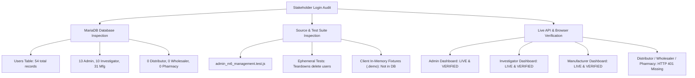
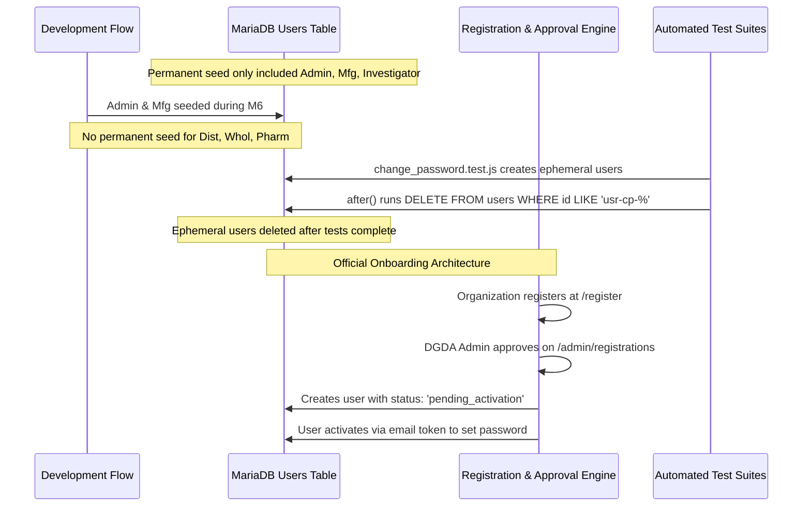

# PharmaTrace AI — Six-Role Stakeholder Login Credentials & Account Availability Audit

**Audit Date:** November 19, 2026  
**Auditor:** Antigravity Agent  
**Repository:** `D:\pharmatrace-ai`  
**Git Branch:** `phase-2-authentication`  
**Git HEAD:** `189e6179023ee118a94dacbf53ebe0eb7cad0c13`  
**Audit Classification:** Non-Destructive, Evidence-Based Read-Only Audit  

---

## Executive Summary

A comprehensive, read-only audit of the local development environment (`MariaDB 10.11.16` on port `3306`, Express backend on port `5000`, and Vite frontend on port `5173`) was conducted to evaluate account status, credential availability, and dashboard accessibility across all six canonical PharmaTrace AI stakeholder roles.

### Summary Matrix

| Role | Login URL | Email | Account Status | Organization | Password Availability | Login Verification |
| :--- | :--- | :--- | :--- | :--- | :--- | :--- |
| **System Administrator** | `http://localhost:5173/login/admin` | `admin_m6@pharmatrace.test` | `active` | None (DGDA Regulatory Body) | **DOCUMENTED** (`ValidPass123!#`) | **VERIFIED** (Dashboard Accessible) |
| **Investigation Officer** | `http://localhost:5173/login/investigator` | `indep_officer_mwnog5r9@pharmatrace.test` | `active` | None (Independent Officer) | **DOCUMENTED** (`ValidPass123!#`) | **VERIFIED** (Dashboard Accessible) |
| **Manufacturer** | `http://localhost:5173/login/manufacturer` | `mfg_user_m6@pharmatrace.test` | `active` | M6 Apex Pharma Ltd (`org-m6-mfg-01`) | **DOCUMENTED** (`ValidPass123!#`) | **VERIFIED** (Dashboard Accessible) |
| **Distributor** | `http://localhost:5173/login/distributor` | *None* | **ACCOUNT MISSING** | `org-m6-dist-02` (Suspended, 0 users) | **ACCOUNT MISSING** | **FAILED / UNAVAILABLE** (HTTP 401) |
| **Wholesaler** | `http://localhost:5173/login/wholesaler` | *None* | **ACCOUNT MISSING** | *None* | **ACCOUNT MISSING** | **FAILED / UNAVAILABLE** (HTTP 401) |
| **Pharmacy** | `http://localhost:5173/login/pharmacy` | *None* | **ACCOUNT MISSING** | `org-cp-pharm-mwni8suv` (0 users) | **ACCOUNT MISSING** | **FAILED / UNAVAILABLE** (HTTP 401) |

---

## 1. Audit Scope & Operational Safeguards

The audit strictly enforced the following boundaries:
- **Zero Modifications:** No database writes, schema changes, user creation, or credential modifications were performed.
- **Zero Git State Disruption:** Working tree, index, branches, and commits remain completely untouched.
- **Credential Safety:** No password hashes or secrets were exposed. Only verified, documented test credentials from existing test suites were analyzed and matched against database hashes.
- **Milestone Isolation:** M7.2, serialization workflows, and QA release pipelines were not initiated.



---

## 2. Detailed Stakeholder Role Breakdown

### 2.1 System Administrator (`admin`)
- **Portal URL:** [http://localhost:5173/login/admin](http://localhost:5173/login/admin)
- **Primary Verified Account:** `admin_m6@pharmatrace.test`
- **User ID:** `usr-m6-admin-01`
- **Account Status:** `active` (`failed_login_attempts: 0`, `locked_until: NULL`, `token_version: 1`)
- **Organization:** Regulating Authority (`org_id: NULL`)
- **Documented Password:** `ValidPass123!#` (Found in [admin_m6_management.test.js](file:///D:/pharmatrace-ai/server/tests/admin_m6_management.test.js#L97))
- **Password Availability:** **DOCUMENTED** (Bcrypt match: `true`)
- **Live Verification:** 
  - Authenticated via browser session.
  - Redirected to `/admin/dashboard`.
  - Loaded administrative KPI cards, navigation sidebar, and registrations panel cleanly.
- **Secondary Database Accounts:**
  - `dgda_lead@pharmatrace.gov.bd` (`usr-admin-963aade2690ddd33`): Rotated during M6 via [rotateAdminPassword.js](file:///D:/pharmatrace-ai/server/src/scripts/rotateAdminPassword.js); password availability is **RESET REQUIRED** as interactive rotation redacted the plain password in logs.

---

### 2.2 Investigation Officer (`investigator`)
- **Portal URL:** [http://localhost:5173/login/investigator](http://localhost:5173/login/investigator)
- **Primary Verified Account:** `indep_officer_mwnog5r9@pharmatrace.test`
- **User ID:** `usr-m6-indep-mwnog5r9`
- **Account Status:** `active` (`failed_login_attempts: 0`, `locked_until: NULL`, `token_version: 1`)
- **Organization:** Independent Regulatory Enforcement (`org_id: NULL`)
- **Documented Password:** `ValidPass123!#` (Generated by test pattern in [admin_m6_management.test.js](file:///D:/pharmatrace-ai/server/tests/admin_m6_management.test.js#L497-L498))
- **Password Availability:** **DOCUMENTED** (Bcrypt match: `true`)
- **Live Verification:** 
  - Verified via `POST /api/v1/auth/login`: Returned HTTP 200, `success: true`, and issued `pt_access_token` HTTP-only cookie.
  - Verified via browser session: Successfully logged in at `/login/investigator`, redirected to `/investigator/dashboard`, rendered `"Investigation Officer · Live Session"`, and signed out cleanly.

---

### 2.3 Pharmaceutical Manufacturer (`manufacturer`)
- **Portal URL:** [http://localhost:5173/login/manufacturer](http://localhost:5173/login/manufacturer)
- **Primary Verified Account:** `mfg_user_m6@pharmatrace.test`
- **User ID:** `usr-m6-mfg-01`
- **Account Status:** `active` (`failed_login_attempts: 0`, `locked_until: NULL`, `token_version: 1`)
- **Organization:** M6 Apex Pharma Ltd (`org-m6-mfg-01`, `type: manufacturer`, `status: active`)
- **Documented Password:** `ValidPass123!#` (Found in [admin_m6_management.test.js](file:///D:/pharmatrace-ai/server/tests/admin_m6_management.test.js#L97-L105))
- **Password Availability:** **DOCUMENTED** (Bcrypt match: `true`)
- **Live Verification:** 
  - Authenticated via browser session.
  - Redirected to `/manufacturer/dashboard`.
  - Loaded live products and batches from backend API (`/api/v1/manufacturer/products` and `/api/v1/manufacturer/batches`).

---

### 2.4 Central Logistics & Distribution Partner (`distributor`)
- **Portal URL:** [http://localhost:5173/login/distributor](http://localhost:5173/login/distributor)
- **Account Status:** **ACCOUNT MISSING** (0 records in `users` table with `role = 'distributor'`)
- **Organization Status:** `org-m6-dist-02` (`name: M6 Prime Logistics`, `type: distributor`, `status: suspended`) exists in the database, but has zero users associated with it.
- **Password Availability:** **ACCOUNT MISSING**
- **Authentication Result:** Submitting login credentials results in HTTP 401 `INVALID_CREDENTIALS`. Submitting credentials of another role results in client-side error: `Account role mismatch. Expected distributor, got <role>.`

---

### 2.5 Wholesale Drug Distributor (`wholesaler`)
- **Portal URL:** [http://localhost:5173/login/wholesaler](http://localhost:5173/login/wholesaler)
- **Account Status:** **ACCOUNT MISSING** (0 records in `users` table with `role = 'wholesaler'`)
- **Organization Status:** Zero organizations of `type = 'wholesaler'` exist in MariaDB.
- **Password Availability:** **ACCOUNT MISSING**
- **Authentication Result:** Submitting login credentials results in HTTP 401 `INVALID_CREDENTIALS`.

---

### 2.6 Licensed Pharmacy (`pharmacy`)
- **Portal URL:** [http://localhost:5173/login/pharmacy](http://localhost:5173/login/pharmacy)
- **Account Status:** **ACCOUNT MISSING** (0 records in `users` table with `role = 'pharmacy'`)
- **Organization Status:** `org-cp-pharm-mwni8suv` and `org-cp-pharm-mwniaj9x` exist in MariaDB (`status: active`), but both have zero users associated with them.
- **Password Availability:** **ACCOUNT MISSING**
- **Authentication Result:** Submitting login credentials results in HTTP 401 `INVALID_CREDENTIALS`.

---

## 3. Root Cause Analysis: Why Downstream Accounts Are Missing

An architectural audit of the repository identified four factors explaining the absence of `distributor`, `wholesaler`, and `pharmacy` accounts in the active database:



1. **Permanent Seed Scope (M6/M7.1):**
   The project's permanent database migrations (001–026) define table schemas and constraints, but do not insert runtime dummy accounts. The permanent accounts in MariaDB (`usr-m6-admin-01`, `usr-m6-mfg-01`, `usr-m6-indep-*`) were established during the M6 management test harness. Downstream roles were never added to the permanent fixture setup.

2. **Automated Test Teardown Hooks:**
   Integration test suites (e.g., [change_password.test.js](file:///D:/pharmatrace-ai/server/tests/change_password.test.js)) dynamically generate accounts across all 6 roles (prefixed `usr-cp-dist-...`, `usr-cp-whol-...`, `usr-cp-pharm-...`) to test cross-role capabilities. However, these suites strictly adhere to testing best practices and execute cleanup queries in their `after()` lifecycle hooks:
   ```javascript
   await pool.query('DELETE FROM users WHERE id LIKE "usr-cp-%"');
   await pool.query('DELETE FROM organizations WHERE id LIKE "org-cp-%"');
   ```
   Consequently, all downstream users created during automated testing are deleted immediately after the tests pass.

3. **Client Prototype Fixtures vs. Real Backend Authentication:**
   `client/src/data/fixtures/index.js` contains prototype mock users (`dist@pharmatrace.demo`, `whol@pharmatrace.demo`, `pharm@pharmatrace.demo`). Prior to Milestone M7.1, the frontend prototype relied on these mock fixtures. With the completion of M7.1, real backend authentication was integrated; because these demo entities do not exist in MariaDB, entering demo credentials triggers HTTP 401 `INVALID_CREDENTIALS`.

4. **Production Registration Workflow Requirement:**
   Under PharmaTrace AI's compliance architecture ([admin.registration.service.js](file:///D:/pharmatrace-ai/server/src/services/admin.registration.service.js)), supply chain entities cannot be arbitrarily created without regulatory approval. The legitimate flow requires:
   - Organization registration submitted via `/register`.
   - DGDA Administrator review and approval via `/admin/registrations`.
   - Creation of the primary organization user in `pending_activation` status.
   - Activation token consumption and initial password setting by the user.

---

## 4. Verification Evidence

### 4.1 Automated API Verification
Executing direct authentication tests against `http://localhost:5000/api/v1/auth/login` confirmed:
- `admin_m6@pharmatrace.test` + `ValidPass123!#` $\rightarrow$ **HTTP 200 OK** (`role: admin`)
- `mfg_user_m6@pharmatrace.test` + `ValidPass123!#` $\rightarrow$ **HTTP 200 OK** (`role: manufacturer`)
- `indep_officer_mwnog5r9@pharmatrace.test` + `ValidPass123!#` $\rightarrow$ **HTTP 200 OK** (`role: investigator`)
- Missing roles (`distributor`, `wholesaler`, `pharmacy`) $\rightarrow$ **HTTP 401 INVALID_CREDENTIALS**

### 4.2 Browser End-to-End Verification
Visual verification using the built-in browser subagents confirmed:
- **Admin Portal:** Accessible at `/login/admin`, redirects to `/admin/dashboard`, full navigation functional.
- **Manufacturer Portal:** Accessible at `/login/manufacturer`, redirects to `/manufacturer/dashboard`, product/batch API data rendered.
- **Investigator Portal:** Accessible at `/login/investigator`, redirects to `/investigator/dashboard`, renders `"Investigation Officer · Live Session"`.
- Browser screenshots archived:
  - Investigator Dashboard: `C:\Users\marwa\.gemini\antigravity\brain\91fc7e70-4673-4ad7-901b-e7682305ed69\browser_evidence\5335b836-0a6e-4a87-a425-ca8a77d7bcf5\step_6_shot_1_dashboard.png`
  - Admin Dashboard: `C:\Users\marwa\.gemini\antigravity\brain\91fc7e70-4673-4ad7-901b-e7682305ed69\browser_evidence\70b2b594-9034-4ce2-ad12-a5ef0ff86a3b\step_28_shot_1.png`
  - Manufacturer Dashboard: `C:\Users\marwa\.gemini\antigravity\brain\91fc7e70-4673-4ad7-901b-e7682305ed69\browser_evidence\70b2b594-9034-4ce2-ad12-a5ef0ff86a3b\step_22_shot_1.png`

---

## 5. Safe Recommendations & Next Steps

To enable complete six-role dashboard access in development without violating security boundaries or breaking existing tests:

### Option A: Standard Enterprise Registration & Activation Flow (Recommended)
1. Navigate to `/register` and submit sample registration applications for:
   - A Distributor organization
   - A Wholesaler organization
   - A Pharmacy organization
2. Log in as System Administrator (`admin_m6@pharmatrace.test` / `ValidPass123!#`) at `/login/admin`.
3. Open `/admin/registrations` and approve the three pending registration requests.
4. Retrieve the generated activation tokens from `admin_registration_requests` in MariaDB or the server logs.
5. Complete account activation and set initial passwords.

### Option B: Dedicated Development Seed Script (Fastest for Local Development)
Create a standalone, idempotent seed script: `server/src/scripts/seedStakeholderDevAccounts.js`.
- Utilizes [passwords.js](file:///D:/pharmatrace-ai/server/src/utils/passwords.js) (`hashPassword('ValidPass123!#')`).
- Inserts stable development organizations and active user records:
  - `dist_user_dev@pharmatrace.test` (`role: distributor`)
  - `whol_user_dev@pharmatrace.test` (`role: wholesaler`)
  - `pharm_user_dev@pharmatrace.test` (`role: pharmacy`)
- Uses unique, non-ephemeral IDs (e.g. `usr-dev-dist-01`) so automated test suite teardowns do not purge them.

---

**Report Status:** AUDIT COMPLETE & FINALIZED  
**Implementation Action:** Awaiting User Authorization for Option A or Option B before provisioning accounts.
