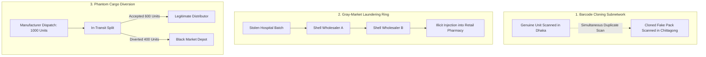

# PharmaTrace AI — AI Dataset Strategy, Graph Construction & Synthetic Fraud Generation

> [!NOTE]
> **DEVELOPMENT SCOPE & ATTRIBUTION NOTICE:**
> The dataset engineering, graph feature extraction pipelines, and synthetic generation methodologies detailed herein represent the research design spearheaded by the project's AI/ML engineer. The full-stack platform currently produces live relational transaction data in MariaDB that serves as the raw input corpus for this pipeline.

---

## 1. Relational-to-Graph ETL Pipeline

To train Graph Neural Networks (GNNs), relational database records stored in MariaDB must be extracted, transformed, and loaded (ETL) into heterogeneous graph tensors compatible with PyTorch Geometric (`torch_geometric.data.HeteroData`).

```mermaid
flowchart LR
    subgraph MariaDB["MariaDB 10.11 Relational Tables"]
        T1[organizations]
        T2[products & batches]
        T3[serialized_packages]
        T4[shipments & custody_events]
    end

    subgraph FeatureETL["Graph Extraction Pipeline (ai-service/etl/)"]
        Extractor[SQL Extraction Query]
        Normalizer[Feature Scaler & One-Hot Encoder]
        GraphAssembler[PyTorch Geometric HeteroData Builder]
    end

    subgraph GraphTensors["Graph Representation (torch_geometric)"]
        Nodes["Heterogeneous Nodes\n(org, batch, package)"]
        Edges["Temporal Edges\n(dispatches, receives, dispenses)"]
        Labels["Ground Truth / Synthetic Labels\n(y: 0 = Benign, 1 = Fraud)"]
    end

    MariaDB --> Extractor
    Extractor --> Normalizer
    Normalizer --> GraphAssembler
    GraphAssembler --> GraphTensors
```

---

## 2. Heterogeneous Entity & Feature Mapping

### 2.1 Node Feature Vectors ($\mathbf{X}_v$)

| Node Type | Source Tables | Dimensionality | Extracted Features |
| :--- | :--- | :---: | :--- |
| **Organization (`org`)** | `organizations`, `admin_audit_log` | $\mathbb{R}^{16}$ | Org category (one-hot), license age (days), total active products, historical compliance violation count, average shipment dispatch volume, geographic coordinate embeddings (latitude/longitude normalized). |
| **Batch (`batch`)** | `batches`, `products` | $\mathbb{R}^{12}$ | Batch target quantity, shelf-life duration (days), dosage formulation type (one-hot), QA release elapsed time, therapeutic drug category. |
| **Package (`package`)** | `serialized_packages`, `anomalies` | $\mathbb{R}^{8}$ | Packaging hierarchy level (unit/shipper/pallet), current custody tenure (hours), public scan frequency counter, previous quarantine flag indicator. |

### 2.2 Temporal Edge Feature Vectors ($\mathbf{e}_{uv}$)

| Edge Type | Source Tables | Features Extracted |
| :--- | :--- | :--- |
| `('org', 'dispatched', 'package')` | `shipments`, `shipment_items` | Dispatch UTC timestamp, manifested transport temperature mode, distance to recipient (km). |
| `('package', 'transferred_to', 'org')`| `custody_events` | Elapsed transit duration (hours), transit velocity ($\text{km/h}$), receiving disposition (`ACCEPT`, `REJECT`, `DAMAGED`). |
| `('org', 'dispensed', 'package')` | `custody_events`, `public_scans`| Dispense timestamp, verified at counter flag, consumer scan location distance. |

---

## 3. The Fraud Scarcity Challenge & Synthetic Generation

### 3.1 Class Imbalance in Supply Chain Surveillance
In compliant commercial distribution networks, fraudulent transactions account for less than $0.1\%$ of total volume. Training deep learning classifiers directly on raw data yields degenerate models that predict the majority class. Furthermore, real-world counterfeit seizure records are legally confidential and protected under regulatory non-disclosure.

### 3.2 Synthetic Topological Fraud Generator
To establish a rigorous, reproducible benchmark, the AI developer is designing a synthetic generator (`ai-service/generator/fraud_injector.py`) that executes rule-directed graph perturbations to model four distinct illicit supply-chain topologies:

1. **Topology A: Barcode Duplication / Cloning:** Injects high-frequency duplicate scans across spatially disconnected nodes within biologically or physically impossible timeframes.
2. **Topology B: Multi-Hop Shell Laundering:** Injects cyclic or high-hop subgraphs through temporary intermediary organizations created to obfuscate the originating diversion point.
3. **Topology C: Cargo Diversion & Shrinkage:** Induces edge volume variances where dispatched batch unit sets diverge from accepted intake unit sets.
4. **Topology D: Expired Re-Labeling:** Simulates altered batch expiry attributes paired with sudden re-activation of dormant serial series.

---

## 4. Dataset Partitioning Protocol

To avoid **temporal data leakage** (a pervasive flaw where models inadvertently learn from future transactions to predict past anomalies), data partitioning strictly follows a chronological forward split:

$$\mathcal{D}_{\text{train}} = \mathcal{G}(t_0 \to t_{\text{train}}), \quad \mathcal{D}_{\text{val}} = \mathcal{G}(t_{\text{train}} \to t_{\text{val}}), \quad \mathcal{D}_{\text{test}} = \mathcal{G}(t_{\text{val}} \to t_{\text{test}})$$

- **Train Split (70%):** Oldest continuous transaction window used for model training and edge representation learning.
- **Validation Split (15%):** Intermediate window used for hyperparameter tuning and early stopping.
- **Test Split (15%):** Most recent chronological window reserved strictly for final out-of-sample evaluation.

---

## 5. Related Documentation
- [AI Research Methodology](research-methodology.md): Theoretical formulation.
- [Proposed GNN Model Architecture](model-architecture.md): Graph neural network models.
- [FastAPI Microservice Integration](fastapi-integration.md): Inter-service serving.
