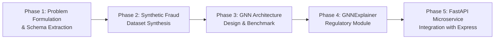

# PharmaTrace AI — AI/ML Research Methodology & Problem Formulation

> [!NOTE]
> **DEVELOPMENT SCOPE & ATTRIBUTION NOTICE:**
> The advanced AI/ML research and model implementation described in this document is being conducted separately by the dedicated AI/ML engineer on the team. This document defines the theoretical formulation, research hypotheses, literature context, and evaluation methodology establishing the foundation for the `ai-service/` module. The core full-stack platform (M1–M9) operates autonomously via deterministic heuristic screening.

---

## 1. Problem Formulation: Pharmaceutical Supply Chains as Fraud Graphs

Pharmaceutical supply networks are inherently structured as large, heterogeneous, directed, time-evolving multigraphs. Traditional relational database queries and rule-based heuristic screeners excel at detecting local, pairwise violations (such as scanning a single barcode twice), but fail to detect sophisticated fraud syndicates that execute topological obfuscation:

```
Nodes (V): Organizations (O), Batches (B), Unit Packages (P), Locations (L)
Edges (E): ManufacturedBy, DispatchedTo, ReceivedBy, DispensedAt, ReportedBy
Attributes (X): Geographical distance, transit elapsed time, package velocity, historical compliance scores
```

### Mathematical Graph Definition
We define the supply chain network as a continuous-time heterogeneous multigraph:

$$\mathcal{G}(t) = \left( \mathcal{V}, \mathcal{E}, \mathcal{T}, \mathcal{R}, \mathbf{X}_v, \mathbf{e}_{uv}(t) \right)$$

where:
- $\mathcal{V} = \mathcal{V}_{\text{org}} \cup \mathcal{V}_{\text{batch}} \cup \mathcal{V}_{\text{package}}$ represents the heterogeneous node set.
- $\mathcal{E}$ represents directed custody transfer and interaction edges.
- $\mathcal{R}$ denotes relation types (e.g., `CUSTODY_TRANSFER`, `QA_RELEASE`, `DISPENSE`).
- $\mathbf{X}_v \in \mathbb{R}^{d_v}$ denotes static and dynamic node feature vectors.
- $\mathbf{e}_{uv}(t) \in \mathbb{R}^{d_e}$ denotes temporal edge feature vectors at interaction timestamp $t$.

The core research objective is **Inductive Graph Anomaly Detection (GAD)**: Given a subgraph $\mathcal{G}_{\text{sub}} \subset \mathcal{G}(t)$ surrounding a package or transaction, predict the probability $P(\text{Anomaly} \mid \mathcal{G}_{\text{sub}})$ that the transaction represents counterfeit cloning, gray-market laundering, or unauthorized diversion.

---

## 2. Research Hypotheses

1. **Hypothesis 1 (Topological Superiority):** Graph representation learning models (specifically Heterogeneous Graph Attention Networks) will achieve significantly higher detection recall on multi-hop diversion rings compared to fixed-threshold deterministic heuristic rules.
2. **Hypothesis 2 (Temporal Edge Dynamics):** Incorporating edge timestamps and calculated velocity vectors into continuous-time dynamic graph embeddings will reduce false-positive anomaly alerts arising from benign logistics delays (e.g., weather or traffic congestion).
3. **Hypothesis 3 (Explainability & Admissibility):** Graph explanation algorithms (such as GNNExplainer or SubgraphX) can extract minimal, human-interpretable subgraph motifs that satisfy regulatory evidentiary standards for DGDA enforcement case dossiers.

---

## 3. Literature Review & Theoretical Foundations

Our research builds upon recent advancements in graph anomaly detection and temporal representation learning:

1. **Heterogeneous Graph Neural Networks:**
   - *Wang et al. (2019), "Heterogeneous Graph Attention Network" (HAN):* Employs node-level and semantic-level attention mechanisms over user-defined metapaths (e.g., Manufacturer $\to$ Batch $\to$ Package $\to$ Distributor), capturing diverse semantic relations.
2. **Temporal Graph Networks:**
   - *Rossi et al. (2020), "Temporal Graph Networks for Deep Learning on Dynamic Graphs" (TGN):* Maintains dynamic node memory states updated asynchronously upon each edge event, highly suitable for streaming custody scans.
3. **Graph Anomaly Detection in Supply Chains:**
   - *Liu et al. (2021), "Anomaly Detection on Attributed Networks via Contrastive Learning":* Identifies topological and attribute outliers in sparse transaction networks without requiring vast quantities of labeled fraud data.

---

## 4. Research Roadmap & Milestone Integration



- **Phase 1 (Completed):** MariaDB relational schema mapped to graph entities; graph extraction queries defined.
- **Phase 2 (In Development):** Synthetic injection of complex fraud topologies (cyclic laundering, phantom split shipments).
- **Phase 3 (Planned):** Implementation of baseline models (Isolation Forest, GCN, GATv2, HAN) in PyTorch Geometric.
- **Phase 4 (Planned):** Subgraph explanation extraction for investigator case files.
- **Phase 5 (Planned):** Packaging the trained model inside the `ai-service/` FastAPI container.

---

## 5. Related Documentation
- [Dataset Strategy & Synthetic Fraud Synthesis](dataset-strategy.md)
- [Proposed GNN Model Architecture](model-architecture.md)
- [FastAPI Microservice Integration](fastapi-integration.md)
- [Deterministic Anomaly Screener Baseline](../workflows/anomaly-detection.md)
