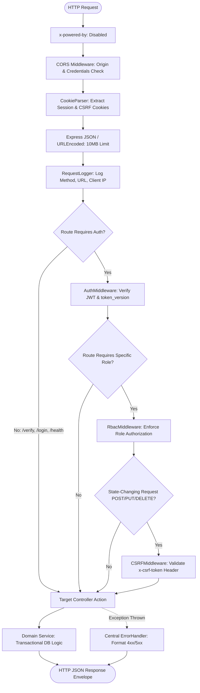

# PharmaTrace AI — Backend Architecture & Service Engineering

This document outlines the architectural patterns, service-controller modularization, middleware pipeline, database connection management, and error handling contracts implemented in the PharmaTrace AI Node.js/Express backend.

---

## 1. Runtime Environment & Technology Stack

- **Runtime:** Node.js `v24.18.0` LTS (verified baseline runtime environment; Node 26 is supported as an alternative after compatibility testing; Node 20 is EOL and not recommended; consult the [Node.js Previous Releases Schedule](https://nodejs.org/en/about/previous-releases))
- **Module System:** ECMAScript Modules (`"type": "module"` in `package.json`)
- **HTTP Framework:** Express 4.21.2 (`express: ^4.21.2`)
- **Database Driver:** `mysql2` 3.12.0 (`mysql2: ^3.12.0`, connecting to MariaDB 10.11.16 LTS)
- **Security & Cryptography:** `bcrypt` 6.0.0 (native C++ bindings, cost factor 12), `jsonwebtoken` 9.0.3, `cookie-parser` 1.4.7, `cors` 2.8.5
- **Rate Limiting:** `express-rate-limit` 8.7.4
- **Testing Engine:** Built-in Node.js Test Runner (`node --test`) with `--env-file`

---

## 2. Layered Service-Controller Architecture

The backend follows a strict separation of concerns, ensuring that routing, request validation, business transactions, and persistence operations are cleanly isolated:

```
server/src/
├── app.js                      # Express application assembly & global middleware mounting
├── server.js                   # HTTP server startup, port binding (5000), & graceful shutdown
├── config/                     # Configuration loaders
│   ├── env.js                  # Typed environment variable loader & test safety guards
│   └── database.js             # MariaDB connection pool & connection lifecycle handlers (mysql2)
├── middleware/                 # Cross-cutting HTTP filters
│   ├── auth.js                 # JWT verification & token_version session validation
│   ├── rbac.js                 # Role-Based Access Control gatekeeper
│   ├── csrf.js                 # Double-submit cookie CSRF validation (x-csrf-token)
│   ├── cors.js                 # Dynamic CORS whitelist validator
│   ├── requestLogger.js        # Structured HTTP request access logger
│   ├── errorHandler.js         # Centralized error serialization envelope
│   └── notFoundHandler.js      # 404 handler for unmatched routes
├── routes/                     # Domain router definitions (REST endpoints)
│   ├── index.js                # Root router mounting /v1/ subpaths
│   ├── auth.routes.js          # Authentication, password changes, session check
│   ├── admin.*.routes.js       # Governance, organization reviews, user resets
│   ├── manufacturer.*.routes.js# Medicines, batches, GS1 serialization
│   ├── shipment.routes.js      # Multi-echelon custody dispatch & intake
│   ├── verification.routes.js  # Public consumer QR verification
│   └── investigator.routes.js  # Anomaly detection feeds, case dossiers, evidence
├── controllers/                # Request parsing, HTTP status codes, envelope formatting
│   ├── auth.controller.js
│   ├── admin.controller.js
│   ├── manufacturer.controller.js
│   ├── shipment.controller.js
│   ├── verification.controller.js
│   └── investigator.controller.js
├── services/                   # Encapsulated transactional business logic
│   ├── auth.service.js         # Native bcrypt hashing, JWT issuance, token_version checks
│   ├── registration.service.js # Dossier storage & capacity governance
│   ├── serialization.service.js# GS1 DataMatrix algorithm & package allocation
│   ├── custody.service.js      # Multi-echelon custody handoffs & inventory updates
│   ├── verification.service.js # Public scan timeline collation
│   ├── investigator.service.js # 5 deterministic anomaly rules & case files
│   └── audit.service.js        # Platform-wide security audit logging
├── utils/
│   ├── passwords.js            # Native bcrypt cost-12 hashing & constant-time comparison
│   ├── tokens.js               # Cryptographic SHA-256 token hashing
│   └── logger.js               # Structured application logging
└── database/                   # Database schema & migrations
    ├── pool.js                 # Reusable mysql2 connection pool instance
    ├── migrate.js              # Migration CLI execution entry point
    ├── migrator.js             # 28-migration runner and test isolation harness
    └── migrations/             # 28 numbered forward SQL migrations (001_... to 028_...)
```

---

## 3. Middleware Execution Pipeline

Every incoming HTTP request traverses an ordered pipeline of security, parsing, and context-enrichment middleware before reaching route handlers:



---

## 4. Transaction Management & Database Pool Safety

To guarantee atomicity and prevent orphaned records during multi-step supply-chain custody handoffs, all write operations execute within strict database transaction boundaries:

```javascript
// Pattern: Robust Transactional Execution in Services
import { getPool } from '../config/database.js';

export async function executeCustodyTransfer(shipmentRef, receivingOrgId, receivedSerials) {
  const pool = getPool();
  const conn = await pool.getConnection();
  try {
    // 1. Begin atomic transaction
    await conn.beginTransaction();

    // 2. Lock shipment row for update
    const [shipments] = await conn.execute(
      'SELECT id, ref, status, from_org_id, to_org_id FROM shipments WHERE ref = ? FOR UPDATE',
      [shipmentRef]
    );

    if (shipments.length === 0 || shipments[0].to_org_id !== receivingOrgId) {
      throw new Error('INVALID_SHIPMENT_RECIPIENT');
    }

    // 3. Update shipment state
    await conn.execute(
      'UPDATE shipments SET status = ?, received_at = CURRENT_TIMESTAMP WHERE ref = ?',
      ['delivered', shipmentRef]
    );

    // 4. Update individual serialized packages & insert traceability records
    for (const serial of receivedSerials) {
      await conn.execute(
        'UPDATE packages SET custodian_org_id = ?, status = ? WHERE serial = ?',
        [receivingOrgId, 'available', serial]
      );
      await conn.execute(
        'INSERT INTO traceability_events (serial, actor_org_id, target_org_id, event_type) VALUES (?, ?, ?, ?)',
        [serial, shipments[0].from_org_id, receivingOrgId, 'RECEIVED']
      );
    }

    // 5. Commit atomic transaction
    await conn.commit();
    return { success: true, count: receivedSerials.length };
  } catch (error) {
    // 6. Automatic rollback on any failure
    await conn.rollback();
    throw error;
  } finally {
    // 7. Always release connection back to pool
    conn.release();
  }
}
```

---

## 5. Standardized JSON Response & Error Envelopes

The backend enforces uniform JSON envelopes for both successful responses and error states, eliminating ambiguous payloads:

### Success Envelope
```json
{
  "success": true,
  "data": {
    "shipmentRef": "SHP-2026-0089",
    "status": "delivered",
    "receivedItemsCount": 20
  },
  "timestamp": "2026-11-21T17:00:00.000Z"
}
```

### Error Envelope
```json
{
  "success": false,
  "error": {
    "code": "FORBIDDEN_ROLE",
    "message": "Access denied: User role 'pharmacy' lacks required permission 'admin:read'.",
    "details": null
  },
  "timestamp": "2026-11-21T17:00:00.000Z"
}
```

---

## 6. Security Standards in Application Code

1. **SQL Injection Defense:** All database queries utilize parameterized prepared statements (`conn.execute(sql, [param1, param2])`). String concatenation or template literal query interpolation is strictly prohibited throughout the codebase.
2. **Native Bcrypt Hashing with Constant-Time Comparison:** Passwords are never stored in plaintext. Passwords are hashed using native `bcrypt` (`^6.0.0`) with cost factor 12 (`BCRYPT_SALT_ROUNDS = 12`). To prevent user enumeration via timing attacks, when an account is not found, the system compares against a precomputed, cached cost-12 dummy hash (`compareConstantTime`).
3. **Double-Submit CSRF Protection:** State-changing API calls (`POST`, `PUT`, `PATCH`, `DELETE`) require an `x-csrf-token` HTTP header matching the cryptographically signed `pt_csrf_token` cookie.
4. **Session Revocation via `token_version`:** Each user record includes an integer `token_version`. Changing a user's password or clicking "Sign out all devices" increments this counter in MariaDB, instantly invalidating all active JWTs issued under earlier token versions.

---

## 7. Related Documentation
- [System Architecture Guide](system-architecture.md): Overall multi-tier system topology.
- [Database Architecture Guide](database-architecture.md): Relational tables, triggers, and dual-account security.
- [API Overview Guide](../api/api-overview.md): Comprehensive REST endpoint catalog.
- [Security Architecture Guide](../security/security-architecture.md): Cryptographic algorithms and session lifecycles.
