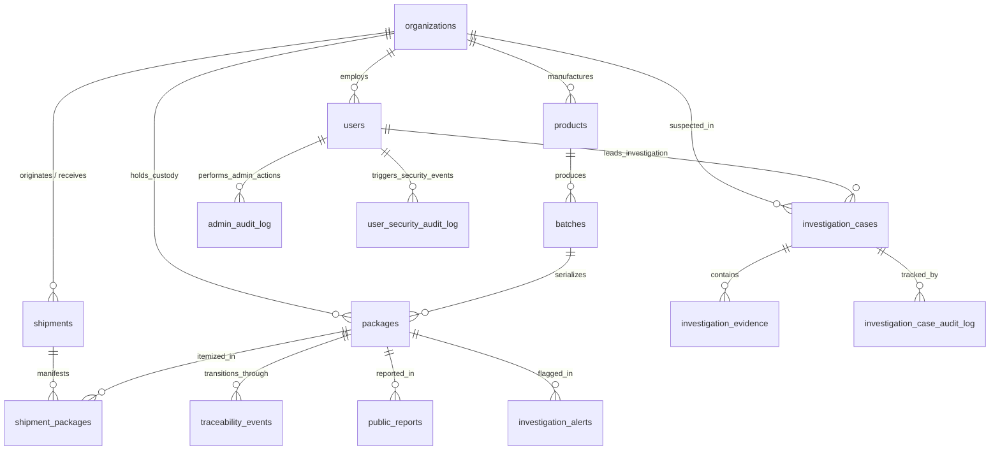
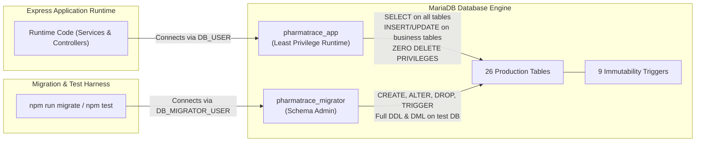

# PharmaTrace AI — Database Architecture, Schema & Immutability

This document provides a comprehensive technical reference for the MariaDB relational database architecture, the 26 normalized core tables, the 28 forward SQL migrations, the dual-account security model, and the 9 engine-level immutability triggers enforcing zero-tamper audit logs.

---

## 1. Relational Engine & Database Specifications

- **Database Engine:** MariaDB 10.11.16 LTS (`InnoDB` Storage Engine, UTF8MB4 charset, `utf8mb4_unicode_ci` collation)
- **Host & Default Port:** `127.0.0.1:3306`
- **Development Database:** `pharmatrace_ai`
- **Automated Test Database:** `pharmatrace_ai_test`
- **Database Driver:** `mysql2` (`^3.12.0` with connection pooling, max 20 connections, acquire timeout 10,000 ms).

---

## 2. Entity-Relationship Schema Architecture

The database comprises **26 normalized tables** structured into functional domains:



### Table Domain Classification

| Domain | Table Name | Purpose & Primary Keys | Key Foreign Keys & Constraints |
| :--- | :--- | :--- | :--- |
| **Identity & Tenancy** | `organizations` | Registered supply-chain organizations & license statuses. | `id` (PK), `license_no` (UNIQUE), `status` (pending, active, suspended). |
| | `users` | User accounts, hashed passwords, roles, token versions. | `id` (PK), `org_id` (FK $\to$ `organizations.id`), `email` (UNIQUE), `role`. |
| | `category_policies` | Enforces license quotas, category tiers, and packaging caps. | `category` (PK), `max_batch_volume`, `max_skus_allowed`. |
| | `organization_registrations`| Self-service organization registration applications. | `id` (PK), `tracking_code` (UNIQUE), `status` (SUBMITTED, UNDER_REVIEW, APPROVED).|
| | `registration_documents`| Uploaded licensing PDF/image dossiers. | `id` (PK), `registration_id` (FK $\to$ `organization_registrations.id`), `file_hash`. |
| | `registration_access_tokens`| Secure tokens for registration application tracking. | `id` (PK), `registration_id` (FK), `token_hash` (UNIQUE). |
| | `registration_submissions`| Multi-stage registration submission payloads. | `id` (PK), `registration_id` (FK), `submission_data`. |
| | `registration_audit_log`| Regulatory review comments and status transition audit. | `id` (PK), `registration_id` (FK), `actor_user_id` (FK). |
| | `activation_tokens` | Single-use user activation tokens. | `id` (PK), `user_id` (FK $\to$ `users.id`), `token_hash`. |
| **Product & Production**| `products` | Master medicine catalog (GTIN-14, formulation, dosage).| `id` (PK), `org_id` (FK), `gtin` (UNIQUE 14-char GS1 identifier). |
| | `batches` | Production batches, expiry dates, QA release signatures. | `id` (PK), `product_id` (FK $\to$ `products.id`), `batch_no` (UNIQUE per product).|
| | `packages` | Item-level cartons with GS1 DataMatrix serials. | `id` (PK), `batch_id` (FK $\to$ `batches.id`), `serial` (UNIQUE), `custodian_org_id`.|
| **Logistics & Custody** | `shipments` | Multi-echelon shipment manifests and dispatch states. | `id` (PK), `ref` (UNIQUE), `from_org_id` (FK), `to_org_id` (FK), `status`. |
| | `shipment_packages` | Many-to-many junction binding packages to manifests. | `shipment_ref` (FK), `package_serial` (FK), `disposition_status` (accepted, missing, damaged, rejected).|
| | `traceability_events` | Chronological custody handoff event ledger. | `id` (PK), `serial` (FK), `actor_org_id` (FK), `target_org_id` (FK), `event_type`. |
| | `government_allocations`| Regulatory government quotas and allocations. | `id` (PK), `allocation_ref` (UNIQUE), `status`. |
| | `government_allocation_documents`| Associated regulatory quota certificates. | `id` (PK), `allocation_id` (FK). |
| **Public Transparency** | `public_reports` | Consumer fraud, adverse reaction, or counterfeit reports. | `id` (PK), `report_number` (UNIQUE), `package_serial` (FK), `status`. |
| | `public_report_attachments`| Consumer photographic evidence of packaging. | `id` (PK), `report_id` (FK $\to$ `public_reports.id`). |
| **Surveillance & Cases** | `investigation_alerts` | Detected anomalies (duplicate scans, broken custody). | `id` (PK), `package_serial` (FK), `alert_type`, `severity` (CRITICAL, HIGH, MEDIUM). |
| | `investigation_cases` | Formal regulatory case dossiers. | `id` (PK), `case_number` (UNIQUE `INV-YYYY-XXXX`), `assigned_officer_id` (FK).|
| | `investigation_evidence`| Attached physical or digital exhibits in case dossiers. | `id` (PK), `case_id` (FK $\to$ `investigation_cases.id`), `source_ref`. |
| | `investigation_case_audit_log`| Append-only event history for each case file. | `id` (PK), `case_id` (FK), `action`, `actor_user_id` (FK), `timestamp`. |
| **Governance & Security**| `admin_audit_log` | Immutable platform administrative activity logs. | `id` (PK), `admin_id` (FK $\to$ `users.id`), `action`, `target_entity`, `timestamp`.|
| | `user_security_audit_log`| Auth events: logins, failures, lockouts, token resets. | `id` (PK), `user_id` (FK), `event_type`, `ip_address`, `timestamp`. |
| | `schema_migrations` | Forward migration execution tracker. | `version` (PK), `applied_at`, `checksum`. |

---

## 3. Immutability Architecture & 9 Database Triggers

Regulatory compliance mandates that once an audit entry, security event, or legal evidence exhibit is recorded, it must never be modified or erased—even by database administrators. PharmaTrace AI enforces this invariant via **9 MariaDB engine-level triggers**:

```sql
-- Pattern: Immutability Enforcement Triggers in MariaDB
DELIMITER $$

-- 1. Prevent UPDATE on admin_audit_log
CREATE TRIGGER trg_admin_audit_log_prevent_update
BEFORE UPDATE ON admin_audit_log
FOR EACH ROW
BEGIN
    SIGNAL SQLSTATE '45000'
    SET MESSAGE_TEXT = 'SECURITY ERROR: admin_audit_log is append-only. Updates are prohibited.';
END$$

-- 2. Prevent DELETE on admin_audit_log
CREATE TRIGGER trg_admin_audit_log_prevent_delete
BEFORE DELETE ON admin_audit_log
FOR EACH ROW
BEGIN
    SIGNAL SQLSTATE '45000'
    SET MESSAGE_TEXT = 'SECURITY ERROR: admin_audit_log is append-only. Deletions are prohibited.';
END$$

-- 3. Prevent UPDATE on user_security_audit_log
CREATE TRIGGER trg_user_security_audit_log_prevent_update
BEFORE UPDATE ON user_security_audit_log
FOR EACH ROW
BEGIN
    SIGNAL SQLSTATE '45000'
    SET MESSAGE_TEXT = 'SECURITY ERROR: user_security_audit_log is append-only. Updates are prohibited.';
END$$

-- 4. Prevent DELETE on user_security_audit_log
CREATE TRIGGER trg_user_security_audit_log_prevent_delete
BEFORE DELETE ON user_security_audit_log
FOR EACH ROW
BEGIN
    SIGNAL SQLSTATE '45000'
    SET MESSAGE_TEXT = 'SECURITY ERROR: user_security_audit_log is append-only. Deletions are prohibited.';
END$$

-- 5. Prevent UPDATE on investigation_evidence
CREATE TRIGGER trg_investigation_evidence_prevent_update
BEFORE UPDATE ON investigation_evidence
FOR EACH ROW
BEGIN
    SIGNAL SQLSTATE '45000'
    SET MESSAGE_TEXT = 'SECURITY ERROR: investigation_evidence exhibits are immutable. Updates are prohibited.';
END$$

-- 6. Prevent DELETE on investigation_evidence
CREATE TRIGGER trg_investigation_evidence_prevent_delete
BEFORE DELETE ON investigation_evidence
FOR EACH ROW
BEGIN
    SIGNAL SQLSTATE '45000'
    SET MESSAGE_TEXT = 'SECURITY ERROR: investigation_evidence exhibits cannot be expunged. Deletions are prohibited.';
END$$

-- 7. Prevent UPDATE on investigation_case_audit_log
CREATE TRIGGER trg_investigation_case_audit_log_prevent_update
BEFORE UPDATE ON investigation_case_audit_log
FOR EACH ROW
BEGIN
    SIGNAL SQLSTATE '45000'
    SET MESSAGE_TEXT = 'SECURITY ERROR: investigation_case_audit_log is append-only. Updates are prohibited.';
END$$

-- 8. Prevent DELETE on investigation_case_audit_log
CREATE TRIGGER trg_investigation_case_audit_log_prevent_delete
BEFORE DELETE ON investigation_case_audit_log
FOR EACH ROW
BEGIN
    SIGNAL SQLSTATE '45000'
    SET MESSAGE_TEXT = 'SECURITY ERROR: investigation_case_audit_log is append-only. Deletions are prohibited.';
END$$

-- 9. Protect permanent chain-of-custody event records in traceability_events

DELIMITER ;
```

---

## 4. Dual-Account Least-Privilege Security Model

To defend against SQL injection attacks and accidental data corruption, application runtime operations are isolated from schema migration tasks using two distinct database user accounts:



---

## 5. Forward Migration Chronology (Migrations 001–028)

All schema changes are tracked in `server/src/database/migrations/` and executed sequentially by the migration runner (`server/src/database/migrator.js`):

1. `001_create_schema_migrations.sql`: Establishes migration ledger table.
2. `002_create_category_policies.sql`: Establishes category policy constraints and batch quotas.
3. `003_create_organizations.sql`: Primary organization registry and license validation.
4. `004_create_users.sql`: Stakeholder user accounts, roles, and password hash storage.
5. `005_add_org_verification_fk.sql`: Foreign key links between organizations and verification metadata.
6. `006_create_organization_registrations.sql`: Onboarding registration submissions table.
7. `007_create_registration_documents.sql`: Uploaded PDF and image licensing exhibits.
8. `008_create_registration_access_tokens.sql`: Secure tracking access tokens for applicants.
9. `009_create_activation_tokens.sql`: One-time password setup and activation tokens.
10. `010_create_registration_submissions.sql`: Structured multi-step registration payload records.
11. `011_create_registration_audit_log.sql`: Regulatory review audit log for onboarding.
12. `012_create_products.sql`: Master medicine catalog table.
13. `013_create_batches.sql`: Manufacturing batch records and QA release statuses.
14. `014_create_government_allocations.sql`: Government drug allocation quotas and institutions.
15. `015_create_government_allocation_documents.sql`: Supporting documentation for government drug quotas.
16. `016_create_packages.sql`: Serialized package cartons with GS1 DataMatrix identifiers.
17. `017_create_shipments_and_packages.sql`: Shipping manifests and package-to-shipment junction table.
18. `018_create_traceability_events.sql`: Serialized chain-of-custody transfer event ledger.
19. `019_create_investigation_alerts.sql`: Anomaly detection alert records and triage states.
20. `020_create_public_reports_and_attachments.sql`: Public consumer fraud reports and packaging photos.
21. `021_seed_category_policies.sql`: Default capacity limits for manufacturers, distributors, pharmacies.
22. `022_add_user_security_columns.sql`: Failed login counters, account lockouts, `token_version`.
23. `023_create_admin_audit_log.sql`: Dedicated platform administrative action audit table.
24. `024_enforce_admin_audit_log_immutability.sql`: Engine triggers preventing UPDATE and DELETE on admin log.
25. `025_create_user_security_audit_log.sql`: Dedicated authentication and access security audit table.
26. `026_add_gtin_to_products.sql`: Enforces unique 14-digit GS1 GTIN constraints on medicine products.
27. `027_create_investigation_cases_and_evidence.sql`: Formal regulatory case files and evidence exhibits.
28. `028_protect_investigation_cases_and_evidence.sql`: Immutability triggers protecting legal evidence exhibits.

---

## 6. Test Database Isolation Strategy

To ensure zero cross-test interference and protect development data from test artifacts:
- Automated tests execute exclusively against `pharmatrace_ai_test` via `.env.test`.
- Hard safety guards in `server/src/config/env.js`, `server/src/config/database.js`, and `server/src/database/migrator.js` unconditionally throw `FATAL_TEST_SAFETY_VIOLATION` if tests ever attempt to connect to `pharmatrace_ai`.
- Tests run against genuine MariaDB SQL engines via the built-in Node.js test runner (`node --test`), exercising real triggers and constraints.

---

## 7. Related Documentation
- [System Architecture Guide](system-architecture.md): High-level system overview.
- [Security Architecture Guide](../security/security-architecture.md): Least-privilege and immutability details.
- [Testing & Quality Assurance Guide](../testing/testing-and-quality-assurance.md): Test runner configuration and database teardown.
