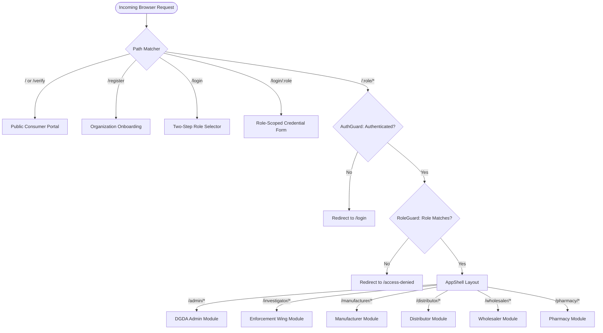

# PharmaTrace AI — Frontend Client Architecture & Design System

This document outlines the architectural patterns, state management strategies, design system principles, and build pipelines implemented in the PharmaTrace AI web client.

---

## 1. Technical Stack & Build Pipeline

- **Core Framework:** React 18.3.1 (`react`, `react-dom`)
- **Build Tooling:** Vite 5.3.1 with `@vitejs/plugin-react`
- **Routing:** React Router DOM 6.26.0 (`react-router-dom`)
- **Styling & Design System:** Tailwind CSS 3.4.4, Autoprefixer, PostCSS
- **Barcode & Label Generation:** `bwip-js` 4.11.4 (pure JavaScript/WASM GS1 DataMatrix rendering)
- **Icons & Visuals:** `lucide-react` 0.383.0
- **Camera Scanning:** `html5-qrcode` 2.3.8
- **Data Charts:** `recharts` 2.12.7

### Production Bundle Profile
During Milestone 9 verification and audit, the production JavaScript bundle compiled under Vite was profiled:
- **Total Uncompressed Size:** ~2,116 KB
- **Gzip Compressed Size:** ~566 KB
- **Primary Contributor:** `bwip-js` (~864 KB uncompressed) encapsulates complete GS1 DataMatrix matrix algorithms, Reed-Solomon error correction tables, and vector font glyphs, enabling browser-native label printing without external graphic generation services.

---

## 2. Directory Structure & Modular Decomposition

The frontend code resides in `client/src/` organized into domain-driven feature modules and shared infrastructural primitives:

```
client/src/
├── app/
│   ├── App.jsx                 # Root component with Context Providers
│   └── router.jsx              # React Router 6 route definitions & mapping
├── components/                 # Reusable UI primitives
│   ├── AppShell.jsx            # Multi-stakeholder application layout shell
│   ├── RoleGuard.jsx           # Client-side RBAC route protection
│   ├── AuthGuard.jsx           # Authentication enforcement wrapper
│   ├── Toast.jsx               # Floating asynchronous feedback alerts
│   ├── Modal.jsx               # Accessible dialog container
│   ├── BarcodeScanner.jsx      # HTML5 video camera barcode intake scanner
│   └── DataMatrixLabel.jsx     # High-resolution GS1 label renderer
├── contexts/
│   ├── AuthContext.jsx         # Central identity, role, and session state
│   ├── NotificationContext.jsx # Toast and alert dispatching state
│   └── ThemeContext.jsx        # Visual theme configuration
├── constants/
│   ├── navigation.js           # Stakeholder role navigation manifests
│   └── apiRoutes.js            # Centralized API endpoint URI constants
├── features/                   # Domain-driven stakeholder feature modules
│   ├── admin/                  # DGDA Administrator screens & drawers
│   ├── authentication/         # Two-step login, forgot password, logout
│   ├── distributor/            # Central logistics intake, warehouse, dispatch
│   ├── investigator/           # Surveillance feeds, anomaly triage, case dossiers
│   ├── manufacturer/           # Product registry, batch QA, GS1 serialization
│   ├── pharmacy/               # Dispensary inventory, intake, dispensing verification
│   ├── public-verification/    # Open consumer verification journey & reporting
│   ├── registration/           # Public organization onboarding & license upload
│   └── wholesaler/             # Regional depot intake, custody holding, distribution
├── services/
│   ├── api.js                  # Axios HTTP client with CSRF & credential injection
│   ├── auth.service.js         # Authentication API calls
│   └── ...                     # Domain-specific API service adapters
├── index.css                   # Tailwind CSS imports and utility layer rules
└── main.jsx                    # React 18 DOM entry mount
```

---

## 3. Router Architecture & Route Protection

Routing is governed by `client/src/app/router.jsx` leveraging React Router 6's `createBrowserRouter`. All authenticated routes are nested beneath the common `AppShell` layout component, which enforces unified styling, responsive sidebars, header session controls, and breadcrumbs.



### Route Guard Implementation
1. **`AuthGuard`:** Validates that `auth.user` is defined. If the user session is expired or uninitialized, the guard saves the attempted target location in React Router state and redirects immediately to `/login`.
2. **`RoleGuard`:** Accepts an array of allowed roles (`allowedRoles={['admin']}`). If the authenticated user's role does not match, navigation is halted and the user is redirected to `/access-denied` (see screenshot `19-security-cross-role-access-denied.png`).

---

## 4. State Management Strategy

PharmaTrace AI favors a lightweight, predictable state architecture combining React Context for cross-cutting global concerns and local component state for domain views:

1. **Authentication Context (`AuthContext`):**
   - Manages `user`, `role`, `organization`, and `isAuthenticated` status.
   - On application mount, executes an un-cached `GET /api/v1/auth/me` to hydrate session state from HttpOnly cookies (`pt_access_token`).
   - Exposes asynchronous actions: `login(role, email, password)`, `logout()`, `changePassword(currentPassword, newPassword)`.
2. **Notification Context (`NotificationContext`):**
   - Provides a global toast notification dispatcher (`notify.success()`, `notify.error()`, `notify.info()`, `notify.warning()`).
   - Automatically cleans up toasts after a 5-second countdown with pause-on-hover semantics.
3. **Form & View State:**
   - Managed via standard React controlled inputs with strict real-time schema validation before dispatching HTTP payloads.

---

## 5. API Client & Security Injection Layer

All client HTTP requests flow through `client/src/services/api.js`, configured for zero-trust environments:

```javascript
// client/src/services/api.js (Pattern Illustration)
import axios from 'axios';

const api = axios.create({
  baseURL: '/api/v1',
  withCredentials: true, // Guarantees HttpOnly JWT cookie transmission
  headers: {
    'Content-Type': 'application/json',
  },
});

// Request Interceptor: Injects Double-Submit CSRF Token
api.interceptors.request.use((config) => {
  const csrfToken = getCookieValue('pt_csrf_token');
  if (csrfToken && ['post', 'put', 'patch', 'delete'].includes(config.method.toLowerCase())) {
    config.headers['x-csrf-token'] = csrfToken;
  }
  return config;
});

// Response Interceptor: Centralized Error Normalization & Session Expiry
api.interceptors.response.use(
  (response) => response.data,
  (error) => {
    if (error.response?.status === 401 && window.location.pathname !== '/login') {
      window.location.href = '/login?session_expired=1';
    }
    return Promise.reject(error.response?.data || error.message);
  }
);
```

---

## 6. Design System & Accessibility

The user interface adheres to a clinical design system implemented with Tailwind CSS:
- **Color Palette:**
  - **Primary (DGDA Regulatory Navy):** `#0F172A` (Slate 900), `#1E293B` (Slate 800)
  - **Accent (Clinical Emerald):** `#059669` (Emerald 600), `#10B981` (Emerald 500)
  - **Surveillance & Warnings (Amber/Orange):** `#D97706` (Amber 600), `#EA580C` (Orange 600)
  - **Critical Anomaly & Danger (Rose):** `#E11D48` (Rose 600)
  - **Neutral Surfaces:** `#F8FAFC` (Slate 50), `#FFFFFF` (White), `#E2E8F0` (Slate 200)
- **Typography:** Inter (`sans-serif`), JetBrains Mono (`font-mono` for serial numbers, GTINs, and cryptographic hashes).
- **Responsive Viewport:** Fully responsive grid/flexbox layouts verified across desktop workstations (1920x1080), laptops (1280x800), and mobile smartphones (390x844).

---

## 7. Related Documentation
- [System Architecture Guide](system-architecture.md): High-level multi-tier system topology.
- [Visual Application Gallery](../screenshots/README.md): Comprehensive catalog of captured frontend screens.
- [Security Architecture Guide](../security/security-architecture.md): Frontend authentication and CSRF details.
