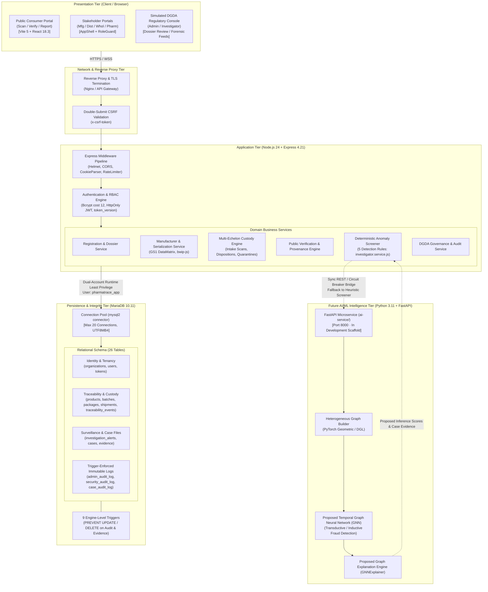
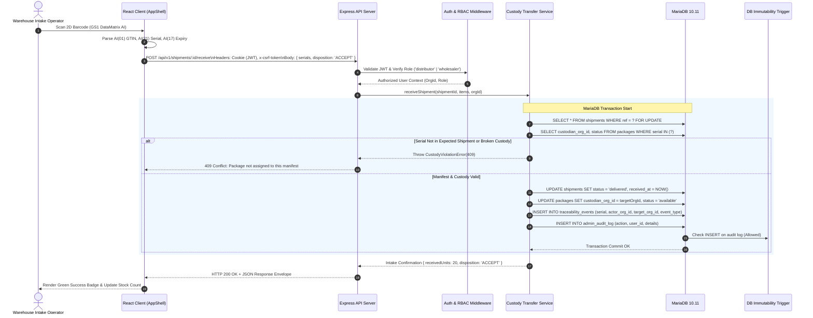

# PharmaTrace AI — System Architecture & Multi-Tier Topology

This document details the multi-tier software architecture, system boundaries, component interactions, and data flows of the PharmaTrace AI platform. Designed for academic evaluators, software architects, and engineering auditors, it describes both the implemented Full-Stack M9 Foundation and the planned microservice integration with the advanced AI/ML service.

---

## 1. High-Level Architectural Overview

PharmaTrace AI is structured as an enterprise-grade, multi-tier pharmaceutical traceability and regulatory surveillance system. It enforces end-to-end serialized custody tracking from factory production lines to point-of-dispense retail shelves, with real-time anomaly detection and simulated regulatory oversight by the Directorate General of Drug Administration (DGDA).

---

## 2. Multi-Tier Component Breakdown

### 2.1 Presentation Tier (Frontend Client)
- **Technology Stack:** React 18.3.1, Vite 5.3.1, Tailwind CSS 3.4.4, React Router DOM 6.26.0.
- **Client Architecture:** Single Page Application (SPA) structured around a centralized layout shell (`AppShell`) providing role-aware navigation sidebars, breadcrumbs, live session banners, and notification drawers.
- **Security Invariants:**
  - Route-level client guards (`RoleGuard`, `AuthGuard`) preventing unauthenticated access or unauthorized role browsing.
  - Zero sensitive state stored in `localStorage` or `sessionStorage`. All authentication state is validated via `/api/v1/auth/me` using secure, HttpOnly, SameSite cookies.
  - Client-side GS1 DataMatrix generation using `bwip-js` 4.11.4, offloading label rendering computation to the browser.

### 2.2 Application Tier (Express API Server)
- **Technology Stack:** Node.js `v24.18.0` LTS (verified baseline runtime environment; Node 26 supported after compatibility testing; Node 20 is EOL and not recommended; [Node.js Previous Releases](https://nodejs.org/en/about/previous-releases)), Express 4.21.2, ES Modules (`"type": "module"`).
- **Service-Controller Design Pattern:**
  - **Controllers (`server/src/controllers/`):** Pure request validation, input sanitization, HTTP status coordination, and JSON response enveloping.
  - **Services (`server/src/services/`):** Encapsulated business logic, multi-table database transactions, cryptographic operations, and state machine transitions.
  - **Middleware Pipeline:**
    1. `helmet`: Sets HTTP security headers.
    2. `corsMiddleware`: Strict origin validation allowing only registered client origins with credentials support.
    3. `cookieParser`: Extracts session tokens and double-submit CSRF tokens.
    4. `express.json` & `express.urlencoded`: Safe JSON body parsing with strict size limits (10MB).
    5. `requestLogger`: Structured request/response logging capturing IP, method, path, and duration.
    6. `authMiddleware`: JWT token decryption and user session validation.
    7. `rbacMiddleware`: Role-based route authorization.
    8. `errorHandler`: Centralized error envelope formatter.

### 2.3 Persistence & Integrity Tier (MariaDB Enterprise)
- **Technology Stack:** MariaDB 10.11.16 LTS, MariaDB Connector via `mysql2` (`^3.12.0`).
- **Database Architecture:**
  - Relational schema composed of **26 normalized tables** managed through **28 strict forward migrations** in `server/src/database/migrations/`.
  - **Dual-Account Security Model:**
    - `pharmatrace_app`: Runtime application user granted `SELECT` on all tables, and explicit `INSERT`/`UPDATE` on business tables. `DELETE` privileges are **revoked platform-wide**.
    - `pharmatrace_migrator`: Dedicated administrative account reserved for schema migrations, test runner isolation teardowns, and maintenance.
  - **Immutable Audit Logging:** Nine database triggers enforce append-only guarantees at the engine level. Any attempt to execute an `UPDATE` or `DELETE` on `admin_audit_log`, `user_security_audit_log`, or `investigation_evidence` fails with a MariaDB signal `SQLSTATE '45000'`.

### 2.4 Planned AI/ML Intelligence Tier (Python FastAPI Microservice)
- **Technology Stack:** Python 3.11, FastAPI, PyTorch 2.2+, PyTorch Geometric (PyG), NetworkX.
- **Repository Scaffold:** Located at `ai-service/` (branched under `ai-module`).
- **Architectural Boundary:**
  - The AI service operates as an autonomous, decoupled microservice listening on port 8000.
  - Inter-service communication with Express occurs via internal REST calls.
  - **Graceful Fallback:** The core full-stack platform does not depend on the AI service to maintain operational integrity. If the AI service is offline, the system seamlessly relies on the existing deterministic heuristic screener (`server/src/services/investigator.service.js`).

---

## 3. End-to-End Request & Data Flow Lifecycles

### 3.1 Custody Transfer & Intake Scan Sequence

---

## 4. Hardware & Infrastructure Specifications

| Component | Minimum Specification (Development) | Recommended Specification (Target Deployment) | Purpose |
| :--- | :--- | :--- | :--- |
| **Frontend Server** | 1 vCPU, 512 MB RAM | 2 vCPU, 2 GB RAM (CDN Cached) | Static asset serving, Vite production build distribution. |
| **Application API** | 2 vCPU, 2 GB RAM (Node.js 24) | 4 vCPU, 8 GB RAM (Cluster) | Express REST routing, JWT handling, business logic orchestration. |
| **Database Server** | 2 vCPU, 4 GB RAM, SSD Storage | 8 vCPU, 16 GB RAM, NVMe RAID-10 | MariaDB 10.11 relational persistence, trigger execution, indexing. |
| **AI/ML Engine** | 4 vCPU, 8 GB RAM (CPU Mode) | 8 vCPU, 32 GB RAM + GPU | PyTorch Geometric GNN inference, graph embeddings, model training. |

---

## 5. Architectural Invariants & Non-Functional Requirements

1. **Deterministic Traceability:** Every pharmaceutical unit carton must possess a globally unique identifier (GTIN-14 + serial number) that cannot be altered or re-assigned once released by quality assurance.
2. **Strict Multi-Tenancy:** Users belonging to Organization $A$ can never inspect or mutate private shipments, internal inventories, or customer lists of Organization $B$. All queries enforce tenant isolation at the service SQL layer.
3. **Audit Immutability:** No administrator, operator, or automated process possesses the database permission to delete or retroactively modify historical custody transitions, user security logs, or closed regulatory investigation records.
4. **Resilience & Fault Tolerance:** Failure of external network services, camera scanners, or the future AI microservice results in clean degradation to safe local defaults without compromising transactional integrity.

---

## 6. Related Documentation
- [Frontend Architecture Guide](frontend-architecture.md): Deep dive into React 18 component structures and client state.
- [Backend Architecture Guide](backend-architecture.md): Service-controller patterns and middleware pipelines.
- [Database Architecture Guide](database-architecture.md): Schema, triggers, and dual-account security.
- [Security Architecture Guide](../security/security-architecture.md): Cryptography, RBAC, and threat mitigations.
