# PharmaTrace AI — Visual Application Gallery & Screenshot Catalog

This document provides a comprehensive visual catalog of verified user interfaces, stakeholder portals, and security screens in PharmaTrace AI. All screenshots reflect genuine running application states captured during milestone verifications across the six core supply-chain roles, the public verification portal, and administrative security subsystems.

---

## Screenshot Inventory Summary

| ID | Filename | Stakeholder / Domain | Workflow Stage | Verification Source | Key UI Capabilities |
| :--- | :--- | :--- | :--- | :--- | :--- |
| **01** | `01-role-selection-login.png` | Public / Multi-Role | Authentication | Milestone 7.1 | Two-step role selection landing view; 6 distinct stakeholder cards; zero credential prefill. |
| **02** | `02-admin-dashboard-overview.png` | DGDA Administrator | Governance | Milestone 9 | Live system metrics, pending organization approvals, user account directory, system audit logs. |
| **03** | `03-admin-licensing-dossier-preview.png` | DGDA Administrator | Governance | Milestone 6 | Interactive document preview modal inspecting cryptographic drug manufacturing license dossiers. |
| **04** | `04-admin-users-security-audit.png` | DGDA Administrator | Security / RBAC | Milestone 6 | User management side drawer; live verification of Bcrypt password hash masking and RBAC roles. |
| **05** | `05-manufacturer-dashboard-lifecycle.png` | Pharmaceutical Manufacturer | Production | Milestone 9 | Product catalog, batch registration status, QA release tracking, DataMatrix serialization metrics. |
| **06** | `06-manufacturer-batch-serialization.png` | Pharmaceutical Manufacturer | Serialization | Milestone 8 | GS1 GTIN registry lookup, item-level serial number generation, package allocation records. |
| **07** | `07-distributor-dashboard-logistics.png` | Central Distributor | Logistics | Milestone 9 | Inbound manufacturer shipments, warehouse inventory, damaged unit quarantine, outbound dispatches. |
| **08** | `08-distributor-intake-custody.png` | Central Distributor | Custody Transfer | Milestone 7.3 | Inbound shipment intake scan, itemized acceptance/rejection disposition, signature verification. |
| **09** | `09-wholesaler-dashboard-depot.png` | Wholesale Drug Depot | Regional Logistics | Milestone 9 | Regional incoming dispatches, depot on-hand custody inventory, pharmacy fulfillment tracking. |
| **10** | `10-wholesaler-intake-inventory.png` | Wholesale Drug Depot | Custody Transfer | Milestone 7.3 | Depot receiving verification, serial package scanning, item disposition confirmation. |
| **11** | `11-pharmacy-dashboard-inventory.png` | Licensed Retail Pharmacy | Dispensing & Stock | Milestone 9 | Model pharmacy on-hand inventory, incoming depot shipments, active recall/quarantine notices. |
| **12** | `12-pharmacy-stock-intake.png` | Licensed Retail Pharmacy | Retail Intake | Milestone 7.3 | Retail inventory barcode scanning, package verification, point-of-sale dispensing status. |
| **13** | `13-public-verification-result.png` | Public Consumer | Verification | Milestone 9 | Unauthenticated consumer scan result; GTIN-14, batch validity, manufacturer provenance, verification seal. |
| **14** | `14-public-verification-timeline.png` | Public Consumer | Transparency | Milestone 9 | Complete 7-stage chronological custody handoff history from factory QA release to pharmacy shelf. |
| **15** | `15-investigator-dashboard-overview.png` | DGDA Enforcement Wing | Investigation | Milestone 9 | Real-time anomaly detection feed, active case dossiers, suspect entity tracking, rapid recall tools. |
| **16** | `16-investigator-alert-details-drawer.png` | DGDA Enforcement Wing | Anomaly Triage | Milestone 8 | Deep inspection drawer for tamper alerts, broken custody leaps, and duplicate scan anomalies. |
| **17** | `17-investigator-case-audit-trail.png` | DGDA Enforcement Wing | Regulatory Case | Milestone 8 | Formal investigative case record, suspect entity bindings, seized evidence, immutable audit trail. |
| **18** | `18-investigator-custody-timeline.png` | DGDA Enforcement Wing | Deep Trace | Milestone 8 | Package-level custody chain inspection displaying geolocation, custody timestamps, and officer notes. |
| **19** | `19-security-cross-role-access-denied.png` | Security Subsystem | Access Control | Milestone 9 | AppShell Route Guard intercepting cross-role privilege escalation attempts with HTTP 403 Forbidden. |

---

## Detailed Gallery

### 1. Two-Step Authentication & Stakeholder Role Selection
- **Filename:** `01-role-selection-login.png`
- **Route:** `/login`
- **Stakeholder Audience:** All Supply Chain Stakeholders & Regulatory Officers
- **Description:** Clean, secure landing interface presenting six distinct stakeholder portals. To prevent credential spraying, accidental cross-role authentication, and demo account leakage, the initial screen presents only role selection cards without credential inputs or preset buttons. Clicking a role card transitions the user to the dedicated, role-scoped login form.
- **Key UI Elements Highlighted:**
  - Individual role badges: DGDA Administrator, Investigation Officer, Manufacturer, Distributor, Wholesaler, and Pharmacy.
  - Zero credential leakage: No pre-filled email or password fields.
  - Consistent system branding with academic prototype indicators.

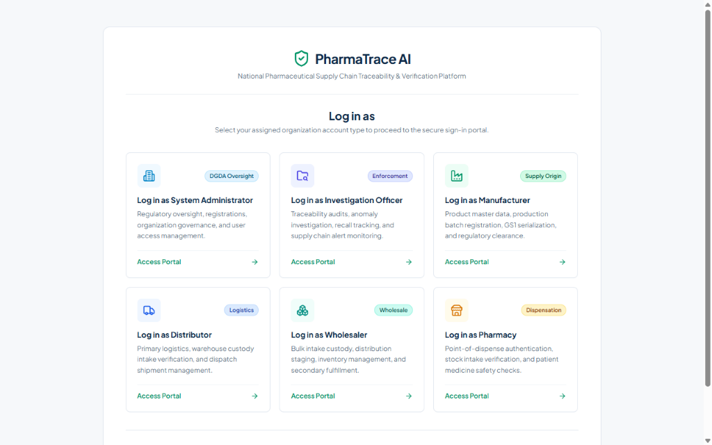

---

### 2. DGDA Administrator Dashboard & System Governance
- **Filename:** `02-admin-dashboard-overview.png`
- **Route:** `/admin/dashboard`
- **Stakeholder Audience:** DGDA System Administrator (`admin_m6@pharmatrace.test`)
- **Description:** Central command portal for Directorate General of Drug Administration (DGDA) regulatory supervisors. Displays platform-wide operational KPIs, organization registration pipelines, user account lifecycle statuses, and database-level audit event metrics.
- **Key UI Elements Highlighted:**
  - System health cards: Registered Organizations, Pending Licensing Reviews, Active System Users, and Total Audit Records.
  - Organization verification queue with direct actions to approve, reject, or request dossier clarification.
  - Security alert indicators for locked accounts and privilege escalations.

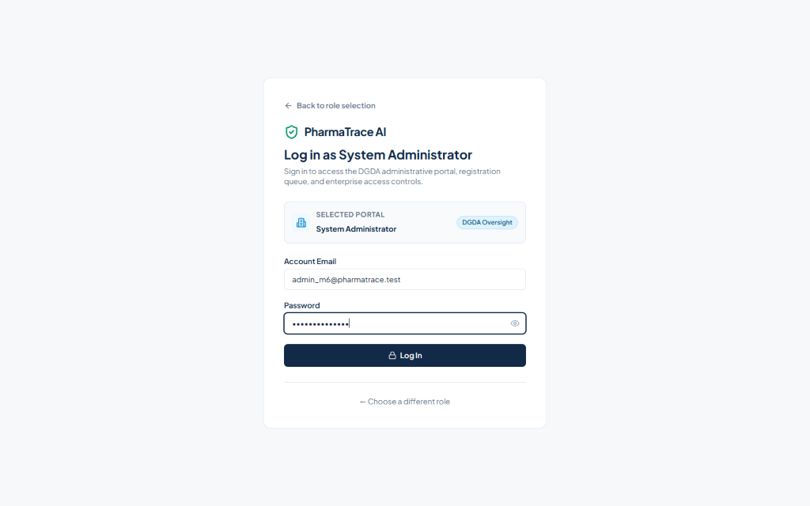

---

### 3. Administrator Licensing Dossier Inspection Modal
- **Filename:** `03-admin-licensing-dossier-preview.png`
- **Route:** `/admin/organizations`
- **Stakeholder Audience:** DGDA Regulatory Licensing Officers
- **Description:** High-resolution document viewer modal allowing DGDA administrators to inspect submitted drug manufacturing licenses, trade permits, and cold-chain compliance certificates before granting supply-chain credentials.
- **Key UI Elements Highlighted:**
  - In-browser PDF/image rendering without external third-party viewer dependencies.
  - Document metadata: File SHA-256 hash, upload timestamp, and issuing authority.
  - One-click regulatory decision controls: Approve License, Reject, or Flag for Field Inspection.

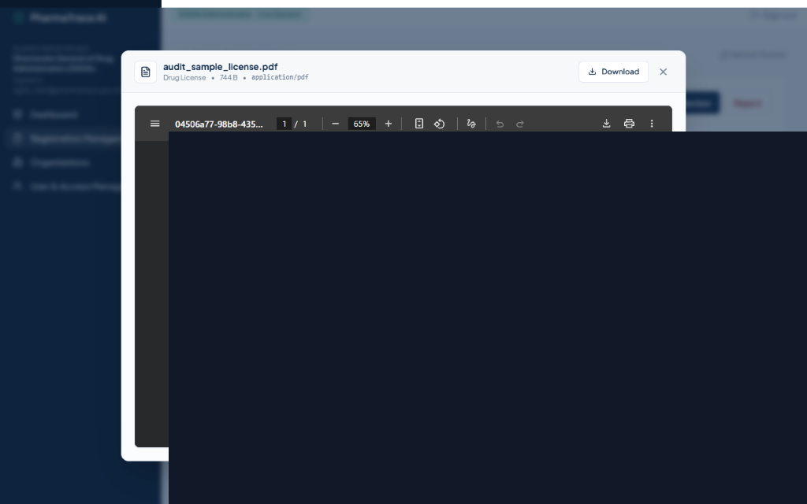

---

### 4. User Security Administration & Bcrypt Audit
- **Filename:** `04-admin-users-security-audit.png`
- **Route:** `/admin/users`
- **Stakeholder Audience:** DGDA Security Administrators
- **Description:** Slide-over user management drawer verifying system security invariants. Confirms that sensitive credentials are never stored in plain text, showing Bcrypt password hashing (`$2b$10$...`), assigned RBAC roles, tenant organization bindings, and failed login attempt counters.
- **Key UI Elements Highlighted:**
  - Truncated cryptographic password hash verification column confirming zero plaintext storage.
  - Multi-tenant organization scoping (`Apex Pharma Ltd`, `Central Logistics Ltd`).
  - Account lockout controls and token version revocation triggers.

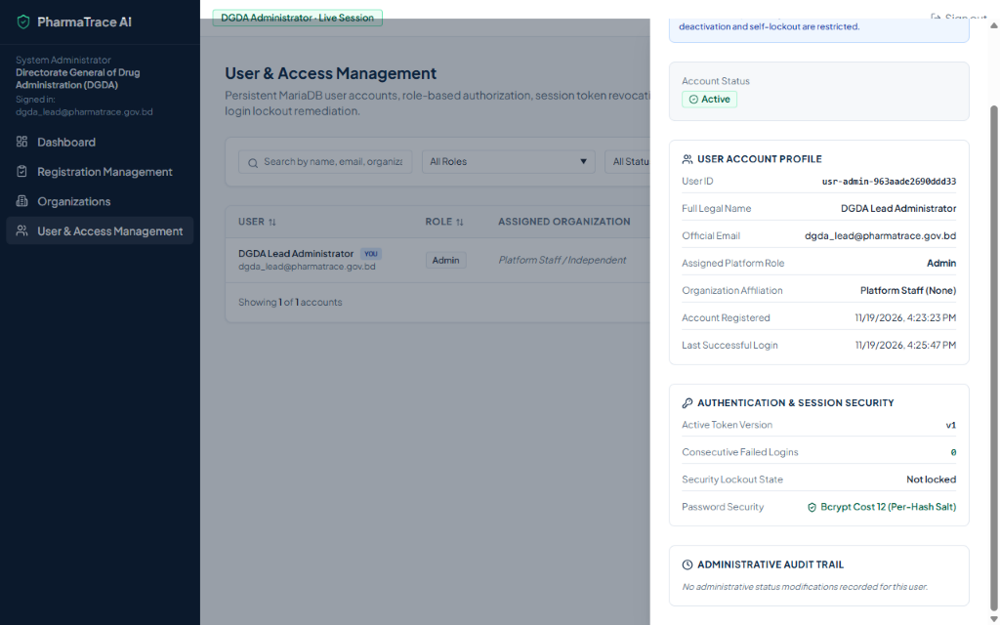

---

### 5. Pharmaceutical Manufacturer Portal & Batch Lifecycle
- **Filename:** `05-manufacturer-dashboard-lifecycle.png`
- **Route:** `/manufacturer/dashboard`
- **Stakeholder Audience:** Licensed Pharmaceutical Manufacturers (`mfg_user_m6@pharmatrace.test`)
- **Description:** Primary production management interface for pharmaceutical manufacturing plants. Tracks registered medicine products, production batch statuses (Draft $\to$ In Production $\to$ QA Release $\to$ Dispatched), and serialization generation batches.
- **Key UI Elements Highlighted:**
  - Product catalog overview with generic formulations, brand names, and GTIN-14 identifiers.
  - Batch status progression pipeline and QA analytical release certification status.
  - Serialization allocation counters tracking generated vs packaged GS1 DataMatrix identifiers.

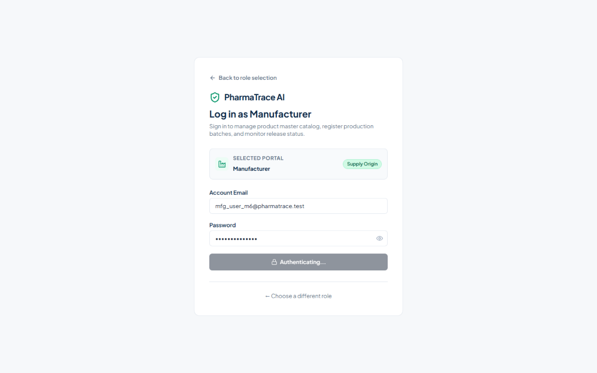

---

### 6. GS1 DataMatrix Serialization Registry & Batch Allocation
- **Filename:** `06-manufacturer-batch-serialization.png`
- **Route:** `/manufacturer/batches`
- **Stakeholder Audience:** Packaging & Quality Assurance Engineers
- **Description:** Item-level serialization registry displaying cryptographically generated serial numbers formatted under the GS1 DataMatrix standard. Each serial record includes the application identifiers AI(01) for GTIN-14, AI(21) for Serial Number, AI(17) for Expiration Date, and AI(10) for Batch Number.
- **Key UI Elements Highlighted:**
  - Tabular view of allocated serial numbers (`SN-NX-B26-01-00001` through `00020`).
  - Packaging status: Unit Carton, Bundled Shipper, or Pallet Aggregation.
  - DataMatrix barcode preview modal and batch printing export controls.

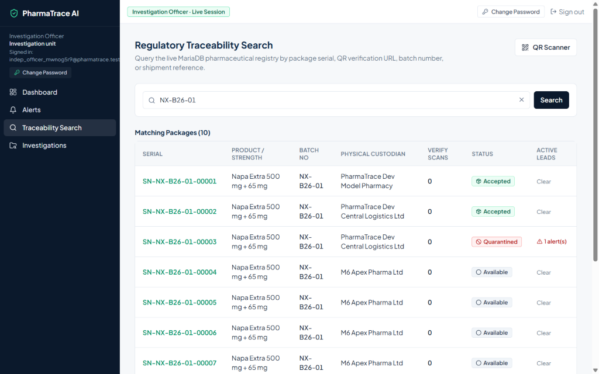

---

### 7. Central Logistics & Distributor Operations Portal
- **Filename:** `07-distributor-dashboard-logistics.png`
- **Route:** `/distributor/dashboard`
- **Stakeholder Audience:** Central Distribution Logistics Officers (`dist_user_dev@pharmatrace.test`)
- **Description:** Operational logistics hub tracking incoming pharmaceutical shipments from manufacturing facilities, active warehouse inventory, quarantined units, and outbound dispatches destined for regional wholesale depots.
- **Key UI Elements Highlighted:**
  - Incoming shipments awaiting barcode scanning and physical custody intake.
  - Warehouse stock counts organized by GTIN-14 and batch expiration dates.
  - Quarantined inventory holding area for units flagged with seal damage or cold-chain breaches.

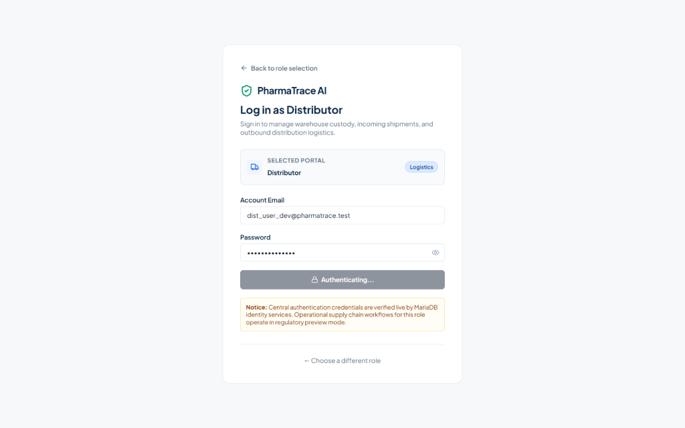

---

### 8. Distributor Inbound Shipment Intake & Custody Acceptance
- **Filename:** `08-distributor-intake-custody.png`
- **Route:** `/distributor/receive`
- **Stakeholder Audience:** Warehouse Receiving Operators
- **Description:** Live custody intake verification screen where warehouse personnel scan inbound serialized containers. The system validates the dispatch manifest against physical scans, prompting the operator for item-by-item disposition (`ACCEPT`, `REJECT`, or `DAMAGED_DISPOSITION`).
- **Key UI Elements Highlighted:**
  - Scan input field supporting physical handheld 2D scanners and software camera feeds.
  - Manifest verification checklist comparing expected units against scanned units.
  - Custody handoff confirmation generating an immutable `custody_events` record.

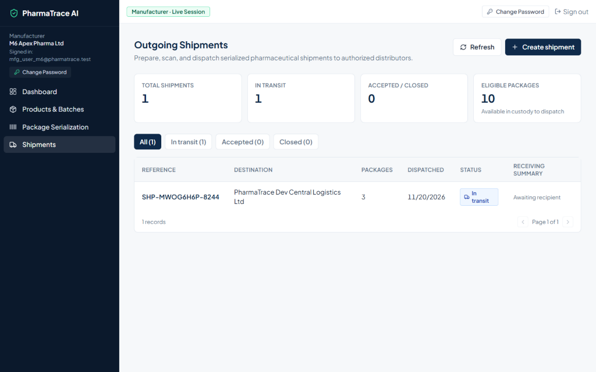

---

### 9. Wholesale Drug Depot Management Dashboard
- **Filename:** `09-wholesaler-dashboard-depot.png`
- **Route:** `/wholesaler/dashboard`
- **Stakeholder Audience:** Regional Wholesale Operations Managers (`whol_user_dev@pharmatrace.test`)
- **Description:** Regional drug distribution depot portal managing intermediate inventory between central distributors and retail pharmacies. Monitors regional order fulfillment, temperature-controlled inventory, and local transit dispatches.
- **Key UI Elements Highlighted:**
  - Inbound shipment pipeline from national central logistics providers.
  - Regional depot inventory counts categorized by therapeutic drug class.
  - Outbound dispatch builder targeting licensed retail and hospital pharmacies.

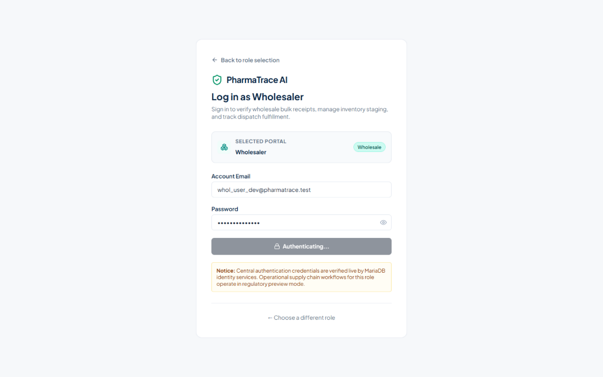

---

### 10. Wholesaler Receiving Scan & Inventory Disposition
- **Filename:** `10-wholesaler-intake-inventory.png`
- **Route:** `/wholesaler/receive`
- **Stakeholder Audience:** Regional Depot Inventory Clerks
- **Description:** Inbound intake verification workflow at the wholesale depot. Scanned serial numbers are verified against the distributor's electronic shipping manifest, ensuring zero broken custody links before packages enter depot stock.
- **Key UI Elements Highlighted:**
  - Real-time barcode validation feedback indicating package integrity.
  - Itemized disposition selection: Accepted into Active Stock, Rejected to Shipper, or Quarantined.
  - Digital receiving signature capture binding the warehouse supervisor identity to the transaction.

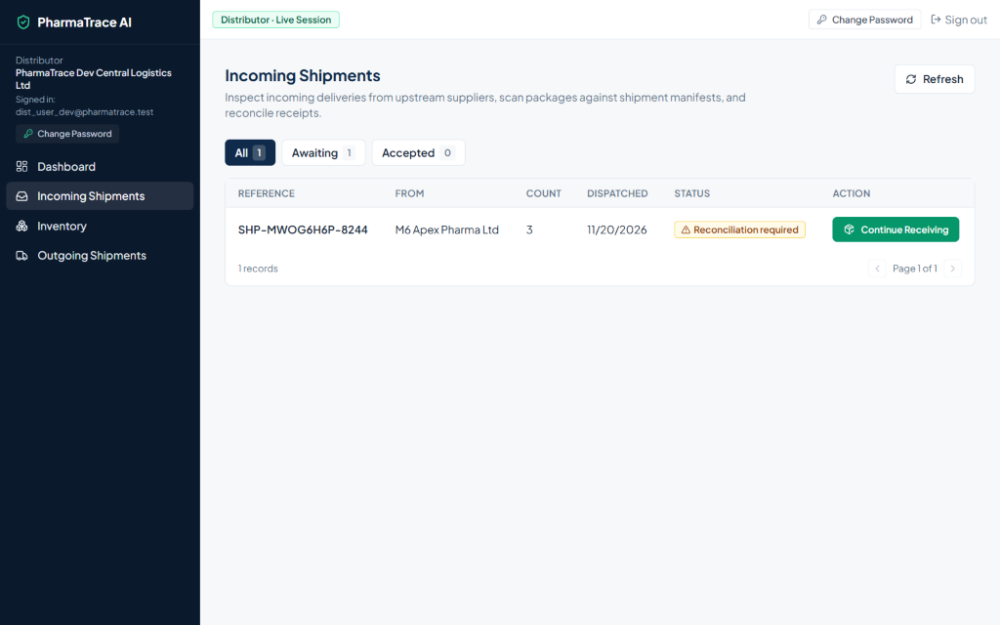

---

### 11. Licensed Model Pharmacy Portal & Dispensing Stock
- **Filename:** `11-pharmacy-dashboard-inventory.png`
- **Route:** `/pharmacy/dashboard`
- **Stakeholder Audience:** Licensed Pharmacists & Pharmacy Technicians (`pharm_user_dev@pharmatrace.test`)
- **Description:** Point-of-dispense portal for community model pharmacies and hospital dispensaries. Displays verified on-hand medicine stock, incoming wholesale shipments, active regulatory recall alerts, and dispensing history.
- **Key UI Elements Highlighted:**
  - Ready-to-dispense inventory counts verified down to individual serial numbers.
  - High-priority regulatory notice banner warning against quarantined or recalled batches.
  - Point-of-sale verification shortcut to validate packages immediately before patient handover.

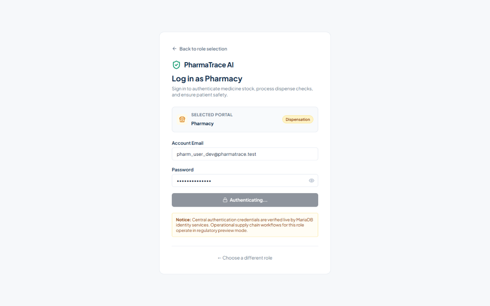

---

### 12. Pharmacy Stock Receiving & Barcode Verification
- **Filename:** `12-pharmacy-stock-intake.png`
- **Route:** `/pharmacy/receive`
- **Stakeholder Audience:** Dispensary Staff
- **Description:** Final supply-chain intake interface where retail pharmacies take physical custody of medicine packages. Validates the wholesale manifest, verifies serial uniqueness, and marks packages as `READY_FOR_DISPENSING`.
- **Key UI Elements Highlighted:**
  - Camera-based barcode scanner integration with fallback manual GTIN/serial entry.
  - Instant package validation confirmation against central MariaDB custody records.
  - Automatic inventory replenishment upon successful scan completion.

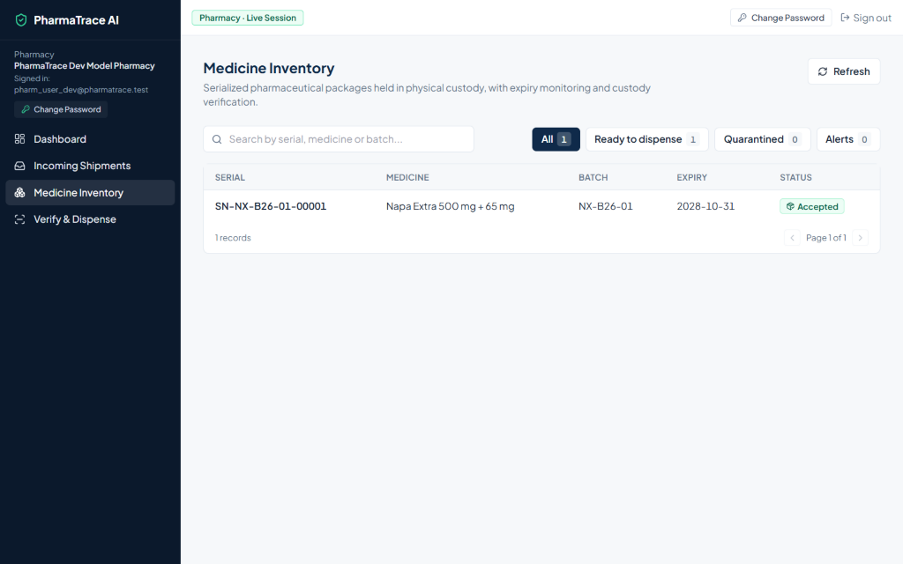

---

### 13. Public Consumer Verification Portal — Verified Product
- **Filename:** `13-public-verification-result.png`
- **Route:** `/verify?serial=SN-NX-B26-01-00001`
- **Stakeholder Audience:** General Public, Patients, Healthcare Consumers
- **Description:** Open-access verification screen accessible without authentication via smartphone QR code scan or manual serial search. Confirms medicine authenticity, GTIN-14, batch validity, expiration status, and manufacturing provenance.
- **Key UI Elements Highlighted:**
  - Prominent green "VERIFIED GENUINE" authenticity seal with verification timestamp.
  - Product details card: Generic Name (e.g., *Napa Extra Paracetamol 500mg + Caffeine 65mg*), Brand Name, GTIN-14, Batch Number, and Expiry Date.
  - Statutory academic prototype disclaimer clarifying that digital verification confirms custody records and does not replace chemical laboratory analysis.

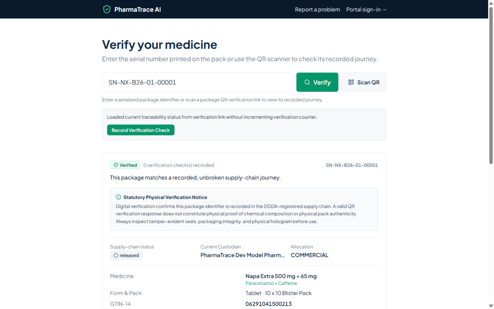

---

### 14. Public Verification — Chronological Custody Chain
- **Filename:** `14-public-verification-timeline.png`
- **Route:** `/verify?serial=SN-NX-B26-01-00001` (Scrolled)
- **Stakeholder Audience:** General Public, Healthcare Providers
- **Description:** Interactive supply-chain provenance timeline presented directly below the verification result. Displays the uninterrupted custody progression across every certified echelon from factory manufacturing to retail pharmacy shelf.
- **Key UI Elements Highlighted:**
  - 7-stage sequential custody progression: Batch Registration $\to$ QA Release $\to$ Factory Serialization $\to$ Central Distributor Dispatch $\to$ Wholesale Depot Intake $\to$ Pharmacy Stock $\to$ Patient Verification.
  - Timestamp, certified organization name, and DGDA license identifier for each transfer event.
  - Tamper-evident visual indicators showing unbroken chain-of-custody continuity.

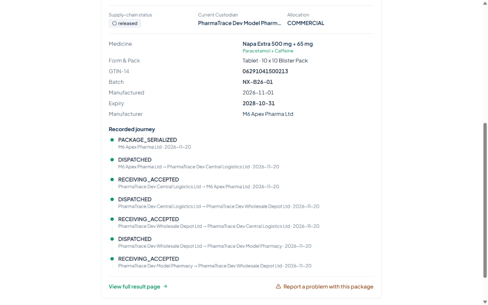

---

### 15. DGDA Regulatory Enforcement Dashboard & Anomaly Feed
- **Filename:** `15-investigator-dashboard-overview.png`
- **Route:** `/investigator/dashboard`
- **Stakeholder Audience:** DGDA Regulatory Enforcement Officers (`indep_officer_mwnog5r9@pharmatrace.test`)
- **Description:** Surveillance and enforcement operations center. Displays real-time anomaly detection alerts generated by deterministic screening algorithms (duplicate scans, broken custody leaps, inventory shrinkage, velocity anomalies), active case dossiers, and emergency recall controls.
- **Key UI Elements Highlighted:**
  - Real-time anomaly KPI counters: Critical Tamper Alerts, Broken Custody Leaps, High-Risk Organizations, Open Investigations.
  - Live custody event stream displaying transactions across all supply-chain nodes.
  - Quick action toolbar: Launch Investigation Case, Issue Product Recall, Freeze Organization License.

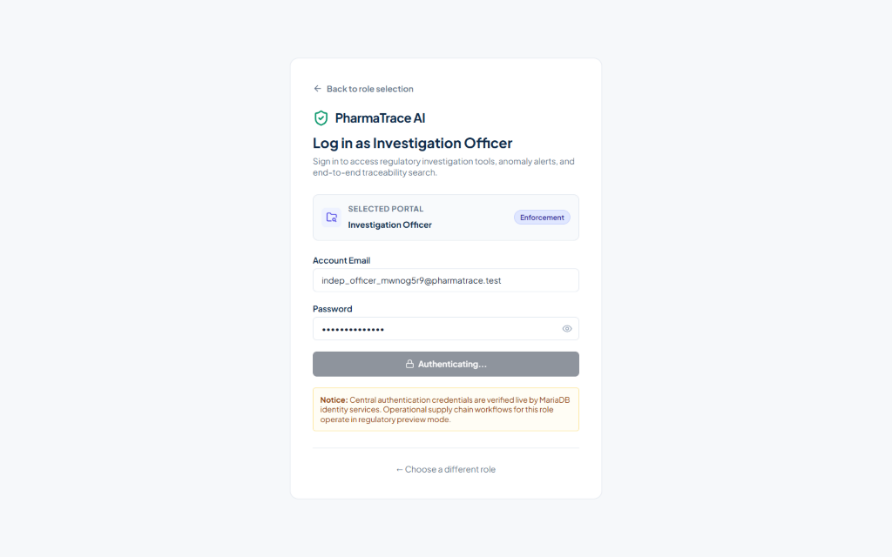

---

### 16. Live Anomaly Alert Details & Triage Drawer
- **Filename:** `16-investigator-alert-details-drawer.png`
- **Route:** `/investigator/alerts`
- **Stakeholder Audience:** Enforcement Wing Investigators
- **Description:** Slide-over investigative inspection drawer providing deep forensic context on a flagged anomaly. Shows offending serial numbers, geolocation coordinates, conflicting timestamps, and suspected fraud classification (e.g., duplicate barcode scan indicating packaging counterfeiting).
- **Key UI Elements Highlighted:**
  - Forensic anomaly metadata: Severity Score (CRITICAL), Rule Trigger ID, Detection Engine (Deterministic Heuristic Screener).
  - Geographic conflict visualization showing identical serial numbers scanned in two distant cities within an impossible transit window.
  - One-click workflow transition: Escalate to Formal Case Dossier or Dismiss with Justification.

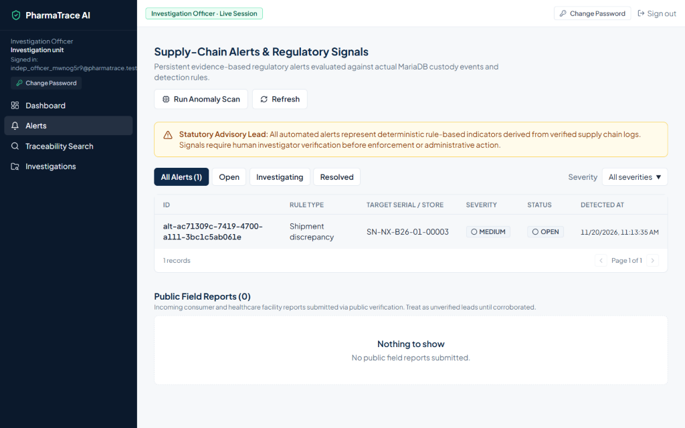

---

### 17. Formal Investigation Case Dossier & Immutable Audit Trail
- **Filename:** `17-investigator-case-audit-trail.png`
- **Route:** `/investigator/cases/:id`
- **Stakeholder Audience:** Lead DGDA Enforcement Investigators
- **Description:** Comprehensive regulatory case dossier documenting an active pharmaceutical investigation. Contains linked suspect organizations, seized physical evidence batches, witness statements, and an immutable MariaDB trigger-enforced case audit trail.
- **Key UI Elements Highlighted:**
  - Case metadata: Unique Case Identifier (`INV-2026-0001`), Lead Investigator, Current Disposition (`open` / `under_review`).
  - Linked entities table: Suspect Wholesaler, Offending GTIN-14, and Seized Serial Range.
  - Append-only case audit log documenting every evidence attachment and status change with cryptographic timestamping.

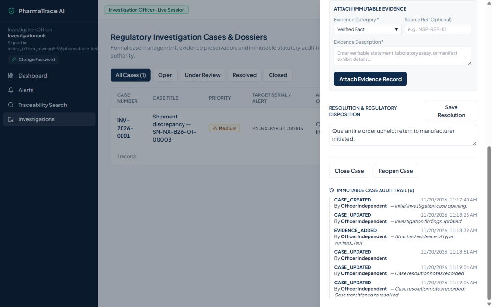

---

### 18. Package Forensic Trace & Deep Custody Timeline
- **Filename:** `18-investigator-custody-timeline.png`
- **Route:** `/investigator/trace`
- **Stakeholder Audience:** Forensic Supply Chain Analysts
- **Description:** Deep forensic tracing interface allowing investigators to look up any batch or individual serial number and inspect every internal database event, including warehouse location coordinates, operator user IDs, device IP addresses, and transition durations.
- **Key UI Elements Highlighted:**
  - High-density chronological log of all scan events, custody dispatches, intake acceptances, and status transitions.
  - Calculated velocity and transit time between supply-chain nodes to identify anomalous transport delays or shrinkage.
  - Direct link to initiate an immediate batch-wide quarantine or national drug recall.

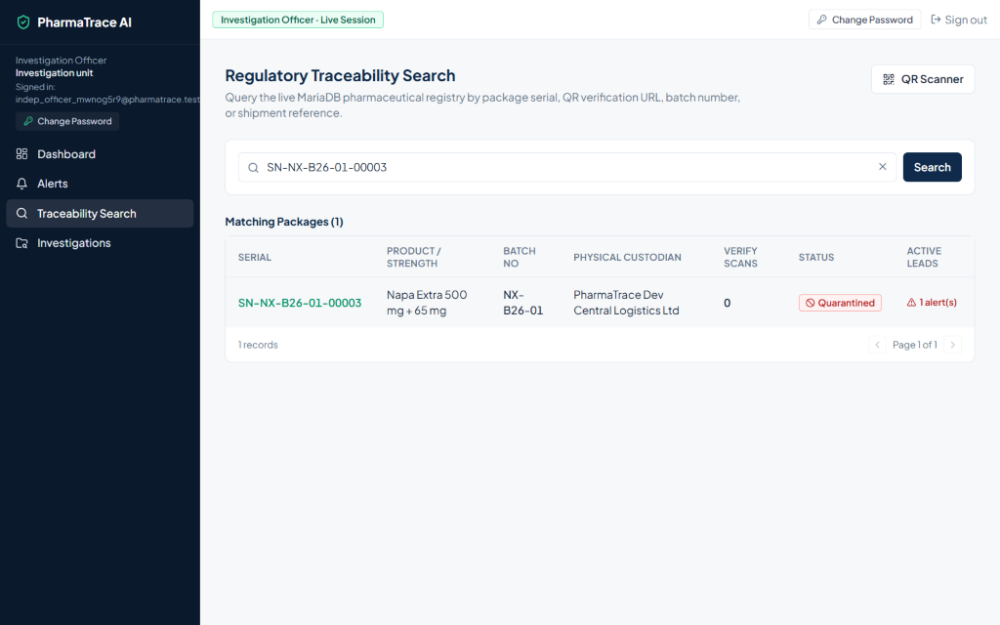

---

### 19. Security Enforcement — Cross-Role Privilege Escalation Interception
- **Filename:** `19-security-cross-role-access-denied.png`
- **Route:** `/access-denied` (Triggered via unauthorized navigation to `/admin/dashboard`)
- **Stakeholder Audience:** Security Subsystem & Penetration Testers
- **Description:** Visual verification of the platform's multi-layered Role-Based Access Control (RBAC) system. When an authenticated user assigned a lower-privilege role (such as a retail pharmacy clerk) attempts direct navigation to an administrative route, the client-side `RoleGuard` immediately halts rendering and redirects to `/access-denied`, while the backend API simultaneously rejects the request with HTTP 403 Forbidden.
- **Key UI Elements Highlighted:**
  - Prominent HTTP 403 Access Denied notification explaining privilege boundary enforcement.
  - Contextual remediation advice directing the user back to their authorized role workspace.
  - Proof of defense-in-depth security operating at both the frontend routing tier and the backend controller middleware tier.

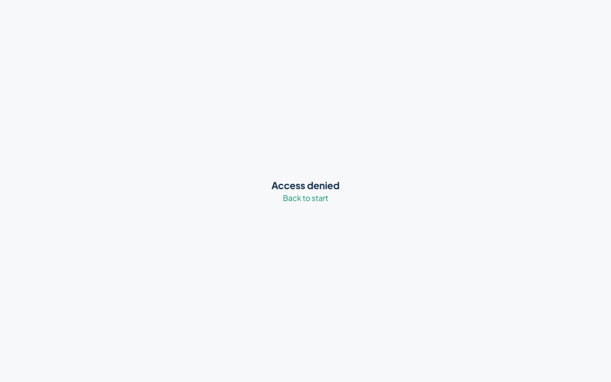

---

## Gallery Navigation & Cross-References
- Return to the [Root README.md](../../README.md) for complete project architecture and demonstration instructions.
- Consult the [System Architecture Guide](../architecture/system-architecture.md) for tier breakdown and request lifecycles.
- Consult the [Security Architecture Guide](../security/security-architecture.md) for RBAC matrix and token security mechanisms.
- Live demonstration scripts and internal evaluation walk-throughs are maintained in private local testing guides for evaluators.
