# PharmaTrace AI — Security Architecture, Cryptography & Threat Defense

This document details the multi-layered defense-in-depth security model, cryptographic standards, session management protocols, Role-Based Access Control (RBAC) matrix, and database immutability mechanisms protecting PharmaTrace AI.

---

## 1. Defense-in-Depth Security Model

PharmaTrace AI implements security controls across six concentric layers, ensuring that the compromise of any single protective barrier cannot breach platform integrity:

```mermaid
flowchart TD
    subgraph Layer1["1. Network & Transport Layer"]
        L1A[TLS 1.3 / HTTPS Encryption]
        L1B[Strict-Transport-Security / HSTS Preload]
    end

    subgraph Layer2["2. HTTP & Edge Security Layer"]
        L2A[Helmet Security Headers: CSP, Frameguard, NoSniff]
        L2B[CORS Origin Whitelisting with Credential Binding]
        L2C[Double-Submit Cookie CSRF Defense: x-csrf-token]
    end

    subgraph Layer3["3. Identity & Authentication Layer"]
        L3A[Native Bcrypt Hashing with Cost Factor 12]
        L3B[HttpOnly, SameSite=Strict JWT Session Cookies]
        L3C[Account Lockout Defense: Consecutive Failed Attempts]
        L3D[Instant Session Revocation via token_version]
    end

    subgraph Layer4["4. Authorization & Tenancy Layer"]
        L4A[Role-Based Access Control: 6 Granular Stakeholder Roles]
        L4B[Client-Side Route Interception: RoleGuard & AuthGuard]
        L4C[Multi-Tenant SQL Row-Level Scoping: org_id Binding]
    end

    subgraph Layer5["5. Database & Persistence Layer"]
        L5A[100% Parameterized Prepared Statements: Zero SQLi]
        L5B[Least-Privilege Runtime User: pharmatrace_app ZERO DELETE]
        L5C[9 Engine-Level Immutability Triggers]
    end

    subgraph Layer6["6. Forensic Surveillance Layer"]
        L6A[Append-Only Admin Audit Log]
        L6B[Real-Time Security Event Logging: user_security_audit_log]
        L6C[Court-Admissible Evidence Hashing: SHA-256]
    end

    Layer1 --> Layer2 --> Layer3 --> Layer4 --> Layer5 --> Layer6
```



---

## 2. Identity & Credential Protection

### 2.1 Native Bcrypt Hashing & Constant-Time Defense
- **Algorithm:** Native `bcrypt` (`^6.0.0`) with cost factor 12 (`BCRYPT_SALT_ROUNDS = 12`) in `server/src/utils/passwords.js`.
- **Enforcement:** Plaintext passwords are never logged, serialized into JSON responses, or retained in heap memory beyond verification execution.
- **Timing Attack Mitigation:** To prevent user enumeration attacks via response timing differences, the system implements constant-time evaluation (`compareConstantTime`). When a candidate user account is not found in the database, the comparison evaluates against a precomputed, cached cost-12 dummy hash (`getDummyHash`), ensuring indistinguishable response latency.
- **Visual Evidence:** In screenshot `04-admin-users-security-audit.png`, the user management drawer displays truncated Bcrypt hashes (`$2b$10$...` / `$2b$12$...`), confirming zero plaintext storage.

### 2.2 Account Lockout Mechanism
- The `users` table tracks `failed_login_attempts` and `locked_until`.
- If an attacker submits consecutive invalid passwords, the account is locked for a cooling period.
- All failed authentication attempts are logged in `user_security_audit_log` with remote client IP addresses and user agents.

---

## 3. Session Security & Instant Token Revocation

### 3.1 Token Transmission via Secure Cookies
- **Zero LocalStorage/SessionStorage Storage:** Web storage APIs are vulnerable to Cross-Site Scripting (XSS) extraction. PharmaTrace AI stores zero authentication tokens in `localStorage` or `sessionStorage`.
- **Cookie Security Attributes:**
  - `HttpOnly = true`: Inaccessible to browser JavaScript execution (`document.cookie`).
  - `Secure = true`: Transmitted exclusively over encrypted HTTPS connections in production.
  - `SameSite = Strict`: Cookie is withheld on cross-site requests, mitigating Cross-Site Request Forgery (CSRF).
  - Cookie name: `pt_access_token`.

### 3.2 Instant Revocation via `token_version`
Standard JSON Web Tokens are stateless and cannot be revoked before expiration without server-side blacklists. PharmaTrace AI solves this with an integer `token_version` stored in the `users` table and embedded inside the JWT payload:

$$\text{JWT Payload} = \{ \text{userId}: 142, \text{role}: \text{'manufacturer'}, \text{token\_version}: 3 \}$$

- On every authenticated API request, the `authMiddleware` validates:
  $$\text{IF } \text{JWT}.\text{token\_version} \neq \text{DatabaseUser}.\text{token\_version} \implies \text{HTTP 401 UNAUTHORIZED}$$
- **Revocation Triggers:**
  1. The user changes their password.
  2. The user clicks "Sign out all devices".
  3. A DGDA administrator freezes the account or organization.
  Executing `UPDATE users SET token_version = token_version + 1` instantly revokes all active sessions across all devices globally.

---

## 4. Cross-Site Request Forgery (CSRF) Defense

PharmaTrace AI enforces the **Cryptographic Double-Submit Cookie Pattern**:
1. Upon initial connection, the server sets a secure cookie named `pt_csrf_token` containing a cryptographically random hexadecimal string.
2. The frontend HTTP client (`client/src/services/api.js`) reads this cookie and injects it as an HTTP header:
   ```http
   x-csrf-token: e8a91b...
   ```
3. For all state-changing HTTP methods (`POST`, `PUT`, `PATCH`, `DELETE`), the `csrfMiddleware` compares the header value against the cookie value. Because cross-origin attackers cannot read cookies from other origins due to the Same-Origin Policy (SOP), malicious forged requests are blocked with HTTP 403 Forbidden.

---

## 5. Role-Based Access Control (RBAC) Matrix

The system enforces six canonical stakeholder roles plus public consumer access:

| Permission / Endpoint Domain | Public Consumer | Licensed Manufacturer | Central Distributor | Wholesale Depot | Model Pharmacy | DGDA Investigator | DGDA Administrator |
| :--- | :---: | :---: | :---: | :---: | :---: | :---: | :---: |
| **Public Verification (`/verify`)** | **READ** | **READ** | **READ** | **READ** | **READ** | **READ** | **READ** |
| **Consumer Fraud Reporting (`/report`)**| **WRITE**| — | — | — | — | — | — |
| **Organization Registration (`/register`)**| **WRITE**| — | — | — | — | — | — |
| **Product & Batch Registry** | — | **FULL** | — | — | — | **READ** | **READ** |
| **GS1 Serialization Allocation** | — | **WRITE**| — | — | — | **READ** | — |
| **Outbound Dispatch Manifests** | — | **WRITE**| **WRITE** | **WRITE** | — | **READ** | — |
| **Inbound Intake & Custody Dispositions**| — | — | **WRITE** | **WRITE** | **WRITE** | **READ** | — |
| **Point-of-Sale Dispense Validation** | — | — | — | — | **WRITE** | **READ** | — |
| **Surveillance & Anomaly Triage** | — | — | — | — | — | **FULL** | **READ** |
| **Regulatory Case Dossiers & Seizures** | — | — | — | — | — | **FULL** | **READ** |
| **Quarantine & Enforcement Directives** | — | — | — | — | — | **FULL** | **FULL** |
| **Organization Licensing Approval** | — | — | — | — | — | — | **FULL** |
| **User Lockout Reset & Governance** | — | — | — | — | — | — | **FULL** |
| **Administrative Audit Logs** | — | — | — | — | — | **READ** | **FULL (Read/Append)**|

---

## 6. Multi-Tenancy Data Isolation

Commercial pharmaceutical organizations are direct market competitors. A core security requirement is that a manufacturer, distributor, or pharmacy must never observe the inventory, shipments, or customers of another organization:
- Every business query in `services/` enforces tenant scoping:
  ```sql
  SELECT * FROM packages WHERE custodian_org_id = ? AND batch_id = ?
  ```
- Any attempt to query or update an object belonging to another organization results in an immediate authorization failure or empty set.

---

## 7. Database Engine Immutability & Least Privilege

- **Zero-Delete Runtime User (`pharmatrace_app`):** The application database connection pool connects under a dedicated user account that has zero `DELETE` permissions platform-wide. It is mathematically impossible for an application bug or SQL injection payload to execute `DELETE FROM ...`.
- **9 Immutability Triggers:** Triggers on `admin_audit_log`, `user_security_audit_log`, `investigation_evidence`, `investigation_case_audit_log`, and `traceability_events` raise `SQLSTATE '45000'` on any `UPDATE` or `DELETE`, preventing retroactive alteration of historical events.

---

## 8. Related Documentation
- [Database Architecture & Immutability Triggers](../architecture/database-architecture.md)
- [Backend Architecture & Middleware](../architecture/backend-architecture.md)
- [Visual Application Gallery: RBAC Access Denied](../screenshots/README.md#19-security-enforcement--cross-role-privilege-escalation-interception)
