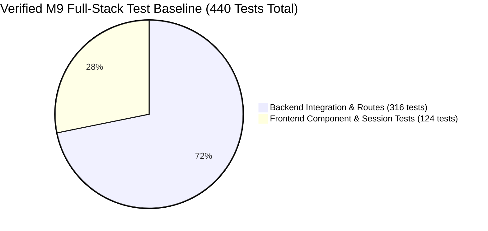

# PharmaTrace AI — Testing Strategy, Automated Test Suites & Quality Assurance

This document details the multi-tiered testing methodology, test database isolation harness, verified test metrics, execution commands, and end-to-end browser verification procedures implemented in PharmaTrace AI.

---

## 1. Quality Assurance Philosophy

PharmaTrace AI enforces a zero-tolerance policy for mock-induced false positives in core transaction logic:
1. **Real Database Testing:** Rather than relying on mock database drivers or in-memory SQLite approximations that ignore MariaDB-specific trigger syntax, all backend integration tests execute against a genuine MariaDB 10.11 instance (`pharmatrace_ai_test`).
2. **Deterministic State Isolation:** Tests execute within an automated isolation harness that wipes and resets operational tables between test suites, guaranteeing zero cross-test state pollution.
3. **Defense-in-Depth Verification:** Testing spans unit algorithms, HTTP integration routes, cryptographic immutability triggers, CSRF defenses, RBAC route guards, and live multi-role browser workflows.

---

## 2. Verified Test Suite Metrics (Milestone 9 Full-Stack Baseline)

During the comprehensive Milestone 9 system audit, the automated test suite achieved a **100% pass rate with zero failures across 440 tests** using the built-in Node.js test runner:

```
================================================================================
PHARMATRACE AI — M9 FULL-STACK BASELINE TEST EXECUTION SUMMARY
================================================================================
Test Domain             Test Runner       Suites   Tests   Pass Rate   Duration
--------------------------------------------------------------------------------
Backend API & Services  Node.js --test      75      316      100%       ~18.4s
Frontend UI Components  Node.js --test      14      124      100%        ~4.8s
--------------------------------------------------------------------------------
TOTAL M9 FULL-STACK BASELINE                89      440      100%       ~23.2s
================================================================================
```

> [!NOTE]
> **Scope Notice:** The 440 passing tests above measure the complete, operational Milestone 9 full-stack implementation (Express, MariaDB, React 18). The separate `ai-service/` module is in active development and is excluded from this test count.



---

## 3. Test Suite Architecture & Structure

### 3.1 Backend Test Hierarchy (`server/tests/` — 17 Test Files)
```
server/tests/
├── admin_m6_management.test.js               # Admin governance, user locking, category quotas
├── admin_registration.test.js                # Onboarding dossier review and capacity checks
├── auth.test.js                              # Authentication, JWT cookies, token_version
├── change_password.test.js                   # Password updates and global session revocation
├── custody_transfer_shipping.test.js         # Multi-echelon custody dispatches & intake scans
├── database.test.js                          # Connection pool ping and health check
├── dev_auth_lockout_bypass.test.js           # Development lockout bypass guard verification
├── health.test.js                            # Public system health endpoint
├── investigator_regulatory_enforcement.test.js# Anomaly feeds, case dossiers, evidence exhibits
├── m9_system_integration.test.js             # End-to-end multi-echelon lifecycle integration
├── manufacturer_products_batches.test.js     # Medicine catalog and batch QA release
├── manufacturer_serialization.test.js        # GS1 DataMatrix allocation and serial generation
├── passwords.test.js                         # Native bcrypt cost-12 hashing & constant-time check
├── registration.test.js                      # Public registration submission and validation
├── registration_tracking.test.js             # Tracking code lookups and resubmissions
├── schema.test.js                            # Schema table integrity and foreign keys
└── tokens.test.js                            # Token hashing and activation lifecycle
```

### 3.2 Frontend Test Hierarchy (`client/tests/` — 15 Test Files)
```
client/tests/
├── adminM6Corrections.test.js                # Admin management UI and drawer interactions
├── adminRegistrationApi.test.js              # Admin registration API integration
├── adminRegistrationComponents.test.js       # Registration review UI components
├── changePasswordModal.test.js               # Password change modal and validation
├── fixtures.test.js                          # Reusable UI test fixtures
├── loginPageRedesign.test.js                 # Two-step role selection and form submit
├── manufacturerProductsBatches.test.js       # Products and batches UI forms
├── persistenceAndSession.test.js             # Client session persistence & token handling
├── qrPayloadAndLabels.test.js                # Barcode payload parsing and formatting
├── registrationApi.test.js                   # Public registration API adapter
├── registrationEndToEnd.test.js              # End-to-end registration onboarding flow
├── registrationWorkflows.test.js             # Registration state transitions
├── serialization.test.js                     # Serialization UI and allocation controls
├── supplyChain.test.js                       # Multi-echelon logistics and intake UI
└── verification.test.js                      # Public verification UI and timeline
```

---

## 4. Test Database Isolation Harness

To prevent automated tests from overwriting development data or interfering with concurrent runs:
1. Tests load configuration from `server/.env.test`, targeting `pharmatrace_ai_test`.
2. Hard safety guards in `server/src/config/env.js`, `server/src/config/database.js`, and `server/src/database/migrator.js` unconditionally throw `FATAL_TEST_SAFETY_VIOLATION` if tests ever attempt to connect to `pharmatrace_ai`.
3. The migration runner (`npm run test:migrate`) provisions all 28 forward migrations on `pharmatrace_ai_test`.
4. Operational tables are truncated and reset dynamically between test executions using `pharmatrace_migrator`, while reference seeds remain available.

---

## 5. Security & Immutability Trigger Testing

A critical component of quality assurance is verifying that database triggers successfully reject illicit tamper attempts:

```javascript
// Test: MariaDB Engine-Level Immutability Verification (Node.js test runner)
it('should reject UPDATE operations on admin_audit_log via trigger SQLSTATE 45000', async () => {
  const [entry] = await execute('SELECT id FROM admin_audit_log LIMIT 1');
  
  await assert.rejects(
    async () => {
      await execute('UPDATE admin_audit_log SET action = "TAMPERED" WHERE id = ?', [entry.id]);
    },
    /SECURITY ERROR: admin_audit_log is append-only/
  );
});

it('should reject DELETE operations on investigation_evidence exhibits', async () => {
  const [evidence] = await execute('SELECT id FROM investigation_evidence LIMIT 1');
  
  await assert.rejects(
    async () => {
      await execute('DELETE FROM investigation_evidence WHERE id = ?', [evidence.id]);
    },
    /SECURITY ERROR: investigation_evidence exhibits cannot be expunged/
  );
});
```

---

## 6. How to Run the Automated Test Suites

### 6.1 Execute Backend Tests
```bash
cd server
npm test
```
*Executes `node --env-file=.env.test --test --test-concurrency=1 tests/*.test.js`.*

### 6.2 Execute Frontend Tests
```bash
cd client
npm test
```
*Executes `node --env-file=../server/.env.test --test --test-concurrency=1 tests/*.test.js`.*

### 6.3 Run Full Platform Test Suite
From the repository root (or in separate terminal windows):
```bash
# Terminal 1: Backend Test Suite (316 tests)
cd server && npm test

# Terminal 2: Frontend Test Suite (124 tests)
cd client && npm test
```

---

## 7. Interactive End-to-End Browser Verification

In addition to automated unit and integration tests, PharmaTrace AI underwent live interactive browser verification across 8 stages:
1. **DGDA Admin Governance:** Organization queue reviews, user directory audits.
2. **Manufacturer Portal:** Medicine registration, batch QA sign-off, GS1 DataMatrix generation.
3. **Central Distributor Logistics:** Inbound shipment intake, receiving disposition, stock management.
4. **Wholesale Depot Operations:** Regional intake, custody acceptance, retail dispatch.
5. **Model Pharmacy Intake:** Barcode scanning, ready stock verification, dispense validation.
6. **Public Consumer Scan:** Unauthenticated verification of GTIN-14, batch validity, 7-stage timeline.
7. **DGDA Enforcement Investigation:** Live anomaly alert triage, case dossier assembly, evidence attachment.
8. **RBAC Boundary Guard:** Client-side interception of unauthorized cross-role route browsing.

All visual screenshots captured during this live verification are cataloged in the [Visual Application Gallery](../screenshots/README.md).

---

## 8. Related Documentation
- [Visual Application Gallery](../screenshots/README.md): 19 verified operational screenshots.
- [Database Architecture Guide](../architecture/database-architecture.md): Schema, triggers, and migrations.
- [Local Development Guide](../installation/local-development.md): Environment prerequisites and setup instructions.
