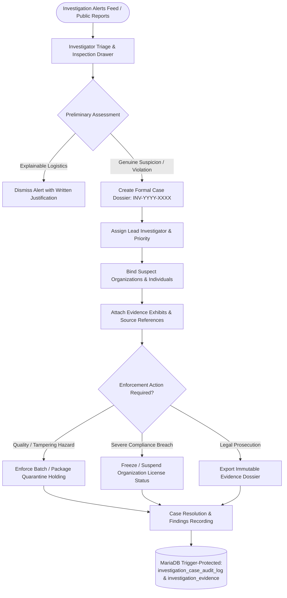

# PharmaTrace AI — Regulatory Investigation, Case Dossiers & Enforcement

This document details the operational workflow, forensic case management tools, evidence handling standards, and enforcement actions available to Directorate General of Drug Administration (DGDA) Regulatory Enforcement Officers.

---

## 1. Regulatory Surveillance & Enforcement Overview

The DGDA Enforcement Wing operates as the regulatory surveillance authority on the PharmaTrace AI platform. When anomalies are flagged or consumer fraud reports are received, investigators utilize the dedicated portal (`/investigator/dashboard`) to triage leads, assemble case dossiers, seize evidence, and enact quarantine directives.

---

## 2. Phase 1: Alert Triage & Forensic Inspection

1. **Surveillance Feed (`/investigator/dashboard`):**
   - Real-time stream displaying anomalies flagged by the deterministic screening engine (`investigation_alerts`) or reported by the public (`public_reports`).
   - Filterable by severity (`CRITICAL`, `HIGH`, `MEDIUM`), alert type (e.g., `DUPLICATE_SCAN_ANOMALY`), date range, or suspected entity.
2. **Slide-Over Alert Details Drawer:**
   - Opening an alert launches the inspection drawer (see screenshot `16-investigator-alert-details-drawer.png`).
   - Displays offending serial numbers, timestamp conflicts, suspect organization, and feature attributions.
   - Allows investigators to immediately view deep provenance timelines without navigating away from the feed.

---

## 3. Phase 2: Formal Case Dossier Creation & Evidence Management

When an alert confirms non-compliance or illicit activity:

1. **Case Number Allocation:**
   - The system generates an official, standardized case identifier via `generateNextCaseNumber`:
     $$\text{Case Identifier} = \text{INV}-\text{YYYY}-\text{XXXX} \quad (\text{e.g., } \text{INV-2026-0001})$$
2. **Suspect Entity Linkage:**
   - Investigators bind suspected licensed entities (e.g., *Wholesale Depot Ltd*) to the case record in `investigation_cases`.
3. **Digital & Physical Evidence Attachment:**
   - Investigators attach exhibits (laboratory assay certificates, inspection photos, seizure manifests, witness statements).
   - Each evidence item is stored in `investigation_evidence` with reference keys (`source_ref`, `source_entity_type`, `source_entity_id`).
4. **Courtroom Admissibility Standards:**
   - MariaDB triggers `trg_investigation_evidence_prevent_update` and `trg_investigation_evidence_prevent_delete` ensure evidence exhibits cannot be altered or purged once attached.

---

## 4. Phase 3: Regulatory Enforcement Powers

The platform equips enforcement officers with direct administrative levers:

### 1. Batch & Package Quarantine Holding
- **Action:** Transitioning the suspect batch or packages to status `quarantined` or `rejected`.
- **Enforcement:**
  - Public verification results immediately inform consumers that the package has been quarantined and must not be used.
  - Retail pharmacy point-of-sale systems block dispensing.
  - Quarantined packages are locked against assignment to active shipping manifests.
- *(Proposed Extension: Automated nationwide broadcast recall alerts dispatched to mobile apps and SMS gateways).*

### 2. Organization License Freeze / Suspension
- **Action:** Toggling the organization status in `organizations` to `suspended`.
- **Enforcement:**
  - Active sessions are immediately invalidated via `token_version` increment.
  - Inbound and outbound logistics transactions involving the suspended entity are blocked platform-wide with HTTP 403 Forbidden.

---

## 5. Phase 4: Immutable Case Audit Trail & Resolution

Every action taken throughout an investigation is recorded in `investigation_case_audit_log`:
- Officer ID, action performed (`CASE_CREATED`, `EVIDENCE_ADDED`, `CASE_UPDATED`), timestamp, previous state, new state, and narrative notes.
- Engine triggers prevent updating or deleting historical audit entries.
- Once adjudicated, the case is marked `resolved` or `closed` with formal findings and resolution notes permanently sealed in the regulatory ledger.

---

## 6. Related Documentation
- [Visual Application Gallery: Investigator Dashboard](../screenshots/README.md#15-dgda-regulatory-enforcement-dashboard--anomaly-feed)
- [Visual Application Gallery: Case Audit Trail](../screenshots/README.md#17-formal-investigation-case-dossier--immutable-audit-trail)
- [Anomaly Detection Rules & Screener](anomaly-detection.md): Upstream triggers.
- [Public Consumer Verification](public-verification.md): Consumer verification journey.
