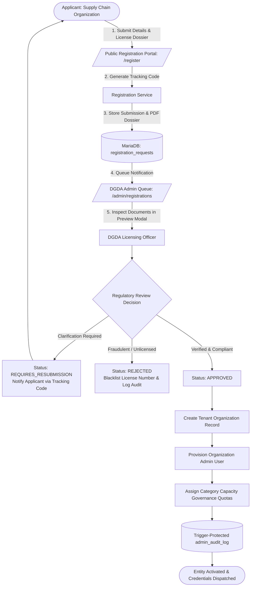

# PharmaTrace AI — Organization Registration & Licensing Governance

This document describes the end-to-end operational workflow for onboarding new supply-chain organizations, verifying regulatory licenses, reviewing legal dossiers, and enforcing category capacity governance under the Directorate General of Drug Administration (DGDA).

---

## 1. Workflow Overview & Business Context

In a national pharmaceutical supply chain, untrusted or unverified entities cannot be permitted to register medicines, generate serialized barcodes, or dispatch drugs. PharmaTrace AI requires every entity—whether a multinational manufacturer, a central logistics distributor, a regional wholesaler, or a community pharmacy—to complete a formal regulatory accreditation workflow before receiving active credentials.

---

## 2. Phase 1: Public Applicant Submission

1. **Accessing the Portal:** The applicant accesses `/register` without prior authentication.
2. **Data Collection:**
   - **Entity Identity:** Legal Organization Name, Organization Type (`manufacturer`, `distributor`, `wholesaler`, `pharmacy`), Tax Identification Number (TIN).
   - **Regulatory License:** DGDA Drug Manufacturing/Distribution License Number, Issuing Authority, License Validity Expiration Date.
   - **Facility Address:** Warehouse/Factory Geolocation coordinates, Physical Address, City, Postal Code.
   - **Primary Contact:** Name, Official Email Address, Phone Number, Designation.
3. **Document Dossier Upload:**
   - The applicant uploads high-resolution scanned copies of their Trade License, Drug Manufacturing/Sale License, and Cold-Chain Compliance Certificate.
   - Files are validated against MIME type restrictions (`application/pdf`, `image/png`, `image/jpeg`) and size limits (10MB max).
   - The backend computes a SHA-256 cryptographic digest of each file upon receipt, storing the hash in `registration_documents` to guarantee tamper-proof evidence.
4. **Tracking Code Issuance:**
   - The applicant receives a unique cryptographic tracking code (e.g., `REG-2026-X892J`).
   - The tracking code enables the applicant to check approval progress at `/register/track` without requiring an authenticated account.

---

## 3. Phase 2: DGDA Regulatory Review & Dossier Inspection

1. **Review Queue (`/admin/registrations`):**
   - DGDA administrators inspect incoming submissions categorized by status (`SUBMITTED`, `UNDER_REVIEW`, `REQUIRES_RESUBMISSION`).
   - Submissions are sorted chronologically with indicators highlighting pending review age.
2. **Interactive Document Preview Modal:**
   - The licensing officer opens the document viewer modal (see screenshot `03-admin-licensing-dossier-preview.png`).
   - Documents render directly within the browser without requiring local file downloads, preventing malware execution and preserving document provenance.
   - The officer cross-references the license number and expiration date against the DGDA official master licensing registry.
3. **Review Actions & Status Transitions:**
   - **Approve:** Moves organization to `APPROVED`. Prompts the administrator to confirm assigned capacity limits.
   - **Request Resubmission:** Moves status to `REQUIRES_RESUBMISSION` and logs mandatory corrective notes (e.g., *"Uploaded Trade License is expired; please upload valid 2026 renewal"*).
   - **Reject:** Transitions status to `REJECTED`, permanently marking the license number as ineligible for registration.

---

## 4. Phase 3: Tenant Provisioning & Capacity Governance

Upon approval, an atomic MariaDB transaction executes the following steps:
1. **Tenant Creation:** An active record is inserted into `organizations` with status `ACTIVE`.
2. **Initial Administrator User:** A primary administrative user account is created in `users` with the appropriate role (`manufacturer`, `distributor`, `wholesaler`, or `pharmacy`).
3. **Initial Password Setup:** A secure, one-time activation link or temporary password is generated with `token_version = 1`.
4. **Category Capacity Governance:**
   - The system binds the organization to category limits defined in `category_capacity_governance`.
   - **Manufacturer:** Maximum registered active SKUs, maximum serialized units per month.
   - **Distributor / Wholesaler:** Maximum active transit manifests, warehouse cubic capacity limits.
   - **Pharmacy:** Maximum on-hand dispensing inventory threshold.
5. **Immutable Audit Trail:**
   - An entry is inserted into `admin_audit_log` recording the administrator user ID, target organization ID, timestamp, and review notes.
   - MariaDB immutability triggers prevent any subsequent alteration of this approval audit record.

---

## 5. Related Documentation
- [Visual Application Gallery: Admin Dossier Preview](../screenshots/README.md#3-administrator-licensing-dossier-inspection-modal)
- [Database Architecture Guide](../architecture/database-architecture.md): Relational tables and immutability triggers.
- [Security Architecture Guide](../security/security-architecture.md): Authentication and password provisioning.
