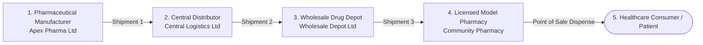
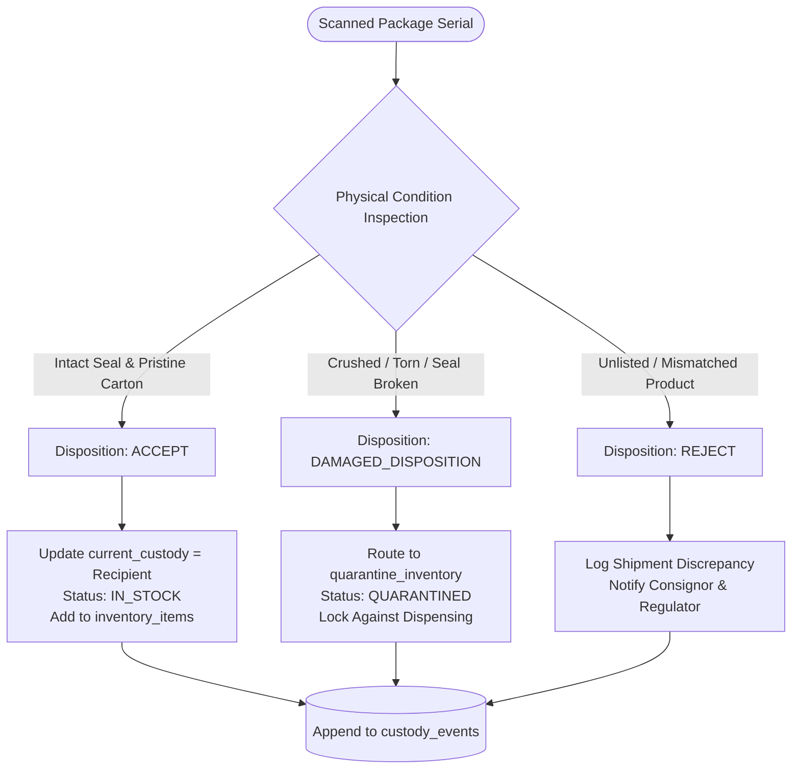

# PharmaTrace AI — Multi-Echelon Shipment, Inbound Intake & Custody Dispositions

This document outlines the multi-echelon pharmaceutical supply-chain custody transfer protocols, electronic shipping manifests, inbound barcode scanning verification, item-level receiving dispositions, and automated quarantine routing.

---

## 1. Multi-Echelon Supply Chain Overview

Pharmaceutical integrity relies on an unbroken chain of verified custody across four consecutive commercial echelons before a medicine reaches a patient:

Every leg of this journey requires an outbound electronic manifest, physical in-transit custody protection, an inbound barcode verification scan, and formal acceptance before ownership and dispensing rights transfer.

---

## 2. Shipment Manifest Lifecycle & State Machine

Shipment manifests govern custody boundaries. The manifest lifecycle follows a deterministic finite state machine:

```mermaid
stateDiagram-v2
    [*] --> CREATED: Sender drafts shipment & binds serial packages
    CREATED --> IN_TRANSIT: Sender dispatches carrier; initial custody handoff logged
    
    IN_TRANSIT --> DELIVERED: Recipient scans & accepts 100% of manifested units
    IN_TRANSIT --> PARTIALLY_DELIVERED: Recipient accepts subset; marks remainder as DAMAGED / REJECTED
    IN_TRANSIT --> REJECTED: Entire shipment rejected (e.g., severe transport accident, counterfeit seal)
    
    DELIVERED --> [*]
    PARTIALLY_DELIVERED --> [*]
    REJECTED --> [*]
```

### Manifest States
1. **`CREATED`:** Draft state. The consignor selects target recipient organization, transport mode, vehicle temperature classification, and itemizes packages.
2. **`IN_TRANSIT`:** Active logistics state. Packages are in physical transit via licensed logistics carriers. The packages are locked: the sender cannot recall or re-allocate them, and the recipient cannot yet dispense them.
3. **`DELIVERED`:** Completed handoff. All units have been physically scanned, inspected, and accepted into recipient inventory.
4. **`PARTIALLY_DELIVERED`:** Completed with variance. Certain units were accepted while others were flagged as damaged or missing.
5. **`REJECTED`:** Complete shipment refusal. Custody remains disputed or reverts to sender pending regulatory investigation.

---

## 3. Inbound Intake Scanning & Reconciliation

When a delivery truck arrives at a warehouse dock or pharmacy receiving bay:
1. **Manifest Retrieval:** The intake clerk scans the master shipment bill of lading or selects the incoming shipment from the dashboard (see screenshot `08-distributor-intake-custody.png` and `10-wholesaler-intake-inventory.png`).
2. **Item-by-Item Physical Scan:**
   - Operators scan each individual unit carton using handheld 2D industrial scanners or the integrated web camera scanner.
   - The scanner extracts the GS1 DataMatrix string, parsing GTIN and Serial Number.
3. **Manifest Reconciliation:**
   - The backend checks whether the scanned serial is genuinely listed in `shipment_items` for that specific shipment ID.
   - If a serial number is scanned that does **not** exist in the manifest, the system immediately flags a **Manifest Discrepancy Error (409 Conflict)** and blocks intake.
   - If an already received package is scanned a second time, the system flags a duplicate scan warning.

---

## 4. Item-Level Receiving Dispositions

Not every package arriving at a warehouse is fit for human consumption. PharmaTrace AI provides granular, item-by-item receiving dispositions:

| Disposition Code | Physical Condition | System Behavior & Inventory Routing |
| :--- | :--- | :--- |
| **`ACCEPT`** | Intact packaging, unbroken tamper seals, valid temperature history. | Package updated to `current_custody = recipient_id`, status `IN_STOCK`. Added to active inventory. Ready for subsequent dispatch or dispensing. |
| **`REJECT`** | Incorrect medicine delivered, expired batch, unmanifested package. | Package rejected back to consignor. Discrepancy logged; status transitions to `RETURN_PENDING`. |
| **`DAMAGED_DISPOSITION`** | Crushed carton, broken vial, liquid leakage, compromised tamper seal. | Package automatically isolated into `quarantine_inventory` with status `QUARANTINED`. Zero possibility of sale or dispensing. |

---

## 5. Automated Quarantine Hold Safety Protocol

When a unit receives `DAMAGED_DISPOSITION`:
- An immediate database record is created in `quarantine_inventory` referencing the package ID, receiving organization, defect category (e.g., *Physical Crushing, Temperature Excursion, Seal Broken*), and photographic evidence.
- The package's global status in `serialized_packages` is set to `QUARANTINED`.
- **System Safety Invariant:** Any subsequent attempt by a dispensary clerk or wholesale fulfillment system to include a `QUARANTINED` package in an outbound shipment or dispensing transaction is unconditionally rejected by backend API validation rules with HTTP 400 Bad Request.

---

## 6. Chain-of-Custody Immutability

Every completed intake transaction generates permanent audit records:
- **`custody_events` Entry:** Records `package_id`, `from_org_id`, `to_org_id`, `event_type` (`CUSTODY_TRANSFER_ACCEPT`), operator user ID, and timestamp.
- **Engine Trigger Enforcement:** The MariaDB trigger `trg_custody_events_prevent_delete` strictly prohibits deletion of historical custody records, ensuring permanent traceability for regulatory audits and legal inquiries.

---

## 7. Related Documentation
- [Visual Application Gallery: Distributor Intake](../screenshots/README.md#8-distributor-inbound-shipment-intake--custody-acceptance)
- [Visual Application Gallery: Wholesaler Intake](../screenshots/README.md#10-wholesaler-receiving-scan--inventory-disposition)
- [Visual Application Gallery: Pharmacy Stock](../screenshots/README.md#12-pharmacy-stock-receiving--barcode-verification)
- [Manufacturer & Serialization Workflow](manufacturer-and-serialization.md): Production origins.
- [Public Verification Workflow](public-verification.md): Consumer verification journey.
